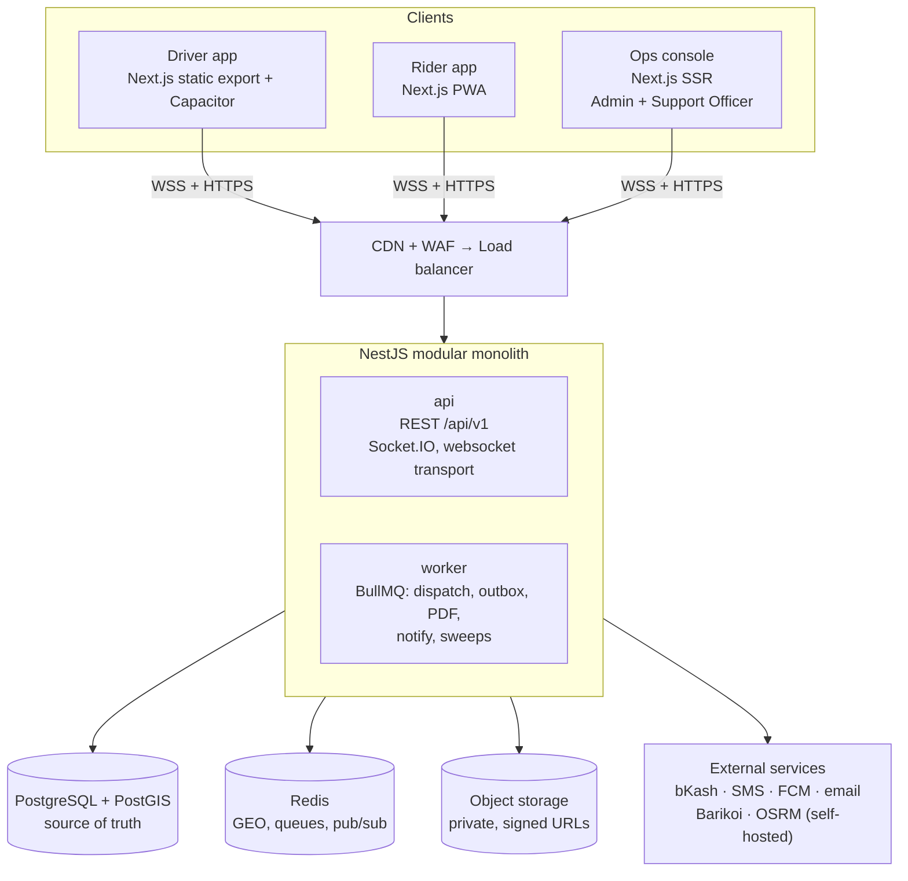
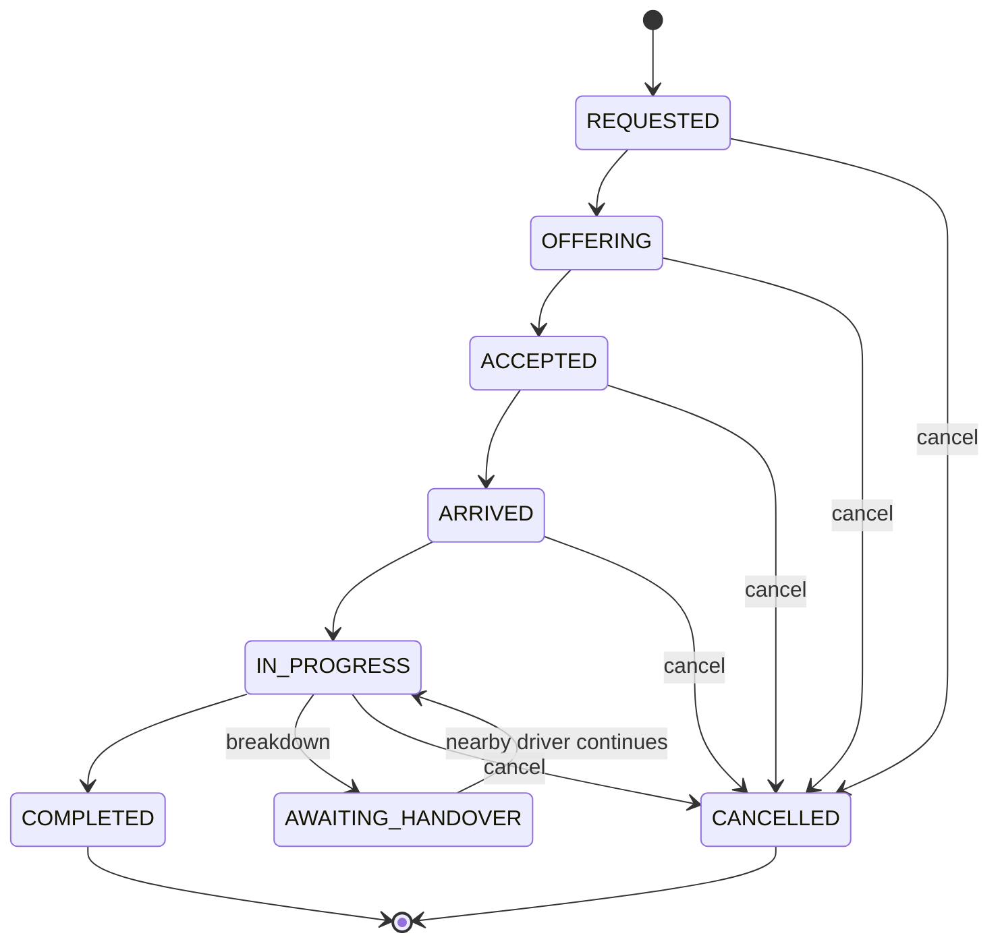

<div align="center">

# Bhorsha (ভরসা)

**Fair ride-hailing platform for Dhaka**

Fare-locked, breakdown-proof, flood-aware ride-hailing for bike, car and CNG.
*Bhorsha* means "trust".

**Status:** Architecture v1.0 accepted · **Last updated:** 4 Nov 2026 · **Origin:** CSC4161 Advanced Programming in Web Technology

</div>

---

This README is the repository version of the Bhorsha Architecture v1.0 document. Section numbers match the original document, so references such as §10, FR-TR-2 or ADR-011 point to the same place in both.

**Quick start:** see [19. Getting Started](#19-getting-started). **Task board:** [Trello: Bhorsha](https://trello.com/b/lfLer4JD/bhorsha) (private, ask Siam for access).

## Table of Contents

1. [Team](#1-team)
2. [Overview](#2-overview)
3. [Regulatory Context](#3-regulatory-context)
4. [Tech Stack](#4-tech-stack)
5. [Architecture Decision Records](#5-architecture-decision-records)
6. [Functional Requirements](#6-functional-requirements)
7. [Non-Functional Requirements](#7-non-functional-requirements)
8. [System Architecture](#8-system-architecture)
9. [Repository Structure](#9-repository-structure)
10. [Real-Time Layer](#10-real-time-layer)
11. [Dispatch and Matching](#11-dispatch-and-matching)
12. [Pricing](#12-pricing)
13. [Payments and Ledger](#13-payments-and-ledger)
14. [Maps, Routing and Waterlogging](#14-maps-routing-and-waterlogging)
15. [Trust and Safety](#15-trust-and-safety)
16. [Data Architecture](#16-data-architecture)
17. [Security and Compliance](#17-security-and-compliance)
18. [Infrastructure and Operations](#18-infrastructure-and-operations)
19. [Getting Started](#19-getting-started)
20. [Development Workflow](#20-development-workflow)
21. [Testing Strategy](#21-testing-strategy)
22. [Roadmap](#22-roadmap)
23. [Scaling Path](#23-scaling-path)
24. [Risks and External Confirmations](#24-risks-and-external-confirmations)
25. [References](#25-references)

---

## 1. Team

**Group:** *TBD*

| SL | Student ID | Name | Section | Module ownership |
|---|---|---|---|---|
| 1 | 24-56637-1 | Siam Hossain | *TBD* | **Admin domain:** identity and auth, zone rules, waterlogging layer, ops console, infrastructure and CI/CD |
| 2 | 23-53027-3 | Sumaiya Akter Roshni | *TBD* | **Driver domain:** fleet onboarding, location pipeline, dispatch, trip state machine, breakdown handover, driver app |
| 3 | Numman | *TBD* | **Rider domain:** pricing and Legal Fare Guard, ledger and payments, ratings, SOS, rider app |
| 4 | Anyka | *TBD* | **Support domain:** cases and evidence, strikes and appeals, audit log, notifications and outbox |

**Shared by all members:** OpenAPI contract, database migrations, code review, testing, release.

## 2. Overview

Riders in Dhaka are often asked to pay more than the fare the app showed. Drivers can lose their accounts after a single dispute. A breakdown ends the trip and forces a rebook. Drivers rarely have change for cash payments. Trips run through waterlogged roads, although about 35% of Dhaka is highly vulnerable to waterlogging [[12]](#ref-12). As a result, informal bargaining has overtaken app-based ride-sharing [[2]](#ref-2).

### Differentiators

1. **Legal Fare Guard:** the fare is locked at booking and never exceeds the legal ceiling.
2. **Breakdown handover:** a nearby driver continues the trip at the same fare; exactly one driver can win.
3. **Change without haggling:** cash change is settled through the ledger.
4. **Waterlogging layer:** bike trips avoid confirmed deep-water reports, which expire after 3 hours.
5. **Fair enforcement:** strikes and appeals replace instant bans.

**Roles:** Rider · Driver · Admin · Support Officer

## 3. Regulatory Context

These are architecture drivers, not paperwork:

- **Operating requirements.** The Ride-Sharing Service Guidelines, 2017 require BRTA licensing, local offices, registered vehicles, licensed drivers, GPS tracking and digital payments. The government is updating them [[1]](#ref-1).
- **Fare ceiling.** Ride-sharing cars must stay within the Taxicab Service Guidelines 2010 limits: Tk85 for the first 2 km, Tk34 per km after that, plus a waiting charge [[2]](#ref-2).
- **Compliance is existential.** BRTA declined to renew Uber Bangladesh's enlistment certificate in May 2026 [[3]](#ref-3).
- **Payments.** Running a payment platform or wallet without Bangladesh Bank authorization is illegal under the Payment and Settlement Systems Act, 2024 [[4]](#ref-4).

**Consequence:** fare rules are versioned data, compliance features ship in v1, and Bhorsha issues no e-money of its own.

## 4. Tech Stack

| Layer | Choice |
|---|---|
| Backend | NestJS (TypeScript) modular monolith: api and worker entrypoints |
| Database | PostgreSQL + PostGIS |
| Hot state and queues | Redis (GEO, pub/sub, BullMQ) |
| Real-time | Socket.IO (websocket transport, Redis adapter) |
| Frontend | Next.js: ops console (SSR), rider PWA, driver app (static export + Capacitor) |
| Maps and routing | Barikoi (geocoding, routes) + self-hosted OSRM (ETA matrix) |
| Payments | bKash tokenized checkout; Nagad in Phase 2 |
| Infrastructure | AWS: ECS Fargate, RDS, ElastiCache, S3 · Terraform · GitHub Actions |
| Observability | OpenTelemetry → Grafana (Prometheus, Loki, Tempo) · Sentry |
| Monorepo | Turborepo + pnpm |

## 5. Architecture Decision Records

| ID | Decision | Key reason |
|---|---|---|
| ADR-001 | Build a real product | — |
| ADR-002 | NestJS modular monolith on PostgreSQL | Money stays in single ACID transactions; modules are extractable later |
| ADR-003 | Next.js is the only frontend stack, with no business logic | One backend owns all rules |
| ADR-004 | Driver app: Next.js static export + Capacitor | Background GPS and push |
| ADR-005 | Live location in Redis GEO with heartbeat expiry | Avoids PostgreSQL write churn |
| ADR-006 | PostGIS for durable geo data | Zones, flood corridor, breadcrumbs |
| ADR-007 | OpenAPI is the contract; typed clients are generated | Decoupled frontends |
| ADR-008 | Integer paisa; double-entry ledger; unique idempotency keys | Correct, replay-safe money handling |
| ADR-009 | H3 cells for surge and demand analytics | Uniform spatial units |
| ADR-010 | Rank candidates by road-network ETA | Straight-line distance lies in Dhaka |
| ADR-011 | Sequential offers with a wave fallback; one durable BullMQ job per match | Fairness on flaky networks |
| ADR-012 | Destination area (not address) shown before accept; masked contact | Stops cherry-picking and phone haggling |
| ADR-013 | Time-aware locked fare; surge capped at 1.5× and at the ceiling; pricing snapshot per ride | Drivers paid for jams; riders get certainty |
| ADR-014 | Platform-funded jam protection | Riders never pay more |
| ADR-015 | No self-issued e-money; licensed payment partners; ledger records obligations | Payment and Settlement Systems Act, 2024 |
| ADR-016 | Barikoi behind a GeoProvider port; self-hosted OSRM matrix | Local data quality, controlled cost |
| ADR-017 | Flood check against the buffered route geometry, with a confirmation threshold | Precise and abuse-resistant |
| ADR-018 | Strikes expire after 90 days; 3 active strikes → 7-day suspension; no automatic permanent ban | The "trust" promise |
| ADR-019 | Socket events are hints; REST is the source of truth; clients resync on reconnect | Correct on mobile networks |
| ADR-020 | Transactional outbox for trip and money events | Nothing lost |
| ADR-021 | Nearest hyperscaler region by latency probe; managed services; no Kubernetes in v1 | Small team, portable infrastructure |
| ADR-022 | Phone OTP; rotating refresh tokens with reuse detection; one device per driver | Account security |
| ADR-023 | OpenTelemetry everywhere; business SLO dashboards | Observable matching quality |
| ADR-024 | Phased rollout: pilot area, bike and car first | Supply density first |

## 6. Functional Requirements

**Identity**

- **FR-ID-1:** Phone and OTP sign-up and login; staff accounts are created by the Admin.
- **FR-ID-2:** Users manage their profile and emergency contact.
- **FR-ID-3:** One active device per driver.

**Fleet**

- **FR-DR-1:** Drivers upload documents; the Admin verifies them.
- **FR-DR-2:** Vehicle management.
- **FR-DR-3:** Drivers go online or offline; heartbeat loss sets them offline.
- **FR-DR-4:** "Heading home" filter, limited to 2 uses per day.

**Pricing**

- **FR-PR-1:** Quote that accounts for predicted traffic time.
- **FR-PR-2:** Fare locked at booking and clamped to the legal ceiling.
- **FR-PR-3:** Versioned fare and zone rules.
- **FR-PR-4:** Surge capped at 1.5× and labeled for the rider.
- **FR-PR-5:** Jam protection.

**Dispatch and trips**

- **FR-MA-1:** Ranked sequential offers with a wave fallback.
- **FR-MA-2:** The offer shows destination area, distance, duration, fare and pickup ETA.
- **FR-TR-1:** Book, track live, cancel.
- **FR-TR-2:** Accept, arrive, start with PIN, complete.
- **FR-TR-3:** Ratings, history, overcharge reports.
- **FR-TR-4:** In-app chat with masked contact.
- **FR-TR-5:** SOS: SMS with a live-tracking link to the emergency contact, an ops alert, and a 999 shortcut.

**Breakdown handover**

- **FR-HO-1:** Same dispatch engine with handover filters; the fare is inherited.
- **FR-HO-2:** Exactly one winner; no driver ever holds two active trips.
- **FR-HO-3:** Fare split across ride legs.

**Payments**

- **FR-PA-1:** Cash and bKash in v1; Nagad in Phase 2.
- **FR-PA-2:** Change handling ([§13](#13-payments-and-ledger)).
- **FR-PA-3:** Commission and driver cash dues.
- **FR-PA-4:** Refunds through the ledger.
- **FR-PA-5:** Nightly reconciliation.

**Waterlogging**

- **FR-FL-1:** Reports and votes, with proximity-gated voting.
- **FR-FL-2:** Corridor check against the planned route.
- **FR-FL-3:** Reports expire after 3 hours; the Admin can remove false ones.
- **FR-FL-4:** Zone rules for regulatory directives.

**Trust and safety**

- **FR-TS-1:** Complaints with evidence.
- **FR-TS-2:** Officer review and evidence-pack PDF.
- **FR-TS-3:** Strikes, suspensions and appeals.
- **FR-TS-4:** Separation of duties on appeals.

**Operations**

- **FR-OP-1:** Live map, case queue, dispatch inspector.
- **FR-OP-2:** Append-only audit log.

## 7. Non-Functional Requirements

| ID | Category | Target |
|---|---|---|
| NFR-01 | Performance | Quote p95 under 300 ms; booking p95 under 500 ms; candidate search and ranking under 2 s |
| NFR-02 | Real-time | Location no older than 10 s during trips; rider sees updates within 5 s; offer reaches the driver within 2 s |
| NFR-03 | Concurrency | Zero double assignments. Test: 50 parallel accepts produce exactly 1 winner. |
| NFR-04 | Consistency | Every transfer_id sums to zero; nightly reconciliation shows zero unexplained difference |
| NFR-05 | Availability | 99.5% monthly uptime; RPO 5 min; RTO 1 h |
| NFR-06 | Scale (v1) | 5,000 online drivers; about 1,250 location writes/s; 20 bookings/s peak |
| NFR-07 | Security | OWASP ASVS Level 2; 15-minute access tokens; rate limits on OTP, login and SOS; signed URLs only |
| NFR-08 | Privacy | 90-day location retention, except disputed trips; personal data encrypted; Personal Data Protection Ordinance 2025 compliance [[7]](#ref-7) |
| NFR-09 | Observability | Request ID end to end; traces, metrics and logs; business SLO dashboards |
| NFR-10 | Maintainability | Lint-enforced module boundaries; migrations only; OpenAPI contract tests |
| NFR-11 | Correctness | Money in paisa; UTC storage, Asia/Dhaka display |
| NFR-12 | Network resilience | Idempotency keys on mutating calls; offline location buffer; resync on reconnect |
| NFR-13 | Quality | 90%+ test coverage on pricing and ledger; concurrency and load tests in CI |

## 8. System Architecture

Three Next.js clients call one NestJS monolith that owns every rule.



Clients carry no business logic: the api serves REST and sockets, the worker runs queued jobs, and both share one PostgreSQL, Redis and object store.

### Modules

| Module | Owns | Responsibility |
|---|---|---|
| identity | users, devices, refresh_tokens | OTP, sessions, role-based access |
| fleet | driver_profiles, vehicles, documents | Onboarding and verification |
| pricing | fare_rules (versioned), zone_rules | Quote, ceiling clamp, surge, snapshot |
| location | Redis GEO keys, trip_breadcrumbs | Ingest, presence, fan-out |
| dispatch | dispatch_attempts; Redis offer state | Candidate search, ranking, offers |
| trips | rides, ride_legs, ratings | State machine, handover, cancellations |
| ledger | wallets, ledger_entries, payment_intents | All money movement and reconciliation |
| geo | — (ports to Barikoi and OSRM) | Geocoding, routing, ETA matrix, snap-to-road |
| safety | flood_reports, flood_votes, sos_events | Corridor check, SOS |
| trust | support_cases, evidence, strikes, appeals | Enforcement |
| notify | — | Push, SMS and email through the outbox |
| audit | audit_logs | Append-only change log |

### Boundary rules

1. A module's tables are written only by that module.
2. Cross-module calls go through exported interfaces; side effects go through events.
3. Only ledger moves money.
4. Trip and money events that must not be lost are written to outbox_events in the same transaction.
5. Slow work never runs inside a request.

### Ride state machine

Rides can be cancelled up to IN_PROGRESS; breakdowns pause the ride for handover.



Transitions are conditional updates (`WHERE id=$1 AND status=$expected AND version=$v`); if zero rows change, the API returns 409. Handover locks the ride row, then the driver row, always in that order.

### API conventions

- **Base path and responses.** REST under `/api/v1`. Successful responses use `{ success, message, data, meta }`.
- **Errors.** `{ success:false, error:{ code, message, details }, meta:{ requestId } }`.
- **Idempotency.** An `Idempotency-Key` header is required on booking, payment, change, accept and handover. Keys are stored for 24 hours.
- **Pagination.** Cursor pagination for rides, ledger and audit; offset pagination for small admin lists.
- **Docs.** Swagger at `/api/docs`.

## 9. Repository Structure

```text
bhorsha/
├── apps/
│   ├── api/            NestJS (api + worker entrypoints)
│   │   └── src/modules/    identity, fleet, pricing, location, dispatch, trips,
│   │                       ledger, geo, safety, trust, notify, audit
│   ├── driver/         Next.js static export + Capacitor
│   ├── rider/          Next.js PWA
│   └── ops/            Next.js SSR (Admin + Support Officer)
├── packages/
│   ├── api-client/     generated from OpenAPI
│   ├── ui/             shared components
│   └── config/         eslint (incl. boundary rules), tsconfig
├── infra/              Terraform
├── docker-compose.yml
└── README.md
```

## 10. Real-Time Layer

### Location pipeline

- **Ping cadence.** Every 4 s on a trip; every 10 s while online and idle.
- **Redis keys:**
  - `drivers:geo:{bike|car|cng}`: available drivers.
  - `driver:{id}:state`: current state, 15 s TTL.
  - `drivers:lastseen`: sorted set read by a sweeper every 5 s, because GEO members can't expire individually.
- **GPS sanity filter.** Reject accuracy worse than 50 m, impossible speeds and mock locations.
- **Breadcrumbs.** Written every ~15 s on a trip into a PostGIS table partitioned by month.

### Socket protocol

- **Namespaces and rooms.** Namespaces `/driver`, `/rider`, `/ops`. Rooms `ride:{id}`, `driver:{id}`, `ops:{city}`. JWT is checked at handshake.
- **Events are hints.** Every event carries the ride version; clients drop stale versions and call `GET /rides/:id` on reconnect.
- **Commands go through REST.** Accept and other commands use REST with an idempotency key, never the socket.
- **Offer delivery.** Sent over the socket and an FCM data message in parallel.

## 11. Dispatch and Matching

1. Run `GEOSEARCH` for the top 15 drivers within 3 km. Expand to 5 km if fewer than 5 are found.
2. Filter: vehicle type matches, verified, not suspended, not reserved.
3. Rank by OSRM road ETA. Tie-breakers: idle time, then rating.
4. Offer to driver #1 with a 12 s timeout. That driver is reserved while the offer is open.
5. After 3 sequential attempts, send a wave to the next 3 drivers; first to accept wins.
6. If nobody accepts, the rider sees "no drivers" with a retry option.

**Before accepting**, the driver sees destination area, distance, duration, locked fare and pickup ETA. The exact address appears after accepting.

**Cancellation policy:**

- Riders cancel free within 2 minutes, or anytime the driver's ETA grows by 5 minutes or more. After that, a configurable fee goes to the driver.
- When a driver cancels after accepting, the ride is re-dispatched with priority. The cancellation is tracked as a metric, not a strike.

**Records.** Every offer is written to `dispatch_attempts` for acceptance metrics and dispute review.

## 12. Pricing

```text
raw    = base + per_km × route_km + per_min × predicted_min
surged = raw × min(surge(H3 r8 cell), 1.5)
locked = min(surged, legal_ceiling(vehicle_type, route_km))
```

- **Versioned rules.** `fare_rules` rows are versioned with `effective_from` and `effective_to`; regulatory changes become new rows.
- **Pricing snapshot.** `rides.pricing_snapshot` (JSONB) stores rule IDs, inputs, multiplier and the ceiling applied, so disputes are reproducible.
- **Repricing.** Only rider-initiated changes reopen the price: destination change, extra stop, waiting at pickup beyond 3 free minutes.
- **Jam protection.** If the actual trip time exceeds 1.5× the prediction, the platform pays the driver per_min × excess minutes, capped at 50% of the trip's commission. The rider's price never changes.

## 13. Payments and Ledger

- **Licensed partners.** Bangladesh had 10 licensed payment service providers or e-wallet operators as of August 2026 [[5]](#ref-5); Pathao Pay is among the providers issuing e-money [[6]](#ref-6). Bhorsha collects through partners, starting with bKash tokenized checkout [[11]](#ref-11).
- **The ledger records obligations, not stored money.** Accounts: `rider_credit`, `driver_earnings`, `driver_dues`, `platform_commission`, `gateway_clearing`, `refunds_payable`, `jam_protection`.
- **Digital-first** at booking, to shrink the cash-change problem.
- **Change handling.** Non-withdrawable ride credit (a ledger transfer from `driver_dues` to `rider_credit`), gated on a legal opinion. If credit is classified as e-money, change goes to the rider's own bKash through the partner, with the same ledger entries.
- **Driver dues.** Above `dues_limit`, the driver can't go online until they settle through bKash.
- **Reconciliation.** A nightly job compares `payment_intents` with partner settlement reports; any mismatch opens an ops ticket.

## 14. Maps, Routing and Waterlogging

### GeoProvider port

- **Barikoi (primary).** Geocoding, autocomplete, reverse geocoding, snap-to-road and routing, including a motorcycle profile [[9]](#ref-9). It was founded because global maps weren't accurate enough with Bangladeshi addresses [[10]](#ref-10).
- **OSRM, self-hosted** on the Bangladesh OpenStreetMap extract and rebuilt weekly, for the dispatch ETA matrix.
- **ETA cache** keyed by origin cell, destination cell (H3 resolution 9) and a 15-minute bucket, with a 5-minute TTL.

### Flood corridor check

1. Get the planned route polyline at quote time.
2. Run `ST_DWithin(flood.location, route_line, 50m)` against confirmed, unexpired deep-water reports. Expiry is enforced at query time.
3. If a report blocks the route, request an alternative. If none avoids it, don't offer bike; still offer car and CNG.

**Confirmation rule.** 3 or more distinct confirmations within 60 minutes (net of denials), or one report from a trusted reporter: a driver with no active strikes and 100+ trips. Votes count only from users within 500 m of the report.

**Zone rules** also encode time-boxed regulatory directives, such as holiday restrictions on motorcycles.

## 15. Trust and Safety

| Rule | Value |
|---|---|
| Strike lifetime | 90 days |
| 3 active strikes | 7-day suspension |
| 5 strikes in 180 days | Deactivation review by Support Officer and Admin, with a written reason; appealable |
| Strikes under appeal | Don't count toward thresholds |
| Safety-critical complaint | Interim suspension, reviewed within 24 h |
| Appeal SLA | Decision within 72 h |
| Separation of duties | The officer who issued a strike can't decide its appeal. Enforced in code. |

**Fraud signals:** mock location, rider and driver on the same device, impossible trip geometry, promo abuse. Each one raises a flag, never an automatic penalty.

## 16. Data Architecture

| Store | Holds |
|---|---|
| PostgreSQL + PostGIS | Source of truth: identity, fleet, rides, ledger, cases, rules, flood data, breadcrumbs, audit, outbox |
| Redis | Live location, presence, OTP codes (5-minute TTL), offer state, queues, quote and ETA cache |
| Object storage | Licences, vehicle papers, evidence. Private, encrypted, signed URLs. |

### Changes from the original proposal

| Change | Reason |
|---|---|
| Remove `driver_profiles.lat`, `lng`, `is_online` | Moved to Redis |
| Add `ride_legs.vehicle_id`, `rides.current_driver_id`, `rides.version`, `rides.pricing_snapshot` | Handover, lookups, concurrency, reproducible pricing |
| Money as bigint paisa; unique `idempotency_key`; zero-sum `transfer_id` | Ledger integrity |
| `fare_rules.effective_from` / `effective_to` | Versioned regulation |
| `zone_rules` as a PostGIS polygon with a time window; `flood_reports.location` as `geography(Point)` | Spatial correctness |
| New tables: `dispatch_attempts`, `payment_intents`, `devices`, `refresh_tokens`, `trip_breadcrumbs`, `outbox_events`, `idempotency_keys`, `sos_events` | New capabilities |
| `audit_logs` and `trip_breadcrumbs` partitioned by month | Growth and retention |

## 17. Security and Compliance

- **OTP:** 6 digits, 5-minute TTL, at most 5 attempts, rate-limited per phone and per IP.
- **Sessions:** refresh tokens hashed and rotated, with the whole token family revoked on reuse. One active device per driver.
- **Authorization:** role guards plus a policy layer that checks resource ownership.
- **Secrets and data:** managed secrets store, encryption at rest, 5-minute signed URLs, WAF with rate limiting.
- **Launch gates:** BRTA enlistment · data-protection review · payments legal opinion · external penetration test.

## 18. Infrastructure and Operations

**Hosting.** There is no hyperscaler region in Bangladesh. Choose Singapore or Mumbai with a one-week latency probe from Grameenphone, Robi and Banglalink networks, and pick the lower p95. If in-country data is required, AWS Outposts racks have been installable in Bangladesh since 2022 [[8]](#ref-8).

| Component | Choice |
|---|---|
| Compute | ECS Fargate: api, worker, osrm, ops, rider |
| Database | RDS PostgreSQL + PostGIS, Multi-AZ, point-in-time recovery |
| Redis | ElastiCache, Multi-AZ replica |
| Storage | S3, private, KMS-encrypted |
| Infrastructure as code | Terraform |
| CI/CD | GitHub Actions; migration job before a rolling deploy |
| Environments | Local · staging (sandbox payment gateways) · production |
| Observability | OpenTelemetry → Grafana; Sentry for clients |

**SLO dashboards:** time to match, match success rate, offer acceptance rate, cancellation rates, ETA error, location freshness, reconciliation status.

### Class-project deployment ($0)

> Not part of the original architecture document. This is the team's free hosting plan for the course; the AWS setup above stays the production target.

| Need | Free option |
|---|---|
| api, worker, PostGIS, Redis, OSRM | One Oracle Cloud Always Free ARM VM (2 OCPU, 12 GB RAM, 200 GB disk) running docker compose, with Caddy for HTTPS |
| Object storage | Oracle Object Storage or Cloudflare R2 (S3-compatible, signed URLs) |
| Ops console and rider PWA | Vercel Hobby or Cloudflare Pages |
| Observability | Grafana Cloud free tier and Sentry free tier |
| OTP and SOS SMS | Fixed test OTPs while developing; real SMS costs money |
| Payments | bKash sandbox |

## 19. Getting Started

### Prerequisites

Node.js (active LTS) · pnpm · Docker with Compose

### Local setup

```bash
git clone <repo-url> bhorsha && cd bhorsha
pnpm install
cp .env.example .env            # fill in values (see below)
docker compose up -d            # postgis, redis, mailpit, osrm (optional)
pnpm --filter api migration:run
pnpm dev                        # runs all apps
```

| App | URL |
|---|---|
| API | http://localhost:3000/api/v1 |
| Swagger | http://localhost:3000/api/docs |
| Ops console | http://localhost:3001 |
| Rider PWA | http://localhost:3002 |
| Driver app (web) | http://localhost:3003 |
| Mailpit | http://localhost:8025 |

### Environment variables

These are validated at boot with Joi; the API refuses to start on invalid config.

| Variable | Purpose |
|---|---|
| `NODE_ENV`, `PORT` | Runtime |
| `DATABASE_URL` | PostgreSQL + PostGIS |
| `REDIS_URL` | Redis |
| `JWT_ACCESS_SECRET`, `JWT_ACCESS_TTL` | Access tokens (15m) |
| `JWT_REFRESH_SECRET`, `JWT_REFRESH_TTL` | Refresh tokens (30d) |
| `SMS_PROVIDER_API_KEY` | OTP and SOS SMS |
| `BKASH_BASE_URL`, `BKASH_APP_KEY`, `BKASH_APP_SECRET`, `BKASH_USERNAME`, `BKASH_PASSWORD` | bKash tokenized checkout |
| `BARIKOI_API_KEY` | Maps |
| `OSRM_URL` | ETA matrix |
| `S3_BUCKET`, `S3_REGION` | Object storage |
| `FCM_SERVICE_ACCOUNT_JSON` | Push |
| `SMTP_URL` | Email |
| `OTEL_EXPORTER_OTLP_ENDPOINT`, `SENTRY_DSN` | Observability |

### Scripts

| Command | Does |
|---|---|
| `pnpm dev` | Run all apps |
| `pnpm --filter api migration:generate -- <Name>` | Generate a migration |
| `pnpm --filter api migration:run` | Apply migrations |
| `pnpm lint` | Lint, including module-boundary rules |
| `pnpm test` / `pnpm test:e2e` / `pnpm test:concurrency` | Test suites |
| `pnpm api:client` | Regenerate the client from OpenAPI |

## 20. Development Workflow

- **Branching and commits.** Trunk-based development with short-lived branches; Conventional Commits.
- **Pull requests.** One approving review; the module owner must approve changes inside their module.
- **Migrations.** Never edit an applied migration. `synchronize` is always off.
- **Definition of done:**
  - Tests pass.
  - OpenAPI is updated and the client regenerated.
  - The migration has been reviewed.
  - Audit and outbox entries are written where they apply.
  - Alerts exist for any new critical path.

**Task board:** [Trello: Bhorsha](https://trello.com/b/lfLer4JD/bhorsha). The plan behind it is in [docs/trello-board.md](docs/trello-board.md).

## 21. Testing Strategy

| Level | Scope |
|---|---|
| Unit | Pricing, ledger, strike policy |
| Integration | Testcontainers (PostGIS, Redis) |
| Concurrency | Accept and handover races (50 parallel → exactly 1 winner) |
| Contract | OpenAPI schema tests |
| Load | k6 against location ingest and dispatch |
| End to end | Playwright for the ops console |

## 22. Roadmap

This assumes 4 full-time engineers.

| Phase | Weeks | Scope | Lead |
|---|---|---|---|
| 0: Foundations | 1–4 | Monorepo, CI/CD, Terraform, auth and OTP, users, fleet onboarding, ops shell, observability | Member 1 (Siam Hossain), with all members |
| 1: MVP pilot | 5–14 | Location, dispatch, trips, pricing, cash and bKash, ledger, SOS, ratings, cases and strikes, driver app, rider PWA. **Bike and car in one pilot area.** | All four, by module ownership |
| 2: Differentiators | 15–22 | Handover, flood layer, appeals, change handling, jam protection, Nagad, CNG | Members 1–4, by module ownership |
| 3: Scale | 23+ | H3 surge, analytics, rider app in Capacitor, read replicas, Kafka evaluation | All |

## 23. Scaling Path

Lyft initially stored driver location on the user record in a monolith, then moved to a Redis geospatial architecture serving up to 15M QPS [[13]](#ref-13). Uber's H3 index [[15]](#ref-15) and Grab's Pharos in-memory driver search [[14]](#ref-14) show where this design evolves at scale.

| Trigger | Action |
|---|---|
| Sustained Redis CPU above 60% | Shard location by city or H3 cell |
| 3 or more consumers need replay | Move to Kafka or Redpanda |
| Read load on PostgreSQL | Read replicas, then partitioning |

## 24. Risks and External Confirmations

> Not legal advice. Confirm with Bangladeshi counsel.

| # | Item | Blocks |
|---|---|---|
| R1 | BRTA enlistment certificate, and how the updated guidelines change the rules | Launch |
| R2 | Whether ride credit counts as e-money under the Payment and Settlement Systems Act, 2024 | Phase 2 change handling |
| R3 | Data-residency obligations under the Personal Data Protection Ordinance 2025 | Final hosting choice |
| R4 | bKash merchant onboarding, and whether payouts to riders are possible | Phase 1 payments |
| R5 | Barikoi vs OpenStreetMap accuracy in the pilot area | Phase 1 routing |
| R6 | Driver supply at pilot launch | Phase 1 |


## License

Proprietary. All rights reserved. Update when the team decides.
