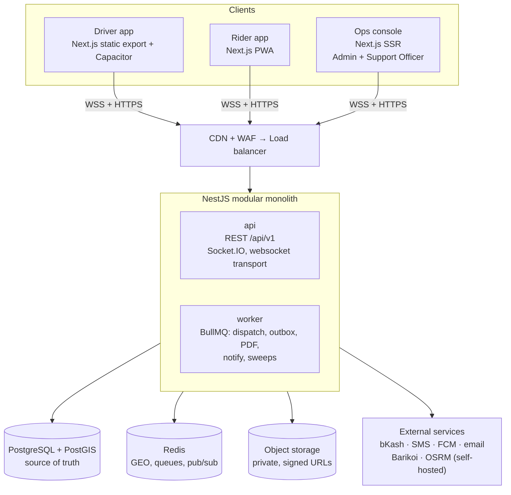
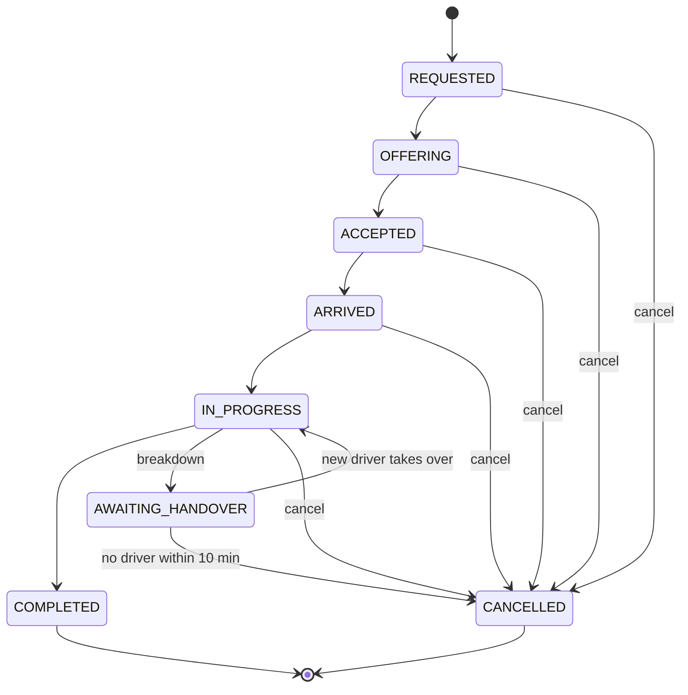
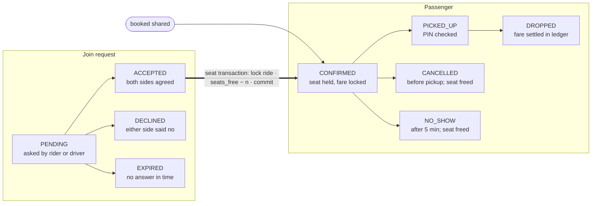

<div align="center">

# Bhorsha (ভরসা)

**Fair ride-hailing and ride-sharing platform for Dhaka**

Fare-locked, breakdown-proof, flood-aware ride-hailing and ride-sharing for bike, car and CNG.
*Bhorsha* means "trust".

**Status:** Architecture v3.1 draft · **Last updated:** 11 Nov 2026 · **Origin:** CSC4161 Advanced Programming in Web Technology

</div>

---

This README is the repository version of the Bhorsha Architecture v3.1 document. Section numbers match the document, so references such as §12, FR-SH-6 or ADR-025 point to the same place in both. v3.1 splits the work by user role, with about a quarter of the code per member, makes driver-to-rider requests the core feature, and trims the course release (§26).

Notes marked **In this repo** are not part of the document. They describe this repository as it is today.

**What we are building now:** [26. CSC4161 Course Release](#26-csc4161-course-release) · **Run it:** [20. Getting Started](#20-getting-started) · **Where code goes:** [9. Repository Structure](#9-repository-structure) · **Task board:** [Trello: Bhorsha](https://trello.com/b/lfLer4JD/bhorsha) (private, ask Siam for access)

## Table of Contents

1. [Team](#1-team)
2. [Overview](#2-overview)
3. [Regulatory Context](#3-regulatory-context)
4. [Tech Stack](#4-tech-stack)
5. [Architecture Decision Records](#5-architecture-decision-records)
6. [Functional Requirements](#6-functional-requirements)
7. [Non-Functional Requirements](#7-non-functional-requirements)
8. [System Architecture](#8-system-architecture)
9. [Repository Structure](#9-repository-structure)
10. [Real-Time Layer](#10-real-time-layer)
11. [Dispatch and Matching](#11-dispatch-and-matching)
12. [Shared Rides](#12-shared-rides)
13. [Pricing](#13-pricing)
14. [Payments and Ledger](#14-payments-and-ledger)
15. [Maps, Routing and Waterlogging](#15-maps-routing-and-waterlogging)
16. [Trust and Safety](#16-trust-and-safety)
17. [Data Architecture](#17-data-architecture)
18. [Security and Compliance](#18-security-and-compliance)
19. [Infrastructure and Operations](#19-infrastructure-and-operations)
20. [Getting Started](#20-getting-started)
21. [Development Workflow](#21-development-workflow)
22. [Testing Strategy](#22-testing-strategy)
23. [Roadmap](#23-roadmap)
24. [Scaling Path](#24-scaling-path)
25. [Risks and External Confirmations](#25-risks-and-external-confirmations)
26. [CSC4161 Course Release](#26-csc4161-course-release)
27. [References](#27-references)

---

## 1. Team

**Group:** *TBD*

| SL | Student ID | Name | Section | Role and module ownership |
|---|---|---|---|---|
| 1 | 24-56637-1 | Siam Hossain | *TBD* | **Admin:** register and login (JWT, bcrypt), roles guard, users, driver verification, fare rules, global exception filter; custom decorators, Swagger and migrations |
| 2 | 23-53027-3 | Sumaiya Akter Roshni | *TBD* | **Driver:** project setup, driver profile, vehicles, status and location, open requests and accept (row lock), arrive, pickup and drop-off, route offers and invites to riders (core feature); response envelope and timing interceptor |
| 3 | *TBD* | Numman | *TBD* | **Rider:** the ride and sharing tables, fare quote and booking with a locked fare, own rides, all-rides view, cancel, nearby route offers, join requests, accepting or declining driver requests (seat transaction), ratings, SOS, the 50-request load test; mailer and env |
| 4 | *TBD* | Anyka | *TBD* | **Support:** cases, strikes and appeals for drivers and riders, audit log and its reads, request-logging middleware |

**Shared by all members:** DTOs, validation and error cases for their own endpoints, Swagger decorators on their own controllers, tests, screenshots and their own part of the report.

## 2. Overview

Riders in Dhaka are often asked to pay more than the fare the app showed. Drivers can lose their accounts after a single dispute. A breakdown ends the trip and forces a rebook. Drivers rarely have change for cash payments. Trips run through waterlogged roads, although about 35% of Dhaka is highly vulnerable to waterlogging [[12]](#ref-12). As a result, informal bargaining has overtaken app-based ride-sharing [[2]](#ref-2). Meanwhile, riders heading the same way at the same hour each pay for a whole car or CNG while its other seats stay empty.

### Differentiators

1. **Driver-to-rider requests (core feature):** a driver with free seats does not have to wait for a booking. They invite a rider who is waiting nearby, or publish the rest of their route so that riders going that way can ask to join. Most ride-hailing apps only let riders request drivers.
2. **Legal Fare Guard:** the fare is locked at booking and never exceeds the legal ceiling.
3. **Breakdown handover:** a nearby driver continues the trip at the same fare; exactly one driver can win.
4. **Shared rides:** riders going the same way share a car or CNG and each pays a lower locked fare; nobody is added to a ride without consent.
5. **Change without haggling:** cash change is settled through the ledger.
6. **Waterlogging layer:** bike trips avoid confirmed deep-water reports, which expire after 3 hours.
7. **Fair enforcement:** strikes and appeals replace instant bans.

**Roles:** Rider · Driver · Admin · Support Officer

**Course release:** the CSC4161 deliverable is a backend-only subset of this architecture, built around driver-to-rider requests, split by user role and demonstrated through Swagger UI ([§26](#26-csc4161-course-release)).

## 3. Regulatory Context

These are architecture drivers, not paperwork:

- **Operating requirements.** The Ride-Sharing Service Guidelines, 2017 require BRTA licensing, local offices, registered vehicles, licensed drivers, GPS tracking and digital payments. The government is updating them [[1]](#ref-1).
- **Fare ceiling.** Ride-sharing cars must stay within the Taxicab Service Guidelines 2010 limits: Tk85 for the first 2 km, Tk34 per km after that, plus a waiting charge [[2]](#ref-2).
- **Compliance is existential.** BRTA declined to renew Uber Bangladesh's enlistment certificate in May 2026 [[3]](#ref-3).
- **Payments.** Running a payment platform or wallet without Bangladesh Bank authorization is illegal under the Payment and Settlement Systems Act, 2024 [[4]](#ref-4).
- **Shared rides.** How the guidelines treat pooled, per-seat fares must be confirmed ([R7](#25-risks-and-external-confirmations)). Until then, each passenger's fare is clamped to the ceiling for that passenger's own distance, and a shared fare is always lower than the solo fare.

**Consequence:** fare rules are versioned data, compliance features ship in v1, and Bhorsha issues no e-money of its own.

## 4. Tech Stack

| Layer | Choice |
|---|---|
| Backend | NestJS (TypeScript) modular monolith: api and worker entrypoints |
| Database | PostgreSQL + PostGIS |
| ORM and migrations | TypeORM: entities, QueryRunner transactions, migrations only (`synchronize` off) |
| Auth and validation | `@nestjs/jwt` with `passport-jwt`, bcrypt; class-validator and class-transformer DTOs behind a global ValidationPipe |
| API docs and email | `@nestjs/swagger` at `/api/docs`; `@nestjs-modules/mailer`, with Mailpit locally |
| Hot state and queues | Redis (GEO, pub/sub, BullMQ) |
| Real-time | Socket.IO (websocket transport, Redis adapter) |
| Frontend | Next.js: ops console (SSR), rider PWA, driver app (static export + Capacitor) |
| Maps and routing | Barikoi (geocoding, routes) + self-hosted OSRM (ETA matrix) |
| Payments | bKash tokenized checkout; Nagad in Phase 2 |
| Infrastructure | AWS: ECS Fargate, RDS, ElastiCache, S3 · Terraform · GitHub Actions |
| Observability | OpenTelemetry → Grafana (Prometheus, Loki, Tempo) · Sentry |
| Monorepo | Turborepo + pnpm |

> **In this repo:** the course release (§26) uses only the backend rows: NestJS 12 and TypeORM 1.x on PostgreSQL 16, which runs from a Docker image that already holds the schema and demo data. Locations are plain latitude and longitude, so there is no PostGIS. The code is one NestJS app in `bhorsha/` with pnpm, Vitest and oxlint, not a Turborepo. Redis, Socket.IO, Next.js, Barikoi, OSRM, bKash, AWS and the observability stack are out of scope.

## 5. Architecture Decision Records

| ID | Decision | Key reason |
|---|---|---|
| ADR-001 | Build a real product | — |
| ADR-002 | NestJS modular monolith on PostgreSQL | Money stays in single ACID transactions; modules are extractable later |
| ADR-003 | Next.js is the only frontend stack, with no business logic | One backend owns all rules |
| ADR-004 | Driver app: Next.js static export + Capacitor | Background GPS and push |
| ADR-005 | Live location in Redis GEO with heartbeat expiry | Avoids PostgreSQL write churn |
| ADR-006 | PostGIS for durable geo data | Zones, flood corridor, breadcrumbs |
| ADR-007 | OpenAPI is the contract; typed clients are generated | Decoupled frontends |
| ADR-008 | Integer paisa; double-entry ledger; unique idempotency keys | Correct, replay-safe money handling |
| ADR-009 | H3 cells for surge and demand analytics | Uniform spatial units |
| ADR-010 | Rank candidates by road-network ETA | Straight-line distance lies in Dhaka |
| ADR-011 | Sequential offers with a wave fallback; one durable BullMQ job per match | Fairness on flaky networks |
| ADR-012 | Destination area (not address) shown before accept; masked contact | Stops cherry-picking and phone haggling |
| ADR-013 | Time-aware locked fare; surge capped at 1.5× and at the ceiling; pricing snapshot per ride | Drivers paid for jams; riders get certainty |
| ADR-014 | Platform-funded jam protection | Riders never pay more |
| ADR-015 | No self-issued e-money; licensed payment partners; ledger records obligations | Payment and Settlement Systems Act, 2024 |
| ADR-016 | Barikoi behind a GeoProvider port; self-hosted OSRM matrix | Local data quality, controlled cost |
| ADR-017 | Flood check against the buffered route geometry, with a confirmation threshold | Precise and abuse-resistant |
| ADR-018 | Strikes expire after 90 days; 3 active strikes → 7-day suspension; no automatic permanent ban | The "trust" promise |
| ADR-019 | Socket events are hints; REST is the source of truth; clients resync on reconnect | Correct on mobile networks |
| ADR-020 | Transactional outbox for trip and money events | Nothing lost |
| ADR-021 | Nearest hyperscaler region by latency probe; managed services; no Kubernetes in v1 | Small team, portable infrastructure |
| ADR-022 | Phone and password login (bcrypt, cost 12) with OTP phone verification; rotating refresh tokens with reuse detection; one device per driver | Account security without depending on SMS for every login |
| ADR-023 | OpenTelemetry everywhere; business SLO dashboards | Observable matching quality |
| ADR-024 | Phased rollout: pilot area, bike and car first | Supply density first |
| ADR-025 | Shared rides: per-passenger locked fare, seats locked on the ride row, consent before anyone joins, detour cap | Cheaper trips without breaking the fare promise |
| ADR-026 | Every request body is a class-validator DTO; one global exception filter maps errors to HTTP codes | Predictable 400 and 409 responses; no leaked stack traces |
| ADR-027 | The course release is backend-first; SMS, maps, payments and push sit behind ports with local fakes | The CSC4161 demo runs offline and fits 13 weeks |

## 6. Functional Requirements

**Identity**

- **FR-ID-1:** Register with phone, name and password (stored as a bcrypt hash); the phone is verified by OTP. Log in with phone and password to receive a JWT. Staff accounts are created by the Admin.
- **FR-ID-2:** Users manage their profile and emergency contact.
- **FR-ID-3:** One active device per driver.

**Fleet**

- **FR-DR-1:** Drivers upload documents; the Admin verifies them.
- **FR-DR-2:** Vehicle management.
- **FR-DR-3:** Drivers go online or offline; heartbeat loss sets them offline.
- **FR-DR-4:** "Heading home" filter, limited to 2 uses per day.

**Pricing**

- **FR-PR-1:** Quote that accounts for predicted traffic time.
- **FR-PR-2:** Fare locked at booking and clamped to the legal ceiling.
- **FR-PR-3:** Versioned fare and zone rules.
- **FR-PR-4:** Surge capped at 1.5× and labeled for the rider.
- **FR-PR-5:** Jam protection.

**Dispatch and trips**

- **FR-MA-1:** Ranked sequential offers with a wave fallback.
- **FR-MA-2:** The offer shows destination area, distance, duration, fare and pickup ETA.
- **FR-TR-1:** Book, track live, cancel.
- **FR-TR-2:** Accept, arrive, start with PIN, complete.
- **FR-TR-3:** Ratings, history, overcharge reports.
- **FR-TR-4:** In-app chat with masked contact.
- **FR-TR-5:** SOS: SMS with a live-tracking link to the emergency contact, an ops alert, and a 999 shortcut.

**Shared rides**

- **FR-SH-1:** A rider can book a shared ride for 1 or 2 seats in a car or CNG; bikes are never shared. The shared fare is locked at booking, is lower than the solo fare, and never exceeds the legal ceiling.
- **FR-SH-2:** A shared request first tries to join an active shared ride going the same way. If no ride fits within every passenger's detour cap, a new shared ride is dispatched.
- **FR-SH-3:** Going this way: a driver with free seats publishes the remaining route. Riders whose trip lies along it can ask to join, and the driver can invite a rider who is waiting nearby.
- **FR-SH-4:** On a solo ride, the driver can ask the rider to open the ride for sharing. If the rider accepts, the fare drops to the shared fare; declining has no penalty, and no answer within 60 s counts as a decline.
- **FR-SH-5:** A join completes only when both sides accept: the rider accepts the shown fare and arrival time, and the driver accepts the extra stops.
- **FR-SH-6:** Seats are never oversold. When riders race for the last seat, exactly one gets it and the others receive 409.
- **FR-SH-7:** Each passenger has their own pickup PIN, stops and fare. The driver app shows the stop order, and the ride completes when the last passenger is dropped off.
- **FR-SH-8:** Co-riders see each other's first name and rating only. SOS, ratings and reports work per passenger.
- **FR-SH-9:** Phase 2: riders can choose women-only sharing, after a policy review.

**Breakdown handover**

- **FR-HO-1:** Same dispatch engine with handover filters; the fare is inherited.
- **FR-HO-2:** Exactly one winner; no driver ever holds two active trips.
- **FR-HO-3:** Fare split across ride legs.
- **FR-HO-4:** If no driver takes over within 10 minutes, the ride ends and each passenger pays only the pro-rated fare for the distance already travelled.
- **FR-HO-5:** On a shared ride, every onboard passenger moves to the new driver together and keeps their own fare.

**Payments**

- **FR-PA-1:** Cash and bKash in v1; Nagad in Phase 2.
- **FR-PA-2:** Change handling ([§14](#14-payments-and-ledger)).
- **FR-PA-3:** Commission and driver cash dues.
- **FR-PA-4:** Refunds through the ledger.
- **FR-PA-5:** Nightly reconciliation.

**Waterlogging**

- **FR-FL-1:** Reports and votes, with proximity-gated voting.
- **FR-FL-2:** Corridor check against the planned route.
- **FR-FL-3:** Reports expire after 3 hours; the Admin can remove false ones.
- **FR-FL-4:** Zone rules for regulatory directives.

**Trust and safety**

- **FR-TS-1:** Complaints with evidence.
- **FR-TS-2:** Officer review and evidence-pack PDF.
- **FR-TS-3:** Strikes, suspensions and appeals.
- **FR-TS-4:** Separation of duties on appeals.
- **FR-TS-5:** Riders can report co-riders; strikes and appeals apply to riders as well as drivers.

**Operations**

- **FR-OP-1:** Live map, case queue, dispatch inspector.
- **FR-OP-2:** Append-only audit log.

## 7. Non-Functional Requirements

| ID | Category | Target |
|---|---|---|
| NFR-01 | Performance | Quote p95 under 300 ms; booking p95 under 500 ms; candidate search and ranking under 2 s |
| NFR-02 | Real-time | Location no older than 10 s during trips; rider sees updates within 5 s; offer reaches the driver within 2 s |
| NFR-03 | Concurrency | Zero double assignments and zero oversold seats. Test: 50 parallel accepts produce exactly 1 winner; 50 parallel joins for the last seat produce exactly 1 passenger. |
| NFR-04 | Consistency | Every transfer_id sums to zero; nightly reconciliation shows zero unexplained difference |
| NFR-05 | Availability | 99.5% monthly uptime; RPO 5 min; RTO 1 h |
| NFR-06 | Scale (v1) | 5,000 online drivers; about 1,250 location writes/s; 20 bookings/s peak |
| NFR-07 | Security | OWASP ASVS Level 2; passwords hashed with bcrypt (cost 12) and never returned; 15-minute access tokens; rate limits on OTP, login and SOS; signed URLs only |
| NFR-08 | Privacy | 90-day location retention, except disputed trips; personal data encrypted; Personal Data Protection Ordinance 2025 compliance [[7]](#ref-7) |
| NFR-09 | Observability | Request ID end to end; traces, metrics and logs; business SLO dashboards |
| NFR-10 | Maintainability | Lint-enforced module boundaries; migrations only; OpenAPI contract tests |
| NFR-11 | Correctness | Money in paisa; UTC storage, Asia/Dhaka display |
| NFR-12 | Network resilience | Idempotency keys on mutating calls; offline location buffer; resync on reconnect |
| NFR-13 | Quality | 90%+ test coverage on pricing and ledger; concurrency and load tests in CI |
| NFR-14 | Input and errors | Every request body is a DTO checked by a global ValidationPipe; unknown fields are rejected; a 400 names each failing field; responses never contain stack traces |
| NFR-15 | Shared rides | A join never delays an onboard passenger by more than min(10 min, 40% of their solo trip time); a joining rider's pickup is at most 10 min away |

## 8. System Architecture

Three Next.js clients call one NestJS monolith that owns every rule.



Clients carry no business logic: the api serves REST and sockets, the worker runs queued jobs, and both share one PostgreSQL, Redis and object store.

### Modules

| Module | Owns | Responsibility |
|---|---|---|
| identity | users, devices, refresh_tokens | Password login (bcrypt), OTP verification, sessions, role-based access |
| fleet | driver_profiles, vehicles, documents | Onboarding and verification |
| pricing | fare_rules (versioned), zone_rules | Quote (solo and shared), ceiling clamp, surge, snapshot |
| location | Redis GEO keys, trip_breadcrumbs | Ingest, presence, fan-out |
| dispatch | dispatch_attempts; Redis offer state | Candidate search, ranking, offers |
| trips | rides, ride_passengers, ride_stops, ride_legs, ratings | State machine, passengers and stops, handover, cancellations |
| sharing | route_offers, join_requests | Going-this-way offers, invites, share consent, detour check, seat transaction |
| ledger | wallets, ledger_entries, payment_intents | All money movement and reconciliation |
| geo | — (ports to Barikoi and OSRM) | Geocoding, routing, ETA matrix, snap-to-road |
| safety | flood_reports, flood_votes, sos_events | Corridor check, SOS |
| trust | support_cases, evidence, strikes, appeals | Enforcement |
| notify | — | Push, SMS and email through the outbox |
| audit | audit_logs | Append-only change log |

### Boundary rules

1. A module's tables are written only by that module.
2. Cross-module calls go through exported interfaces; side effects go through events.
3. Only ledger moves money.
4. Trip and money events that must not be lost are written to outbox_events in the same transaction.
5. The seat transaction is one database transaction: sharing updates join_requests, and trips writes rides, ride_passengers and ride_stops through its exported interface, using the same transaction manager.
6. Slow work never runs inside a request.

### Ride state machine

Rides can be cancelled up to IN_PROGRESS; a breakdown pauses the ride for handover.



Transitions are conditional updates (`WHERE id=$1 AND status=$expected AND version=$v`); if zero rows change, the API returns 409. Handover locks the ride row, then the driver row, always in that order. If no driver takes over within 10 minutes, the ride moves from AWAITING_HANDOVER to CANCELLED with reason HANDOVER_FAILED, and passengers pay only for the distance already travelled. On a shared ride the ride stays IN_PROGRESS until the last passenger is dropped off; each passenger also has their own state ([§12](#12-shared-rides)).

> **In this repo:** a database trigger allows exactly these edges; any other change fails with a 409. The course release has no dispatch offers and no handover, so it never uses OFFERING or AWAITING_HANDOVER: a ride goes REQUESTED → ACCEPTED → ARRIVED → IN_PROGRESS → COMPLETED, or to CANCELLED ([databaseSQL.md §7](bhorsha/doc/databaseSQL.md#7-enums-and-state-machines)).

### API conventions

- **Base path and responses.** REST under `/api/v1`. Successful responses use `{ success, message, data, meta }`.
- **Errors.** `{ success:false, error:{ code, message, details }, meta:{ requestId } }`.
- **Validation.** Every body, query and route parameter is a DTO checked by the global ValidationPipe (whitelist, forbidNonWhitelisted, transform). A 400 lists each failing field.
- **Error mapping.** One global exception filter. Built-in Nest exceptions keep their status; PostgreSQL 23505 (unique) and 23503 (foreign key) become 409, and 23514 (check constraint, such as no seat left) becomes 409. Anything else is a 500 with a generic message and the request ID; stack traces go only to the logs.
- **Idempotency.** An `Idempotency-Key` header is required on booking, payment, change, accept, join and handover. Keys are stored for 24 hours.
- **Pagination.** Cursor pagination for rides, ledger and audit; offset pagination for small admin lists.
- **Docs.** Swagger at `/api/docs`.
- **Common layer.** Middleware sets the request ID and logs every request. Decorators `@Public()`, `@Roles()`, `@CurrentUser()` and `@IdempotencyKey()` declare access and inject context. Interceptors wrap responses in the envelope, enforce idempotency, write audit entries and record timing.

## 9. Repository Structure

```text
bhorsha/
├── apps/
│   ├── api/                NestJS (api + worker entrypoints)
│   │   └── src/
│   │       ├── main.ts         bootstrap, ValidationPipe, Swagger
│   │       ├── common/         decorators, filters, guards, interceptors, middleware
│   │       ├── config/         env loading and Joi validation
│   │       ├── database/       data-source.ts, migrations/
│   │       └── modules/        identity, fleet, pricing, location, dispatch, trips,
│   │                           sharing, ledger, geo, safety, trust, notify, audit
│   ├── driver/             Next.js static export + Capacitor
│   ├── rider/              Next.js PWA
│   └── ops/                Next.js SSR (Admin + Support Officer)
├── packages/
│   ├── api-client/         generated from OpenAPI
│   ├── ui/                 shared components
│   └── config/             eslint (incl. boundary rules), tsconfig
├── infra/                  Terraform
├── docker-compose.yml
└── README.md
```

### In this repo

The course release is backend only (§26), so this repository holds just the `apps/api` part, as one NestJS app in `bhorsha/`. The driver, rider and ops apps, `packages/` and `infra/` are out of scope, so they don't exist here. How to run the API, every endpoint and how login works are in [bhorsha/README.md](bhorsha/README.md).

```text
Bhorsha_Backend/
├── README.md                    this file (Architecture v3.1)
└── bhorsha/                     NestJS 12 API: "apps/api" in the tree above
    ├── README.md                how to run, configure and extend the API
    ├── src/
    │   ├── main.ts              /api/v1 prefix, ValidationPipe, interceptors, Swagger
    │   ├── app.module.ts        config, TypeORM (synchronize off), every module, the global filter
    │   ├── common/              decorators, guards, exception filter, interceptors, pagination
    │   ├── config/              env validation
    │   ├── users/               User entity
    │   ├── fleet/               driver profiles, vehicles, the driver's ride steps, route offers, invites
    │   ├── trips/               rides, passengers, join requests, ratings
    │   ├── pricing/             the fare quote
    │   ├── safety/              SOS
    │   ├── notify/              SOS email (caught by Mailpit)
    │   └── modules/
    │       ├── identity/        auth, users, driver verification
    │       ├── pricing/         fare rules
    │       ├── trust/           cases, strikes, appeals
    │       └── audit/           audit logs
    ├── test/                    end-to-end tests (Vitest + Supertest)
    ├── doc/                     databaseSQL.md (database reference), draw.io diagrams, setup photos
    ├── docker-compose.yml       PostgreSQL 16 (siam001/bhorsha-db:2.0.0) and Mailpit
    ├── .env.example             copy to .env
    └── package.json             scripts (pnpm)
```

The admin and support code uses the document's layout (`src/modules/<module>`). The driver and rider code is still in top-level folders under `src/`. `src/modules/fleet`, `trips`, `sharing` and `notify` hold only empty placeholder classes that nothing imports.

Only the course-release modules exist. Location, dispatch, ledger and geo are out of scope: driver location is two columns on `driver_profiles`, drivers pull open requests instead of receiving dispatch offers, and SOS is an email.

Each module keeps its own entities, DTOs, controllers and services and registers its entities with `TypeOrmModule.forFeature()`.

**Who built what** (from the [§26 work plan](#work-plan)):

| Folder in `bhorsha/src/` | Tables | Built by |
|---|---|---|
| `users/`, `modules/identity/` | users, driver_profiles | Roshni: the users table (project setup). Siam: register, login, users CRUD, driver list and verification |
| `fleet/` | driver_profiles, vehicles, rides, route_offers | Roshni: own profile, status, location, vehicles CRUD, open requests, accept, arrive, pickup, drop-off, route offers, invites |
| `modules/pricing/` | fare_rules | Siam: fare rules |
| `pricing/` | fare_rules | Numman: the fare quote |
| `trips/` | rides, ride_passengers, join_requests, ratings | Numman: booking, own and all rides, cancel, nearby offers, join requests, accept and decline (seat transaction), ratings |
| `safety/`, `notify/` | — | Numman: SOS and the mailer |
| `modules/trust/` | support_cases, strikes, appeals | Anyka: cases, strikes, appeals |
| `modules/audit/` | audit_logs | Anyka: the audit-log reads |
| `common/decorators/`, `common/guards/`, `common/filters/` | — | Siam |
| `common/interceptors/`, `common/dto/` | — | Roshni: timing, the response envelope, pagination. Anyka: the audit interceptor (not built yet) |
| `common/middleware/` | — | Anyka: request logging and the request ID (not built yet) |
| `config/` | — | Numman: env validation |
| `database/` | — | Siam: `data-source.ts` and migrations (not built yet) |

## 10. Real-Time Layer

### Location pipeline

- **Ping cadence.** Every 4 s on a trip; every 10 s while online and idle.
- **Redis keys:**
  - `drivers:geo:{bike|car|cng}`: available drivers.
  - `driver:{id}:state`: current state, 15 s TTL.
  - `drivers:lastseen`: sorted set read by a sweeper every 5 s, because GEO members can't expire individually.
- **GPS sanity filter.** Reject accuracy worse than 50 m, impossible speeds and mock locations.
- **Breadcrumbs.** Written every ~15 s on a trip into a PostGIS table partitioned by month.

### Socket protocol

- **Namespaces and rooms.** Namespaces `/driver`, `/rider`, `/ops`. Rooms `ride:{id}`, `driver:{id}`, `ops:{city}`. JWT is checked at handshake.
- **Events are hints.** Every event carries the ride version; clients drop stale versions and call `GET /rides/:id` on reconnect.
- **Commands go through REST.** Accept and other commands use REST with an idempotency key, never the socket.
- **Offer delivery.** Sent over the socket and an FCM data message in parallel.
- **Shared rides.** Join requests and share prompts are delivered like offers, over the socket and FCM; answers go through REST. Co-riders in `ride:{id}` receive only first names and their own stop details.

## 11. Dispatch and Matching

1. Run `GEOSEARCH` for the top 15 drivers within 3 km. Expand to 5 km if fewer than 5 are found.
2. Filter: vehicle type matches, verified, not suspended, not reserved.
3. Rank by OSRM road ETA. Tie-breakers: idle time, then rating.
4. Offer to driver #1 with a 12 s timeout. That driver is reserved while the offer is open.
5. After 3 sequential attempts, send a wave to the next 3 drivers; first to accept wins.
6. If nobody accepts, the rider sees "no drivers" with a retry option.

**Before accepting**, the driver sees destination area, distance, duration, locked fare and pickup ETA. The exact address appears after accepting.

**Cancellation policy:**

- Riders cancel free within 2 minutes, or anytime the driver's ETA grows by 5 minutes or more. After that, a configurable fee goes to the driver.
- When a driver cancels after accepting, the ride is re-dispatched with priority. The cancellation is tracked as a metric, not a strike.

**Records.** Every offer is written to `dispatch_attempts` for acceptance metrics and dispute review.

**Shared requests** first try to join an active shared ride ([§12](#12-shared-rides)). Only when none fits do they enter this flow, with free seats as an extra filter.

## 12. Shared Rides

Riders going the same way can share one car or CNG, and each pays a lower fare that is locked when they join. Bikes are not shared. Seat capacity is configuration: car 3, CNG 2.

**How a shared ride forms**

- **Rider opts in.** At booking the rider chooses Share and the number of seats (1 or 2).
- **Driver: going this way.** A driver with free seats, on a shared ride or heading home, publishes the remaining route as a route_offer. Riders whose pickup and drop-off fit can ask to join, and the driver can invite a rider who is waiting nearby.
- **Driver asks a solo rider.** On a solo ride the driver can ask the rider to open the ride for sharing. If the rider accepts, the fare drops to the shared fare at once. Declining has no penalty and is not counted against the rider.

**Matching**

1. Find shared rides in ACCEPTED, ARRIVED or IN_PROGRESS with enough free seats and the same vehicle type whose driver is within 2 km of the pickup, plus open route offers that pass within 500 m of both the pickup and the drop-off.
2. For each candidate, insert the new pickup and drop-off into its stop list (pickup before drop-off; existing stops keep their order) and get new ETAs from the OSRM matrix.
3. Reject the insertion if any onboard passenger would arrive later than their detour cap, min(10 min, 40% of their solo trip time), or if the new pickup is more than 10 minutes away.
4. Choose the insertion that adds the least total time. Tie-breaker: driver rating.
5. If nothing fits, dispatch a new shared ride through [§11](#11-dispatch-and-matching); it stays open for joins.

**Consent**

- The joining rider sees the number of co-riders, pickup ETA, arrival ETA and locked fare. The driver sees the extra stops and the added minutes.
- A rider's request needs the driver's accept within 12 s. A driver's invite needs the rider's accept within 60 s. No answer counts as no.
- Riders who booked Share, or accepted the driver's share prompt, have already agreed to co-riders. A solo ride never gets a co-rider.

**Seat transaction**

Accepting a join runs one transaction. If any step fails, everything rolls back and the API returns 409 with "Seat no longer available". For a heading-home route offer with no ride yet, the same transaction first creates the shared ride.

```sql
BEGIN;
SELECT * FROM rides WHERE id = :ride FOR UPDATE;   -- lock the ride
-- require status ACCEPTED/ARRIVED/IN_PROGRESS, is_shared, seats_free >= :n
INSERT INTO ride_passengers (...);                 -- CONFIRMED, locked fare, snapshot
INSERT INTO ride_stops (...);                      -- pickup and drop-off, resequenced
UPDATE rides SET seats_free = seats_free - :n, version = version + 1
 WHERE id = :ride;
UPDATE join_requests SET status = 'ACCEPTED'
 WHERE id = :req AND status = 'PENDING';           -- 0 rows: already answered, 409
INSERT INTO outbox_events (...);                   -- ride.passenger_joined
COMMIT;
```

A check constraint keeps seats_free between 0 and seats_total, so the database refuses an oversold seat even if application code has a bug. The concurrency test runs 50 parallel joins for the last seat and expects exactly one passenger.

> **In this repo:** the course release has no `ride_stops` or `outbox_events` tables, and it takes more locks (the route offer first, then the rides in id order). [databaseSQL.md §9](bhorsha/doc/databaseSQL.md#9-transactions-the-api-must-run) lists the exact steps the API must run.

**Fares and money**

- Each passenger's fare is the shared formula in [§13](#13-pricing), computed on their own route. share_discount (default 25%) is versioned in fare_rules.
- The fare is locked when the passenger joins. Later joins and detours never raise it.
- Each passenger pays separately through the ledger. The driver earns the sum of the passenger fares minus commission, so a full shared ride pays the driver more than a solo one.

**Pickups, drop-offs and cancellations**

- The driver app shows the stop order. Each pickup needs that passenger's PIN, and each drop-off settles that passenger's fare.
- A passenger who cancels before pickup frees their seats; the other passengers' fares do not change. After waiting 5 minutes at a pickup, the driver can mark NO_SHOW, which also frees the seats.
- If the driver cancels, every confirmed passenger is re-dispatched with priority, together when one vehicle can take them all.
- On a breakdown, the replacement driver must have seats for every onboard passenger; all of them move together and keep their fares.

**Privacy and safety**

- Co-riders see first name and rating only, never phone numbers or exact drop-off addresses.
- SOS, ratings and reports are per passenger. Reports about co-riders go to the trust module ([§16](#16-trust-and-safety)).
- Phase 2: riders can choose women-only sharing, after a policy review.

Shared rides: a join request becomes a seat only through the seat transaction.



## 13. Pricing

```text
raw    = base + per_km × route_km + per_min × predicted_min
surged = raw × min(surge(H3 r8 cell), 1.5)
locked = min(surged, legal_ceiling(vehicle_type, route_km))
shared = min(locked × (1 − share_discount),
             legal_ceiling(vehicle_type, route_km))   # per passenger, own route
```

- **Versioned rules.** `fare_rules` rows are versioned with `effective_from` and `effective_to`; regulatory changes become new rows.
- **Pricing snapshot.** `ride_passengers.pricing_snapshot` (JSONB) stores rule IDs, inputs, multiplier and the ceiling applied for each passenger, so disputes are reproducible.
- **Repricing.** Only rider-initiated changes reopen the price: destination change, extra stop, waiting at pickup beyond 3 free minutes.
- **Jam protection.** If the actual trip time exceeds 1.5× the prediction, the platform pays the driver per_min × excess minutes, capped at 50% of the trip's commission. The rider's price never changes.
- **Shared fares.** Computed per passenger on that passenger's own route and locked when they join ([§12](#12-shared-rides)). Jam protection applies to shared rides too.

> **In this repo:** the course release uses the simplified pricing of §26: one rule per vehicle type that the admin can edit, with no version history, no surge and no per-minute part. A 10 km car trip costs Tk 260 solo and Tk 195 shared (25% off), under the Tk 357 legal ceiling. The exact formula in paisa is in [databaseSQL.md](bhorsha/doc/databaseSQL.md#pricing).

## 14. Payments and Ledger

- **Licensed partners.** Bangladesh had 10 licensed payment service providers or e-wallet operators as of August 2026 [[5]](#ref-5); Pathao Pay is among the providers issuing e-money [[6]](#ref-6). Bhorsha collects through partners, starting with bKash tokenized checkout [[11]](#ref-11).
- **The ledger records obligations, not stored money.** Accounts: `rider_credit`, `driver_earnings`, `driver_dues`, `platform_commission`, `gateway_clearing`, `refunds_payable`, `jam_protection`.
- **Digital-first** at booking, to shrink the cash-change problem.
- **Change handling.** Non-withdrawable ride credit (a ledger transfer from `driver_dues` to `rider_credit`), gated on a legal opinion. If credit is classified as e-money, change goes to the rider's own bKash through the partner, with the same ledger entries.
- **Driver dues.** Above `dues_limit`, the driver can't go online until they settle through bKash.
- **Reconciliation.** A nightly job compares `payment_intents` with partner settlement reports; any mismatch opens an ops ticket.
- **Shared rides.** Each passenger's fare is a separate transfer, written in the same transaction as that passenger's drop-off.

## 15. Maps, Routing and Waterlogging

### GeoProvider port

- **Barikoi (primary).** Geocoding, autocomplete, reverse geocoding, snap-to-road and routing, including a motorcycle profile [[9]](#ref-9). It was founded because global maps weren't accurate enough with Bangladeshi addresses [[10]](#ref-10).
- **OSRM, self-hosted** on the Bangladesh OpenStreetMap extract and rebuilt weekly, for the dispatch ETA matrix.
- **ETA cache** keyed by origin cell, destination cell (H3 resolution 9) and a 15-minute bucket, with a 5-minute TTL.

### Flood corridor check

1. Get the planned route polyline at quote time.
2. Run `ST_DWithin(flood.location, route_line, 50m)` against confirmed, unexpired deep-water reports. Expiry is enforced at query time.
3. If a report blocks the route, request an alternative. If none avoids it, don't offer bike; still offer car and CNG.

**Confirmation rule.** 3 or more distinct confirmations within 60 minutes (net of denials), or one report from a trusted reporter: a driver with no active strikes and 100+ trips. Votes count only from users within 500 m of the report.

**Zone rules** also encode time-boxed regulatory directives, such as holiday restrictions on motorcycles.

## 16. Trust and Safety

| Rule | Value |
|---|---|
| Strike lifetime | 90 days |
| 3 active strikes | 7-day suspension |
| 5 strikes in 180 days | Deactivation review by Support Officer and Admin, with a written reason; appealable |
| Strikes under appeal | Don't count toward thresholds |
| Safety-critical complaint | Interim suspension, reviewed within 24 h |
| Appeal SLA | Decision within 72 h |
| Separation of duties | The officer who issued a strike can't decide its appeal. Enforced in code. |
| Co-rider misconduct | Rider strikes under the same rules; 3 active strikes also block shared booking for 7 days |

**Fraud signals:** mock location, rider and driver on the same device, impossible trip geometry, promo abuse. Each one raises a flag, never an automatic penalty.

## 17. Data Architecture

| Store | Holds |
|---|---|
| PostgreSQL + PostGIS | Source of truth: identity, fleet, rides, ledger, cases, rules, flood data, breadcrumbs, audit, outbox |
| Redis | Live location, presence, OTP codes (5-minute TTL), offer state, queues, quote and ETA cache |
| Object storage | Licences, vehicle papers, evidence. Private, encrypted, signed URLs. |

### Changes from the original proposal

| Change | Reason |
|---|---|
| Remove `driver_profiles.lat`, `lng`, `is_online` | Moved to Redis |
| Add `ride_legs.vehicle_id`, `rides.current_driver_id`, `rides.version`, `ride_passengers.pricing_snapshot` | Handover, lookups, concurrency, reproducible pricing |
| Money as bigint paisa; unique `idempotency_key`; zero-sum `transfer_id` | Ledger integrity |
| `fare_rules.effective_from` / `effective_to` | Versioned regulation |
| `zone_rules` as a PostGIS polygon with a time window; `flood_reports.location` as `geography(Point)` | Spatial correctness |
| New tables: `dispatch_attempts`, `payment_intents`, `devices`, `refresh_tokens`, `trip_breadcrumbs`, `outbox_events`, `idempotency_keys`, `sos_events` | New capabilities |
| `audit_logs` and `trip_breadcrumbs` partitioned by month | Growth and retention |
| Riders link to rides through `ride_passengers` (one row per rider, with its own seats, PIN, locked fare and pricing snapshot) instead of a single rider column | Shared rides; riders and rides become many-to-many |
| Add `rides.is_shared`, `seats_total`, `seats_free` (check 0 ≤ seats_free ≤ seats_total); new tables `ride_stops`, `route_offers`, `join_requests` | Seat locking and going-this-way offers |
| Add `users.password_hash` (bcrypt) | Password login |

> **In this repo:** the course-release database is the Docker image `siam001/bhorsha-db:2.0.0`: PostgreSQL 16 with the 13 tables of §26 and demo data. [bhorsha/doc/databaseSQL.md](bhorsha/doc/databaseSQL.md) has every column, foreign key, constraint and trigger, the transactions the API must run, and the error map for the global exception filter.

## 18. Security and Compliance

- **Passwords:** bcrypt with cost 12; login is rate-limited per phone and per IP; the hash is excluded from every response.
- **OTP:** verifies the phone at sign-up and on password reset. 6 digits, 5-minute TTL, at most 5 attempts, rate-limited per phone and per IP. Locally the code is printed to the console and sent to Mailpit instead of SMS.
- **Sessions:** refresh tokens hashed and rotated, with the whole token family revoked on reuse. One active device per driver.
- **Authorization:** role guards plus a policy layer that checks resource ownership.
- **Input and errors:** DTO validation on every request and one global exception filter ([§8, API conventions](#api-conventions)).
- **Secrets and data:** managed secrets store, encryption at rest, 5-minute signed URLs, WAF with rate limiting.
- **Launch gates:** BRTA enlistment · data-protection review · payments legal opinion · external penetration test.

## 19. Infrastructure and Operations

**Hosting.** There is no hyperscaler region in Bangladesh. Choose Singapore or Mumbai with a one-week latency probe from Grameenphone, Robi and Banglalink networks, and pick the lower p95. If in-country data is required, AWS Outposts racks have been installable in Bangladesh since 2022 [[8]](#ref-8).

| Component | Choice |
|---|---|
| Compute | ECS Fargate: api, worker, osrm, ops, rider |
| Database | RDS PostgreSQL + PostGIS, Multi-AZ, point-in-time recovery |
| Redis | ElastiCache, Multi-AZ replica |
| Storage | S3, private, KMS-encrypted |
| Infrastructure as code | Terraform |
| CI/CD | GitHub Actions; migration job before a rolling deploy |
| Environments | Local · staging (sandbox payment gateways) · production |
| Observability | OpenTelemetry → Grafana; Sentry for clients |

**SLO dashboards:** time to match, match success rate, offer acceptance rate, cancellation rates, ETA error, location freshness, reconciliation status.

> **In this repo: course-release deployment ($0).** AWS and Terraform are out of scope (§26), and the course release must cost nothing. It runs on a laptop: the API with `pnpm start:dev`, PostgreSQL from the Docker Hub image, and Mailpit for email. If the demo ever has to be online, one Oracle Cloud Always Free VM can run the API, PostgreSQL and Caddy (for HTTPS) with docker compose.

## 20. Getting Started

### Prerequisites

Node.js (active LTS) · pnpm · Docker with Compose

> **In this repo:** TypeORM 1.x needs Node.js 20.19+, 22.13+ or 24.11+.

### Local setup

**In this repo (course release).** From a fresh clone:

```bash
git clone https://github.com/ALPHAMAN-0/Bhorsha_Backend.git
cd Bhorsha_Backend/bhorsha
pnpm install
cp .env.example .env       # Windows: copy .env.example .env
openssl rand -base64 32    # put the result in .env as JWT_ACCESS_SECRET
docker compose up -d       # PostgreSQL 16 with the 13 tables and demo data, plus Mailpit
pnpm start:dev             # the API on http://localhost:3000
```

Wait until `docker compose ps` shows `bhorsha-db` as `(healthy)` before you start the API. If your machine ran the older v1 database image, run `docker compose down -v` once first, because the tables are created only when the data volume is empty. Step-by-step setup, the Windows commands and fixes for common errors are in [bhorsha/README.md](bhorsha/README.md#quick-start).

| What | Where |
|---|---|
| API | http://localhost:3000/api/v1 |
| Swagger | http://localhost:3000/api/docs. Log in with `POST /auth/login`, then press **Authorize** and paste the `accessToken` |
| Mailpit | http://localhost:8025 (SOS emails) |
| Database | `localhost:5433`, database `bhorsha`, user `bhorsha`, password from `.env` ([DBeaver guide](bhorsha/doc/Photos/Database%20Connection%20On%20Docker%20and%20DBeaver/Approach.md)) |

**Demo accounts.** They come with the database image. Every password is `Bhorsha@123`, and you log in with the phone number.

| Role | Name | Phone (login) | Email |
|---|---|---|---|
| ADMIN | Bhorsha Admin | +8801700000001 | admin@bhorsha.test |
| SUPPORT | Farhana Islam | +8801700000002 | support@bhorsha.test |
| SUPPORT | Mahmud Hasan | +8801700000010 | support2@bhorsha.test |
| RIDER | Nusrat Jahan | +8801711000003 | rider@bhorsha.test |
| RIDER | Tanvir Rahman | +8801811000004 | rider2@bhorsha.test |
| RIDER | Sadia Afrin | +8801711000011 | rider3@bhorsha.test |
| RIDER | Rumana Akter | +8801811000012 | rider4@bhorsha.test |
| RIDER | Imran Hossain | +8801911000013 | rider5@bhorsha.test |
| DRIVER (car) | Karim Mia | +8801911000005 | driver.karim@bhorsha.test |
| DRIVER (car) | Jamal Hossain | +8801511000006 | driver.jamal@bhorsha.test |
| DRIVER (bike) | Rafiq Ahmed | +8801611000007 | driver.rafiq@bhorsha.test |
| DRIVER (bike, not verified yet) | Shakil Khan | +8801311000008 | driver.shakil@bhorsha.test |
| DRIVER (CNG) | Abul Kalam | +8801411000009 | driver.abul@bhorsha.test |

**Demo data to try:**

| Demo | Try this |
|---|---|
| Ride 4: shared car in progress, one seat left | Accept join request 4 (Tanvir's request, as Jamal) and join request 5 (Jamal's invite, as Nusrat). The first accept gets the seat; the second gets 409 |
| Ride 5: Nusrat's shared booking, REQUESTED | As Karim, `GET /rides/open` lists it; accept it |
| Ride 7: solo bike, ACCEPTED | As Rafiq: arrive, pick up Imran with PIN 9150, drop off |
| Route offer 2: Abul is heading home in a CNG | As Abul, accept join request 6 (Tanvir); the seat transaction creates the ride |
| Appeal 2, on a strike Mahmud issued | Mahmud deciding it gets 403; Farhana or the admin can |
| Ride 1: completed solo car, 10 km | Fare Tk 260 under the Tk 357 ceiling; its overcharge case led to strike 1 and a rejected appeal |

The demo requests stay open for 2 hours after the container is created. After that, `docker compose down -v` and `docker compose up -d` give fresh data.

**Full platform (from the document).** These commands are the target setup for all the apps in §9. Most of them don't work in this repo yet.

```bash
git clone <repo-url> bhorsha && cd bhorsha
pnpm install
cp .env.example .env            # fill in values (see below)
docker compose up -d            # postgis, redis, mailpit, osrm (optional)
pnpm --filter api migration:run
pnpm dev                        # runs all apps
```

| App | URL |
|---|---|
| API | http://localhost:3000/api/v1 |
| Swagger | http://localhost:3000/api/docs |
| Ops console | http://localhost:3001 |
| Rider PWA | http://localhost:3002 |
| Driver app (web) | http://localhost:3003 |
| Mailpit | http://localhost:8025 |

### Environment variables

These are validated at boot with Joi; the API refuses to start on invalid config.

| Variable | Purpose |
|---|---|
| `NODE_ENV`, `PORT` | Runtime |
| `DATABASE_URL` | PostgreSQL + PostGIS |
| `REDIS_URL` | Redis |
| `JWT_ACCESS_SECRET`, `JWT_ACCESS_TTL` | Access tokens (15m) |
| `JWT_REFRESH_SECRET`, `JWT_REFRESH_TTL` | Refresh tokens (30d) |
| `BCRYPT_ROUNDS` | Password hashing cost (12) |
| `SMS_PROVIDER_API_KEY` | OTP and SOS SMS |
| `SMS_PROVIDER`, `GEO_PROVIDER`, `PAYMENT_PROVIDER` | `console` or `fake` locally and in the course demo; real providers in staging and production |
| `BKASH_BASE_URL`, `BKASH_APP_KEY`, `BKASH_APP_SECRET`, `BKASH_USERNAME`, `BKASH_PASSWORD` | bKash tokenized checkout |
| `BARIKOI_API_KEY` | Maps |
| `OSRM_URL` | ETA matrix |
| `S3_BUCKET`, `S3_REGION` | Object storage |
| `FCM_SERVICE_ACCOUNT_JSON` | Push |
| `SMTP_URL` | Email |
| `OTEL_EXPORTER_OTLP_ENDPOINT`, `SENTRY_DSN` | Observability |

> **In this repo:** `bhorsha/.env.example` holds every setting the course release uses, with working local values. Copy it to `.env` and set your own `JWT_ACCESS_SECRET`. The API checks the database settings at start-up (a custom validator instead of Joi) and refuses to start without them.
>
> | Variable | Purpose |
> |---|---|
> | `PORT` | API port (3000) |
> | `DB_IMAGE` | Database image and version (`siam001/bhorsha-db:2.0.0`) |
> | `POSTGRES_DB`, `POSTGRES_USER`, `POSTGRES_PASSWORD` | Database that `docker compose` creates |
> | `DB_HOST`, `DB_PORT`, `DB_USER`, `DB_PASSWORD`, `DB_NAME` | How the API reaches the database (`localhost:5433`) |
> | `DB_POOL_MAX`, `DB_LOGGING` | Connection pool size; SQL logging |
> | `DATABASE_URL` | The same connection as one URL, for tools such as DBeaver (the API doesn't read it) |
> | `NODE_ENV` | `production` turns off the development `x-user-id` fallback |
> | `JWT_ACCESS_SECRET`, `JWT_ACCESS_TTL` | Signs access tokens; they last 15 minutes |
> | `BCRYPT_ROUNDS` | Password hashing cost (12) |
> | `ALLOW_X_USER_ID` | Development only: lets a request without a token use the `x-user-id` header. Keep `false` for the demo |
> | `MAIL_HOST`, `MAIL_PORT`, `MAIL_FROM` | SMTP for SOS emails (Mailpit on port 1025), in place of `SMTP_URL` |
>
> Refresh tokens are future work (§26), so there is no `JWT_REFRESH_*`. The other variables in the table above belong to services that are out of scope. [bhorsha/README.md](bhorsha/README.md#environment-variables) explains each value.

### Scripts

| Command | Does |
|---|---|
| `pnpm dev` | Run all apps |
| `pnpm --filter api migration:generate -- <Name>` | Generate a migration |
| `pnpm --filter api migration:run` | Apply migrations |
| `pnpm lint` | Lint, including module-boundary rules |
| `pnpm test` / `pnpm test:e2e` / `pnpm test:concurrency` | Test suites |
| `pnpm api:client` | Regenerate the client from OpenAPI |

> **In this repo:** run these inside `bhorsha/`:
>
> | Command | Does |
> |---|---|
> | `pnpm start:dev` | Run the API and restart on changes |
> | `pnpm build`, then `pnpm start:prod` | Compile to `dist/` and run it |
> | `pnpm lint` | oxlint (type-aware) on `src/` and `test/` |
> | `pnpm format` | Prettier on `src/` and `test/` |
> | `pnpm test` | Unit tests (`*.spec.ts`, Vitest) |
> | `pnpm test:e2e` | End-to-end tests (`test/*.e2e-spec.ts`, Supertest); need the database |
> | `pnpm test:concurrency` | The load test: 50 parallel requests for the last seat |
> | `pnpm test:cov` | Unit tests with coverage |
>
> `migration:generate` and `migration:run` are added with the migrations task.

## 21. Development Workflow

- **Branching and commits.** Trunk-based development with short-lived branches; Conventional Commits.
- **Pull requests.** One approving review; the module owner must approve changes inside their module.
- **Migrations.** Never edit an applied migration. `synchronize` is always off.
- **Definition of done:**
  - Tests pass.
  - OpenAPI is updated and the client regenerated.
  - The migration has been reviewed.
  - Audit and outbox entries are written where they apply.
  - Alerts exist for any new critical path.
  - New endpoints have DTOs and Swagger examples.

> **In this repo:** each member works on their own branch (`SiamHossain`, `SumaiyaAkterRoshni`, `Md_Numman`, `feature/anyka-support`), merges `main` into it before starting new work, and merges into `main` through a pull request that another member approved. The Definition of Done card on the [Trello board](https://trello.com/b/lfLer4JD/bhorsha) is the course version of the list above.

## 22. Testing Strategy

| Level | Scope |
|---|---|
| Unit | Pricing (solo and shared fares), detour check, ledger, strike policy |
| Integration | Testcontainers (PostGIS, Redis) |
| Concurrency | Accept, handover and last-seat join races (50 parallel → exactly 1 winner) |
| Contract | OpenAPI schema tests |
| Load | k6 against location ingest and dispatch |
| End to end | Playwright for the ops console |

> **In this repo:** tests run on Vitest: `pnpm test` for unit tests and `pnpm test:e2e` for end-to-end tests with Supertest. The course release adds the load test from §26: 50 parallel requests for the last seat must end with exactly one winner.

## 23. Roadmap

This assumes 4 full-time engineers. The CSC4161 course release ([§26](#26-csc4161-course-release)) is a separate 13-week, backend-only subset.

| Phase | Weeks | Scope | Lead |
|---|---|---|---|
| 0: Foundations | 1–4 | Monorepo, CI/CD, Terraform, auth and OTP, users, fleet onboarding, ops shell, observability | Member 1 (Siam Hossain), with all members |
| 1: MVP pilot | 5–14 | Location, dispatch, trips, pricing, cash and bKash, ledger, SOS, ratings, cases and strikes, driver app, rider PWA. **Bike and car in one pilot area.** | All four, by module ownership |
| 2: Differentiators | 15–22 | Handover, shared rides (car and CNG), flood layer, appeals, change handling, jam protection, Nagad, CNG | Members 1–4, by module ownership |
| 3: Scale | 23+ | H3 surge, analytics, rider app in Capacitor, read replicas, Kafka evaluation | All |

## 24. Scaling Path

Lyft initially stored driver location on the user record in a monolith, then moved to a Redis geospatial architecture serving up to 15M QPS [[13]](#ref-13). Uber's H3 index [[15]](#ref-15) and Grab's Pharos in-memory driver search [[14]](#ref-14) show where this design evolves at scale.

| Trigger | Action |
|---|---|
| Sustained Redis CPU above 60% | Shard location by city or H3 cell |
| 3 or more consumers need replay | Move to Kafka or Redpanda |
| Read load on PostgreSQL | Read replicas, then partitioning |

## 25. Risks and External Confirmations

> Not legal advice. Confirm with Bangladeshi counsel.

| # | Item | Blocks |
|---|---|---|
| R1 | BRTA enlistment certificate, and how the updated guidelines change the rules | Launch |
| R2 | Whether ride credit counts as e-money under the Payment and Settlement Systems Act, 2024 | Phase 2 change handling |
| R3 | Data-residency obligations under the Personal Data Protection Ordinance 2025 | Final hosting choice |
| R4 | bKash merchant onboarding, and whether payouts to riders are possible | Phase 1 payments |
| R5 | Barikoi vs OpenStreetMap accuracy in the pilot area | Phase 1 routing |
| R6 | Driver supply at pilot launch | Phase 1 |
| R7 | Whether pooled, per-seat fares are allowed under the ride-sharing guidelines, and how the fare ceiling applies to them | Shared rides launch |
| R8 | Riders' willingness to share with strangers, and their safety expectations for shared rides | Shared rides launch |

## 26. CSC4161 Course Release

The course deliverable is a backend-only subset of this architecture, demonstrated through Swagger UI and Postman; no frontend is required. It meets all five minimum requirements of the CSC4161 project guide and all ten bonus items. On the instructor's advice, each member builds one user role, and everything the report needs is finished before any future-work item. The core feature is driver-to-rider requests.

> **In this repo:** the course release is due on **Thursday 19 November 2026**. The [Trello board](https://trello.com/b/lfLer4JD/bhorsha) has the day-by-day plan, and [§9](#in-this-repo) shows which folder each member's code goes in.

### Objectives

1. A driver with free seats invites a waiting rider or publishes a route offer; when the rider accepts, the seat transaction adds them to the ride, and when no seat is left it rolls back and returns 409; in a load test, 50 parallel requests for the last seat end with exactly one winner.
2. A rider gets a fare quote from the admin's fare rules and books a ride, and the fare is locked at booking; when two drivers accept the same request, exactly one wins and the other receives 409.
3. A driver arrives, picks up with the PIN and drops off; any out-of-order step returns 409.
4. Support handles cases, strikes and appeals, and the officer who issued a strike cannot decide its appeal.
5. Every protected route checks the JWT and the role, every request body is validated by a DTO, and every create, update and delete appears in the audit log.

### Scope

**In scope:** password login with JWT and roles, users, driver profiles and verification, vehicles, driver status and location, fare rules that the admin can edit and a fare quote before booking, ride booking with a locked fare, the ride state machine and accept, route offers, driver invites and join requests with the seat transaction, ratings, SOS by email, cases, strikes and appeals, the audit log, and a load test of 50 parallel requests for the last seat.

**Simplified:** dispatch uses a pull model (drivers within 3 km list open requests and the first accept wins); locations are stored as latitude and longitude and distances are straight-line, instead of PostGIS; each vehicle type has one fare rule that the admin can edit, with no version history; the fare is capped at the legal ceiling and stored at booking, and a quote is computed on request and not stored; clients poll `GET /rides/:id` instead of using sockets.

**Out of scope:** the three Next.js apps and Capacitor, Socket.IO, FCM push, bKash and Nagad, Barikoi and OSRM, H3 surge, the waterlogging layer, evidence PDFs, nightly reconciliation, AWS and Terraform, and the observability stack.

**Future work (only after the report's requirements are done):** OTP phone verification, document upload, automatic matching into active shared rides, share request and share consent on solo rides, the ledger with cash change and driver dues, fare rule history and stored quotes, idempotency keys, the first-name-only co-rider view, and breakdown handover.

### Entities and relationships

| Entity | Main fields | Relationships |
|---|---|---|
| users | id, full_name, phone (unique), email (unique), password_hash, role, is_active | 1:1 driver_profiles; 1:N ride_passengers, join_requests, cases, strikes |
| driver_profiles | user_id (PK, FK), licence_no (unique), verification, status, rating, last_lat, last_lng, last_location_at | 1:N vehicles, rides, route_offers |
| vehicles | id, driver_id, type (BIKE, CAR, CNG), reg_no (unique), seats, deleted_at | N:1 driver_profiles |
| fare_rules | id, vehicle_type (unique), base_paisa, per_km_paisa, ceiling_base_paisa, ceiling_per_km_paisa, updated_at | One row per vehicle type; read by quotes and bookings |
| rides | id, driver_id, vehicle_id, status, is_shared, seats_total, seats_free, version | 1:N ride_passengers, route_offers, join_requests |
| ride_passengers | id, ride_id, rider_id, seats, status, pickup_lat, pickup_lng, drop_lat, drop_lng, locked_fare_paisa, pickup_pin | Junction: users M:N rides |
| route_offers | id, ride_id (nullable), driver_id, from_lat, from_lng, to_lat, to_lng, seats_offered, expires_at | N:1 rides, driver_profiles; 1:N join_requests |
| join_requests | id, ride_id, route_offer_id, rider_id, initiated_by (RIDER or DRIVER), seats, quoted_fare_paisa, status, expires_at | N:1 rides, route_offers, users |
| ratings | id, ride_id, from_user_id, to_user_id, stars, comment | N:1 rides, users |
| cases, strikes, appeals | case: reporter, subject, ride, status; strike: user, case, issued_by, expires_at; appeal: strike, decided_by, decision | case 1:N strikes; strike 1:0..1 appeal |
| audit_logs | id, user_id (nullable), action, entity, entity_id, old_value, new_value, ip_address, created_at | N:1 users |

Many-to-many relationship: riders and rides through ride_passengers.

> **In this repo:** these 13 tables are already in the database image (schema v2.0.0), with a few extra columns the rules need; the cases table is named `support_cases`. [databaseSQL.md §12](bhorsha/doc/databaseSQL.md#12-changes-from-the-section-26-entity-list) lists every difference from this list, for the report's ER diagram.

### Roles and access

| Role | Allowed actions |
|---|---|
| Rider | Register and log in; get a fare quote; book a ride; see nearby route offers and ask to join; see, accept or decline requests from drivers; cancel own seat; rate, report and use SOS; view own rides |
| Driver | Register with a licence number; view own profile; manage own vehicles; go online or offline; post location; list and accept open requests; invite waiting riders and publish route offers; accept or decline riders' join requests; run pickups and drop-offs |
| Support Officer | Read all rides and the audit log; work the case queue; issue strikes; decide appeals on strikes they did not issue |
| Admin | Everything a Support Officer can do, plus create staff accounts, verify drivers, edit fare rules and deactivate users |

### Planned endpoints

Base path `/api/v1`; the table lists 54 endpoints, grouped by the member who builds them. Support+ means Support Officer or Admin. For a join request, the other party is the driver when a rider asked to join, and the rider when the driver sent the invite. Every list endpoint is paginated.

**Admin · Siam Hossain** (11 endpoints)

| Method | Endpoint | Purpose | Access |
|---|---|---|---|
| POST | `/auth/register` | Register a rider or driver; for a driver, the user and the driver profile are created in one transaction | Public |
| POST | `/auth/login` | Phone and password; returns a JWT access token | Public |
| GET | `/users` | List users; filter by role and status | Admin |
| GET | `/users/:id` | Get one user | Admin |
| POST | `/users` | Create a staff account | Admin |
| PATCH | `/users/:id` | Update a profile; role and status by Admin only | Owner or Admin |
| DELETE | `/users/:id` | Deactivate a user (soft delete) | Admin |
| GET | `/drivers` | List drivers; filter by verification status | Admin |
| PATCH | `/drivers/:id/verify` | Approve or reject a driver | Admin |
| GET | `/fare-rules` | The fare rule for each vehicle type | Admin |
| PATCH | `/fare-rules/:id` | Change a fare rule; rates above the legal ceiling are rejected | Admin |

**Driver · Sumaiya Akter Roshni** (16 endpoints)

| Method | Endpoint | Purpose | Access |
|---|---|---|---|
| GET | `/drivers/me` | Own driver profile | Driver |
| PATCH | `/drivers/me/status` | Go online or offline; only a verified driver can go online | Driver |
| PUT | `/drivers/me/location` | Post the current location | Driver |
| POST | `/vehicles` | Add a vehicle; seats come from the type | Driver |
| GET | `/vehicles/my` | List own vehicles | Driver |
| GET | `/vehicles/:id` | Get one vehicle | Owner driver |
| PATCH | `/vehicles/:id` | Update a vehicle | Owner driver |
| DELETE | `/vehicles/:id` | Remove a vehicle (soft delete); 409 if it is on an active ride | Owner driver |
| GET | `/rides/open` | Open requests within 3 km of the driver | Driver |
| POST | `/rides/:id/accept` | Accept; the first accept wins (row lock) and others get 409 | Driver |
| POST | `/rides/:id/arrive` | Arrived at the next pickup | Assigned driver |
| POST | `/rides/:id/passengers/:pid/pickup` | Pick up with the passenger's PIN | Assigned driver |
| POST | `/rides/:id/passengers/:pid/dropoff` | Drop off; the ride completes after the last drop-off | Assigned driver |
| POST | `/route-offers` | Publish a going-this-way route with free seats | Driver |
| DELETE | `/route-offers/:id` | Withdraw an offer | Owner driver |
| POST | `/rides/:id/invites` | Send a request to a waiting rider going the same way (core feature) | Assigned driver |

**Rider · Numman** (13 endpoints)

| Method | Endpoint | Purpose | Access |
|---|---|---|---|
| GET | `/rides/quote` | Fare for a pickup and drop-off before booking; nothing is stored | Rider |
| POST | `/rides` | Book a solo or shared ride; the fare is locked at booking | Rider |
| GET | `/rides/my` | Own ride history | Rider or driver |
| GET | `/rides` | All rides; filter by status and date | Support+ |
| GET | `/rides/:id` | One ride | Passenger, driver or Support+ |
| POST | `/rides/:id/cancel` | Cancel own seat (rider) or the ride (driver) | Passenger or driver |
| GET | `/route-offers/nearby` | Offers that fit the rider's pickup and drop-off | Rider |
| POST | `/join-requests` | Ask to join a shared ride or route offer | Rider |
| GET | `/join-requests/my` | Requests sent or received, including driver invites | Rider or driver |
| POST | `/join-requests/:id/accept` | Accept; runs the seat transaction | Other party |
| POST | `/join-requests/:id/decline` | Decline the request | Other party |
| POST | `/ratings` | Rate the driver or a co-rider | Passenger or driver |
| POST | `/rides/:id/sos` | Alert support by email | Passenger or driver |

**Support · Anyka** (14 endpoints)

| Method | Endpoint | Purpose | Access |
|---|---|---|---|
| POST | `/cases` | Report an overcharge, a safety issue or a co-rider | Any user |
| GET | `/cases` | Case queue; filter by status | Support+ |
| GET | `/cases/:id` | Get one case | Reporter or Support+ |
| PATCH | `/cases/:id` | Assign, add notes, resolve | Support+ |
| DELETE | `/cases/:id` | Withdraw a case (soft delete) | Reporter or Support+ |
| POST | `/strikes` | Issue a strike | Support+ |
| GET | `/strikes` | List strikes; filter by user and status | Support+ |
| GET | `/strikes/:id` | Get one strike | Struck user or Support+ |
| PATCH | `/strikes/:id` | Edit the reason or expiry | Support+ |
| DELETE | `/strikes/:id` | Revoke a strike (soft delete) | Support+ |
| POST | `/strikes/:id/appeals` | Appeal a strike | Struck user |
| PATCH | `/appeals/:id` | Decide an appeal; 403 for the officer who issued the strike | Support+ |
| GET | `/audit-logs` | Filter by user, entity and date | Support+ |
| GET | `/audit-logs/:id` | One entry | Support+ |

### Transaction scenarios

The proposal's transaction scenario is joining a shared ride. In the course release the same transaction carries the core feature: a rider accepting a driver's request.

| Operation | Tables changed together | On failure |
|---|---|---|
| Accept a driver's request or a join request (proposal scenario; Rider, Numman) | rides (row lock, seats_free, version), ride_passengers, join_requests | Roll back; 409 "Seat no longer available"; no passenger row remains |
| Accept a ride request (Driver, Roshni) | rides (`SELECT … FOR UPDATE` on the row, then a status and version check) | 409 if another driver won; nothing is written |
| Register a driver (Admin, Siam) | users, driver_profiles | Roll back; no user row remains, and a taken phone or licence number returns 409 |

### Requirement coverage

**Minimum requirements**

| Requirement | Implementation in Bhorsha |
|---|---|
| Multiple entities with CRUD | Full CRUD on users, vehicles, cases and strikes; fare rules can be read and updated; rides, passengers and join requests have create, read and state-change endpoints; audit logs are read-only; lists are paginated |
| Database integration | TypeORM with PostgreSQL; `@OneToOne`, `@ManyToOne` and `@OneToMany`, plus riders and rides many-to-many through ride_passengers; foreign keys and check constraints on seats |
| Data transaction | Accepting a driver's request or a join request (the seat transaction) and driver registration use a QueryRunner with commit and rollback |
| JWT authentication and authorization | Password login with bcrypt hashes, global JwtAuthGuard, RolesGuard for 4 roles, ownership checks |
| Input validation with DTOs | One class-validator DTO per operation; global ValidationPipe with whitelist and forbidNonWhitelisted |
| HTTP exception handling | Built-in Nest exceptions; one global filter with one error shape; PostgreSQL 23505, 23503 and 23514 become 409; a generic 500 with no stack trace |

**Bonus features**

| Requirement | Implementation in Bhorsha |
|---|---|
| Middleware | LoggerMiddleware (method, path, status, duration) and a request-ID header |
| Custom decorators | `@Public()`, `@Roles()`, `@CurrentUser()` |
| Mailer | `@nestjs-modules/mailer`: SOS alert and trip receipt emails, caught by Mailpit |
| Swagger UI | `/api/docs` with bearer auth and request examples |
| Interceptors | TimingInterceptor (response time), TransformInterceptor (envelope), AuditInterceptor |
| Audit log | audit_logs written for every POST, PUT, PATCH and DELETE |
| Env | `@nestjs/config`, validated at start-up; `.env.example` committed, no secrets in Git |
| Migrations | TypeORM migrations; synchronize off; schema built by `migration:run` |
| Response manipulation | `{ success, message, data, meta }` envelope; pagination metadata; password_hash excluded |
| Database transaction (advanced) | `SELECT … FOR UPDATE` on the ride row so only one driver can accept, version checks, a check constraint that keeps seats_free between 0 and seats_total, and a load test in which 50 parallel requests for the last seat end with one winner |

### Work plan

Work is split by user role, one role per member, as the instructor advised, and balanced so that each member does about a quarter of the code. The driver keeps every driver endpoint, so that share is a little higher. Two small future-work items were brought in to even out the rest: fare rules with a quote (Siam and Numman) and the 50-request load test, which tests Numman's seat transaction. The all-rides view sits with Numman because it lives in the same rides controller as his other ride endpoints. Numman builds the rides and join_requests tables first, because the driver's open-request, accept and invite endpoints use them. Each member builds, tests and documents their own endpoints and takes their screenshots. Everything the report needs comes first; the remaining future-work items start only after that. The shares are effort estimates for the code only; report work is split separately below.

| Member and role | Builds | Bonus features |
|---|---|---|
| 1 · Siam Hossain · Admin (about 25%) | Register (creates the driver profile for drivers) and login with JWT and bcrypt, JwtAuthGuard and RolesGuard, users CRUD, driver list and verification, global exception filter, fare rules | Custom decorators, Swagger UI, migrations |
| 2 · Sumaiya Akter Roshni · Driver (about 28%) | Project setup (database connection, validation, and the user, driver profile and vehicle tables), the route_offers table, driver profile view, status and location, vehicles CRUD, open requests and accept with a row lock, arrive, pickup and drop-off, route offers, invites to riders (core feature) | Database transaction (advanced), interceptors (timing), response manipulation |
| 3 · Numman · Rider (about 25%) | The ride and sharing tables (rides, ride_passengers, join_requests, ratings), fare quote, booking with a locked fare, own rides, all-rides view, cancel, nearby route offers, join requests, accept and decline with the seat transaction, ratings, SOS, load test with 50 parallel requests for the last seat | Mailer, env |
| 4 · Anyka · Support (about 23%) | The case, strike, appeal and audit-log tables, cases CRUD, strikes CRUD, appeals with separation of duties, audit-log reads | Audit log, middleware |

**Report:** each member writes the requirements, use cases, API rows and screenshots for their own role. Shared parts: Siam writes the cover page and the ER diagram and puts the report together; Numman writes the normalization; Anyka writes the background study and the use case diagram. Screenshots must include 401, 403, 400, 409 and a forced rollback of the seat transaction.

## 27. References

1. <a id="ref-1"></a>T. Raihan, "Ride-sharing rules on paper, gaps persist on roads," *The Daily Observer*, 2 Aug 2026. [observerbd.com](https://observerbd.com/news/586058)
2. <a id="ref-2"></a>"Informal bargaining overtakes app-based ridesharing in Bangladesh," *UNB*. [unb.com.bd](https://unb.com.bd/category/Special/informal-bargaining-overtakes-app-based-ridesharing-in-bangladesh/151323)
3. <a id="ref-3"></a>"Uber's ridesharing enlistment certificate not being renewed," *Views Bangladesh*. [viewsbangladesh.com](https://viewsbangladesh.com/ubers-ridesharing-enlistment-certificate-not-being-renewed/)
4. <a id="ref-4"></a>"BB warns against 22 unauthorized online payment platforms," *Dhaka Tribune*, 27 Sep 2026. [dhakatribune.com](https://www.dhakatribune.com/business/420801/bb-warns-against-22-unauthorized-online-payment)
5. <a id="ref-5"></a>"BB approves Banglalink subsidiary as payment service provider," *Bangladesh Monitor*. [bangladeshmonitor.com.bd](https://bangladeshmonitor.com.bd/en/bb-approves-banglalink-subsidiary-as-payment-service-provider)
6. <a id="ref-6"></a>"BB unveils draft rules to open mobile money to non-bank players," *The Business Standard*. [tbsnews.net](https://www.tbsnews.net/economy/banking/bb-unveils-draft-rules-open-digital-payments-non-bank-players-1279741)
7. <a id="ref-7"></a>"Bangladesh expands high-performance computing for research and AI," *Dhaka Tribune*, 14 Jan 2026. [dhakatribune.com](https://www.dhakatribune.com/science-technology-environment/401027/bangladesh-expands-high-performance-computing-for)
8. <a id="ref-8"></a>"Amazon Web Services announces availability of AWS Outposts rack in Bangladesh," *Dhaka Tribune*, 3 Nov 2022. [dhakatribune.com](https://www.dhakatribune.com/business/278832/amazon-web-services-announces-availability-of)
9. <a id="ref-9"></a>Barikoi API package documentation. [packagist.org](https://packagist.org/packages/barikoi/barikoiapis)
10. <a id="ref-10"></a>Barikoi founder interview, *IDLC Monthly Business Review*. [idlc.com](https://idlc.com/mbr/article.php?id=376)
11. <a id="ref-11"></a>bKash Developer Portal. [developer.bka.sh](https://developer.bka.sh)
12. <a id="ref-12"></a>"Dhaka city water logging hazards: area identification and vulnerability assessment through GIS-remote sensing techniques," Imperial College London. [spiral.imperial.ac.uk](https://spiral.imperial.ac.uk/entities/publication/037d5cfa-5d84-458a-8d4c-0ad72d344a0f)
13. <a id="ref-13"></a>D. Hochman, "Geospatial Indexing at Scale: The 15 Million QPS Redis Architecture Powering Lyft," RedisConf17. [slideshare.net](https://www.slideshare.net/slideshow/redisconf17-lyft-geospatial-at-scale-daniel-hochman/77087313)
14. <a id="ref-14"></a>"Pharos: Searching Nearby Drivers on Road Network at Scale," *Grab Engineering*. [engineering.grab.com](https://engineering.grab.com/pharos-searching-nearby-drivers-on-road-network-at-scale)
15. <a id="ref-15"></a>H3: Hexagonal hierarchical geospatial indexing system. [h3geo.org](https://h3geo.org)

## License

Proprietary. All rights reserved. Update when the team decides.

