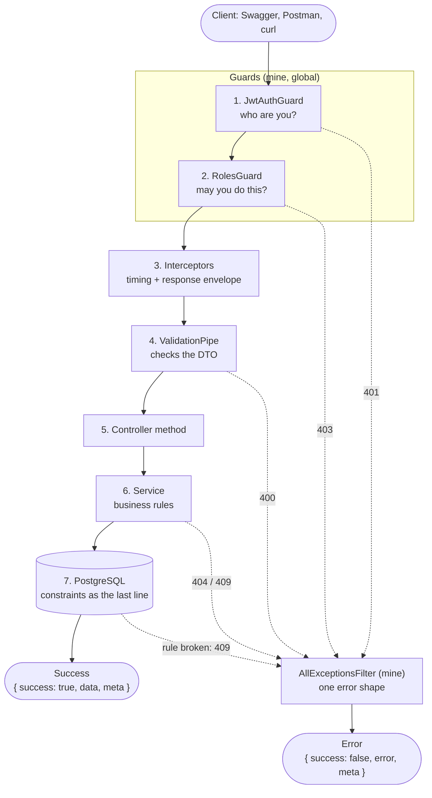
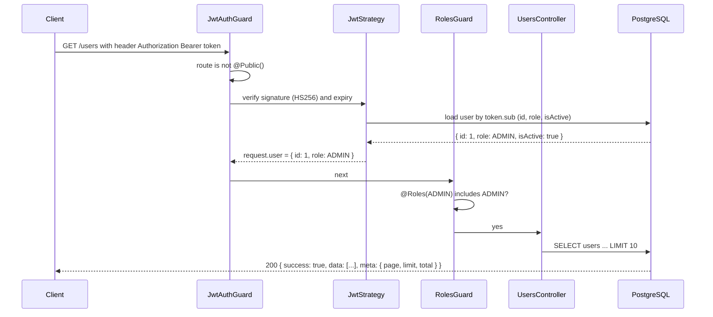
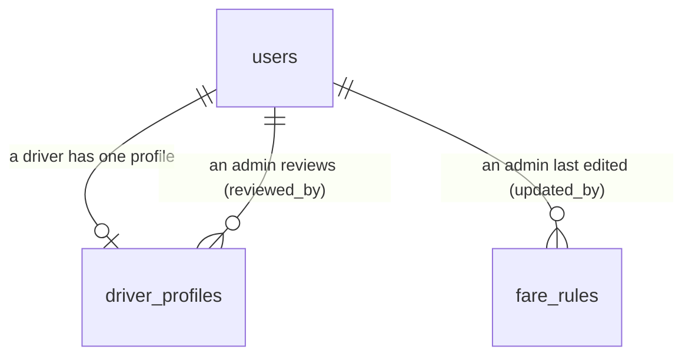
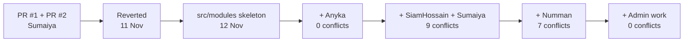

# Admin Module: Identity, Access Control and Administration

**Bhorsha (ভরসা)** · fair ride-hailing and ride-sharing backend for Dhaka · CSC4161
**Presenter:** Siam Hossain (24-56637-1) · **Role in the team:** Admin
**Code:** `bhorsha/src/modules/identity`, `bhorsha/src/modules/pricing`, `bhorsha/src/common`

> How to use this file: each `Slide` heading is one part of the talk, in the order to present it. Section 9 is the merge story, section 10 is a step-by-step live demo, and section 11 lists questions a marker is likely to ask, with answers.

---

## Contents

1. [The problem my part solves](#slide-1--the-problem-my-part-solves)
2. [What I built](#slide-2--what-i-built)
3. [Where it lives in the code](#slide-3--where-it-lives-in-the-code)
4. [How a request travels through the app](#slide-4--how-a-request-travels-through-the-app)
5. [The 11 admin endpoints](#slide-5--the-11-admin-endpoints)
6. [Concepts, one by one](#slide-6--concepts-one-by-one)
7. [Database tables and the SQL that creates them](#slide-7--database-tables-and-the-sql-that-creates-them)
8. [Testing and results](#slide-8--testing-and-results)
9. [Merging the team's branches: problems and fixes](#slide-9--merging-the-teams-branches-problems-and-fixes)
10. [Live demo script](#slide-10--live-demo-script)
11. [Questions a marker may ask](#slide-11--questions-a-marker-may-ask)
12. [Limits and next steps](#slide-12--limits-and-next-steps)
13. [Quick reference](#quick-reference)

---

## Slide 1 · The problem my part solves

Every other module (driver, rider, support) needs to know two things about each request:

1. **Who is calling?** That's *authentication*.
2. **Are they allowed to do this?** That's *authorization*.

The platform also needs someone to run it: create staff accounts, approve drivers before they can take rides, and keep fares under the legal ceiling set by the regulator (BRTA).

My part answers both questions for **every route in the API**, and gives the admin the tools to run the platform.

| Without the admin module | With it |
|---|---|
| Anyone could call any route | Every route needs a valid token, except register and login |
| A rider could call admin routes | `@Roles(Role.ADMIN)` refuses them with 403 |
| Passwords would be readable in the database | Stored only as bcrypt hashes, never returned by the API |
| An unverified driver could take rides | Admin approves or rejects drivers; the database refuses to put unverified drivers online |
| Fares could exceed the legal limit | The service and the database both refuse a fare above the ceiling (409) |
| Errors would come back in many shapes, with stack traces | One error format for the whole API, and stack traces stay in the server log |

---

## Slide 2 · What I built

**Endpoints (11):** register, login, users CRUD (5 routes), driver list and verification (2), fare rules (2).

**Pieces that every module uses:**

| Piece | File | One-line job |
|---|---|---|
| `JwtAuthGuard` (global) | `src/common/guards/jwt-auth.guard.ts` | Checks the Bearer token on every request |
| `RolesGuard` (global) | `src/common/guards/roles.guard.ts` | Checks the caller's role against `@Roles()` |
| `JwtStrategy` | `src/modules/identity/jwt.strategy.ts` | Verifies the token's signature and expiry, then reloads the user from the database |
| `@Public()` | `src/common/decorators/public.decorator.ts` | Marks a route that needs no token |
| `@Roles(...)` | `src/common/decorators/roles.decorator.ts` | Limits a route to some roles |
| `@CurrentUser()` | `src/common/decorators/current-user.decorator.ts` | Hands the logged-in user to a controller method |
| `PasswordService` | `src/modules/identity/password.service.ts` | bcrypt hash and compare |
| `AllExceptionsFilter` (global) | `src/common/filters/all-exceptions.filter.ts` | Turns every error into one JSON shape |
| Database error map | `src/common/filters/database-error.map.ts` | Turns PostgreSQL rule violations into friendly 409 messages |
| Validation error factory | `src/common/filters/validation-exception.factory.ts` | Turns DTO errors into a 400 that names each field |
| Swagger bearer auth | `src/main.ts` | The **Authorize** button in Swagger UI |

**Numbers:** 11 endpoints · 7 test files with 64 unit tests, all passing · 26 live API checks, all as expected · 6 Swagger screenshots for the report.

---

## Slide 3 · Where it lives in the code

```text
bhorsha/src/
├── main.ts                          global prefix /api/v1, ValidationPipe, Swagger with bearer auth
├── app.module.ts                    registers AllExceptionsFilter; imports IdentityModule and FareRulesModule
├── common/
│   ├── decorators/
│   │   ├── public.decorator.ts      @Public()
│   │   ├── roles.decorator.ts       @Roles(...)
│   │   └── current-user.decorator.ts @CurrentUser()
│   ├── guards/
│   │   ├── jwt-auth.guard.ts        global guard 1: who are you?
│   │   ├── roles.guard.ts           global guard 2: may you do this?
│   │   └── auth-user.ts             loads the user from the database for both guards
│   └── filters/
│       ├── all-exceptions.filter.ts one error shape for the whole API
│       ├── database-error.map.ts    PostgreSQL error code + constraint -> HTTP status + message
│       └── validation-exception.factory.ts
└── modules/
    ├── identity/                    accounts and access
    │   ├── identity.module.ts       JwtModule, Passport, APP_GUARD registration
    │   ├── auth.controller.ts       POST /auth/register, POST /auth/login
    │   ├── auth.service.ts
    │   ├── jwt.strategy.ts
    │   ├── password.service.ts
    │   ├── users.controller.ts      /users (5 routes)
    │   ├── users.service.ts
    │   ├── driver-verification.controller.ts  GET /drivers, PATCH /drivers/:id/verify
    │   ├── driver-verification.service.ts
    │   ├── user-response.ts         the only user fields the API ever returns
    │   └── dto/                     register, login, create-staff, update-user, list and verify DTOs
    └── pricing/                     admin fare rules
        ├── fare-rules.controller.ts GET /fare-rules, PATCH /fare-rules/:id
        ├── fare-rules.service.ts
        └── dto/update-fare-rule.dto.ts
```

---

## Slide 4 · How a request travels through the app

NestJS handles every request in a fixed order. My guards sit at the front door; my filter catches anything that goes wrong on the way.



**The same thing as a sequence**, for `GET /api/v1/users` called by an admin:



---

## Slide 5 · The 11 admin endpoints

All paths start with `/api/v1`.

| # | Method | Path | Who may call it | What it does | Main answers |
|---|---|---|---|---|---|
| 1 | POST | `/auth/register` | Anyone (`@Public`) | Sign up as a rider or a driver. A driver also gets a driver profile, in the same transaction | 201, 400, 409 |
| 2 | POST | `/auth/login` | Anyone (`@Public`) | Phone + password in, JWT out | 200, 400, 401, 403 |
| 3 | GET | `/users` | Admin | List users; filter by `role` and `status` (ACTIVE, SUSPENDED, DEACTIVATED); paged | 200 |
| 4 | GET | `/users/:id` | Admin | One user | 200, 404 |
| 5 | POST | `/users` | Admin | Create a staff account (ADMIN or SUPPORT) | 201, 400, 409 |
| 6 | PATCH | `/users/:id` | The owner or an admin | Owner: name and email. Admin also: role, isActive, suspendedUntil | 200, 400, 403, 404, 409 |
| 7 | DELETE | `/users/:id` | Admin | Deactivate (never a real delete); a driver is taken offline | 204, 403, 404 |
| 8 | GET | `/drivers` | Admin | List drivers; filter by verification. The PENDING queue is oldest first | 200 |
| 9 | PATCH | `/drivers/:id/verify` | Admin | Approve or reject a driver; rejecting needs a reason | 200, 400, 404, 409 |
| 10 | GET | `/fare-rules` | Admin | Fare and legal ceiling per vehicle type (BIKE, CAR, CNG) | 200 |
| 11 | PATCH | `/fare-rules/:id` | Admin | Change base fare, per-km fare or share discount, never above the ceiling | 200, 400, 404, 409 |

---

## Slide 6 · Concepts, one by one

Each concept follows the same pattern: **what it is → why we need it → how it works in Bhorsha → where to point in the code.**

### 6.1 Password hashing with bcrypt

- **What:** bcrypt turns a password into a one-way hash with a random salt. The same password gives a different hash every time, and the hash can't be turned back into the password.
- **Why:** if the database leaks, nobody can read the passwords.
- **How here:**
  - `PasswordService.hash()` uses `BCRYPT_ROUNDS` (12 by default). Each extra round doubles the work for an attacker.
  - The password must be 8 to 72 characters, because bcrypt only reads the first 72 bytes.
  - The `password_hash` column has `select: false`, so a normal query never loads it. Login asks for it explicitly with `.addSelect('u.passwordHash')`.
  - The hash is made **before** the database transaction opens, because bcrypt is deliberately slow and shouldn't hold a database connection.
- **Code:** `password.service.ts`, `auth.service.ts` (`register`, `login`), `users/entities/user.entity.ts`.

### 6.2 Registration in one transaction

- **What:** a transaction makes several database writes succeed or fail together.
- **Why:** a driver is two rows, one in `users` and one in `driver_profiles`. If the licence number is already taken, we must not leave a user with no driver profile.
- **How here:** `AuthService.insertAccount()` opens a `QueryRunner`, inserts the user, inserts the driver profile, then commits. On any error it rolls back. A taken phone, email or licence number comes back as **409** with a clear message, through the exception filter.
- **Rules enforced:**
  - `role` can only be RIDER or DRIVER here. Staff accounts come only from `POST /users`.
  - A driver must send `licenceNo`; a rider must not.
  - The response never includes the password or its hash (see 6.10).

### 6.3 Login and the JWT access token

- **What:** a JSON Web Token is a signed string of three parts: `header.payload.signature`. The server signs it with a secret; anyone can read the payload, but nobody can change it without breaking the signature.
- **Why:** after login the client sends the token with each request. The server checks the signature and doesn't need to keep sessions.
- **How here:**
  - Payload: `{ sub: <user id>, role: <role> }`, plus `iat` and `exp`.
  - Signed with **HS256** and `JWT_ACCESS_SECRET` from `.env`. It lasts `JWT_ACCESS_TTL` (15 minutes).
  - The response is `{ accessToken, tokenType: "Bearer", expiresIn: "15m", user }`.
- **Security details worth mentioning:**
  - An unknown phone and a wrong password both return the **same** 401 message, `Invalid phone or password`. An attacker can't learn which phones are registered.
  - For an unknown phone, `compareWithDummy()` still runs one bcrypt comparison, so both cases take about the same time. That blocks *timing attacks*.
  - A deactivated account gets 403, but only **after** the password matched, so this check can't be used to probe phone numbers either.
- **Code:** `auth.service.ts` (`login`), `identity.module.ts` (`JwtModule.registerAsync`).

### 6.4 Passport and the JWT strategy

- **What:** Passport is the standard Node.js authentication library. A *strategy* is one way to authenticate; we use `passport-jwt`.
- **How here:** `JwtStrategy`:
  1. reads the token from the `Authorization: Bearer ...` header,
  2. checks the signature and refuses expired tokens (`ignoreExpiration: false`, `algorithms: ['HS256']`),
  3. then, in `validate()`, **reloads the user from the database**.
- **Why reload:** if an admin changes someone's role or deactivates them, it applies to the very next request, even though their old token is still valid for up to 15 minutes.
- **Code:** `jwt.strategy.ts`, `common/guards/auth-user.ts` (`loadAuthUser`).

### 6.5 Global guards (`APP_GUARD`)

- **What:** a guard decides whether a request may reach the controller. A *global* guard runs on every route without anyone having to remember to add it.
- **Why:** with 55 routes written by four people, "secure by default" is safer than "remember to add the guard".
- **How here:** `identity.module.ts` registers two global guards, in this order:
  1. `JwtAuthGuard`: who are you? No valid token → **401**.
  2. `RolesGuard`: may you do this? Wrong role → **403**.
- **401 vs 403:** 401 means "I don't know who you are". 403 means "I know who you are, and you're not allowed".
- The 401 message even tells an expired token (`Access token expired`) apart from a missing or broken one (`Missing or invalid access token`).

### 6.6 Custom decorators and metadata

A decorator attaches a label (*metadata*) to a route. The guards read the label with Nest's `Reflector`.

| Decorator | Type | What it does | Used on |
|---|---|---|---|
| `@Public()` | `SetMetadata('isPublic', true)` | Lets the route through without a token | register, login, `GET /` |
| `@Roles(Role.ADMIN)` | `SetMetadata('roles', [...])` | Only those roles may call the route | users, drivers (admin side), fare rules |
| `@CurrentUser()` | `createParamDecorator` | Gives the method the logged-in user, or one field with `@CurrentUser('id')` | PATCH and DELETE `/users`, driver verify, fare-rule update |

- `@Roles()` can go on one method or on a whole controller. `FareRulesController` puts it on the class, so both fare routes are admin only.
- **There is no hidden "admin can do everything" rule.** A route is open to exactly the roles listed. That makes access easy to read from the code.

### 6.7 Ownership checks (when a role isn't enough)

Some rules depend on **whose** data it is, not only on the role. `PATCH /users/:id` has no `@Roles()`; `UsersService.update()` decides:

| Caller | May change | Refused with |
|---|---|---|
| Anyone, on their own profile | `fullName`, `email` | |
| Anyone, on someone else's profile | nothing | 403 `You can only change your own profile` |
| A non-admin sending `role`, `isActive` or `suspendedUntil` | nothing | 403 `Only an admin can change role or status` |
| An admin, on any profile | everything above | |
| An admin, on their own account | not their own role, active flag or suspension | 403, so the last admin can't lock everyone out |

- The owner check runs **before** any database lookup, so nobody can probe which user ids exist.
- A driver's role can't be changed, because driver accounts must come from driver registration (409).
- An empty body returns 400 `Send at least one field to change`.

### 6.8 Input validation with DTOs

- **What:** a DTO (Data Transfer Object) is a class that describes the body or query a route accepts. `class-validator` decorators state the rules.
- **How here:** one global `ValidationPipe` in `main.ts`, with three options:
  - `whitelist: true` removes fields that aren't in the DTO,
  - `forbidNonWhitelisted: true` returns **400** if the client sends an unknown field (sending `"isAdmin": true` is refused),
  - `transform: true` turns strings into numbers and dates, and runs `@Transform` (for example, trimming and lower-casing emails).
- **Examples from my DTOs:**
  - Phone must match `^\+8801[3-9]\d{8}$`, the same rule as the database's `ck_users_phone_format`.
  - `CreateStaffDto` reuses `RegisterDto` with `PickType` and only changes `role` to ADMIN or SUPPORT.
  - `VerifyDriverDto` requires `rejectionReason` only when `verification` is REJECTED (`@ValidateIf`).
  - `UpdateFareRuleDto` doesn't have the ceiling fields at all, so trying to change the ceiling is a 400.
- **Error format:** `validationExceptionFactory` returns one entry per field:
  `{ "field": "role", "messages": ["role must be ADMIN or SUPPORT"] }`.

### 6.9 One error shape for the whole API

- **What:** an exception filter catches errors and builds the HTTP response.
- **How here:** `AllExceptionsFilter` uses `@Catch()` with no arguments, so it catches **everything**. It's registered in `app.module.ts` as `APP_FILTER`, so tests that build the app get it too. Every error looks like this:

  ```json
  {
    "success": false,
    "error": { "code": "FORBIDDEN", "message": "You do not have permission to do this", "details": null },
    "meta": { "requestId": "573d43ab-9b7b-48c3-bfd9-a1779f019372" }
  }
  ```

- **Database errors become 409, not 500.** `database-error.map.ts` reads the PostgreSQL error code and the constraint name:

  | PostgreSQL code | Meaning | API answer |
  |---|---|---|
  | 23505 | unique violation, e.g. `uq_users_phone` | 409 `Phone number already registered` |
  | 23514 | check violation, e.g. `ck_fare_rules_within_ceiling` | 409 `Fare is above the legal ceiling` |
  | 23503 | foreign key violation | 409 with a message per constraint |
  | 40P01, 40001, 55P03 | deadlock, serialization failure, lock not available | 409 `Busy, please retry` |

- **Unknown errors become a plain 500** `Internal server error`. The stack trace goes only to the server log, together with the `requestId`, so a bug can be found without exposing internals to the client.

### 6.10 Never returning secrets

- `toPublicUser()` in `user-response.ts` copies only nine named fields (id, fullName, phone, email, role, isActive, suspendedUntil, createdAt, updatedAt).
- Because it copies an allow-list instead of deleting fields, a column added to the table later can't leak by accident.
- Together with `select: false` on `password_hash`, the hash never leaves the database. Fig 6.21 shows a registration response with no password field.

### 6.11 Soft delete: deactivation

- **What:** "soft delete" means marking a row inactive instead of removing it.
- **Why:** rides, ratings, cases and strikes all point at users, and every foreign key is `RESTRICT`. Deleting a user would either fail or break history.
- **How here:** `DELETE /users/:id` returns **204** and, in one transaction:
  1. sets `is_active = false`,
  2. sets the driver profile (if any) to OFFLINE.

  From the next request on, the guard refuses that user with 401 `Account not found or deactivated`, even with a token that hasn't expired. An admin can't deactivate themselves.

### 6.12 Driver verification and safe concurrent updates

- **Why:** only a verified driver may go online. The database itself enforces this with `ck_driver_profiles_online_verified`.
- **How here:** `PATCH /drivers/:id/verify` with `{ "verification": "VERIFIED" }` or `{ "verification": "REJECTED", "rejectionReason": "..." }`:
  - The same decision twice returns 409 `Driver is already VERIFIED`.
  - Rejecting also takes the driver OFFLINE, in the same `UPDATE` statement.
  - It records `reviewedBy` (the admin's id) and `reviewedAt`.
  - `:id` is the driver's **user id**. A user who isn't a driver gets 404 `Driver not found`.
- **Concurrency (optimistic locking):** two admins might review the same driver at the same moment. The update only runs if the status is still the one we read:

  ```sql
  UPDATE driver_profiles SET verification = 'VERIFIED', reviewed_by = 1, reviewed_at = now()
  WHERE user_id = 8 AND verification = 'PENDING';
  ```

  If the other admin got there first, zero rows change and the second admin gets 409 `This driver was just reviewed by someone else; reload and try again`. No lock is held, and no decision is silently overwritten.

### 6.13 Fare rules and the legal ceiling

- **Money as integers:** all amounts are in **paisa** (Tk 1 = 100 paisa), stored as `bigint`, so there are no floating-point rounding errors. The share discount is in **basis points** (2500 bps = 25%).
- **Current values** (from `GET /fare-rules`):

  | id | Vehicle | Base fare | Per km | Ceiling base | Ceiling per km | Share discount |
  |---|---|---|---|---|---|---|
  | 1 | BIKE | 3000 | 1200 | 4000 | 1800 | 2500 |
  | 2 | CAR | 6000 | 2500 | 8500 | 3400 | 2500 |
  | 3 | CNG | 4000 | 1800 | 5500 | 2500 | 2500 |

- **Two lines of defence:**
  1. `FareRulesService.update()` compares the new values with the ceiling and returns **409** with the exact field and limit: `[{ "field": "perKmPaisa", "max": 1800 }]`.
  2. If code ever skipped that check, the database's `ck_fare_rules_within_ceiling` would still refuse the row, and the filter would turn it into the same 409.
- **The ceiling is frozen.** Only `basePaisa`, `perKmPaisa` and `shareDiscountBps` can change. Sending `ceilingPerKmPaisa` gets a 400 from the ValidationPipe, and the database trigger `trg_fare_rules_regulation_frozen` blocks it too. The ceiling can only change through a migration.
- `updatedBy` records which admin changed the fare.

### 6.14 Swagger with bearer authentication

- `main.ts` builds the OpenAPI document with `DocumentBuilder` and serves it at **`/api/docs`**; the raw JSON is at `/api/docs-json`.
- `.addBearerAuth(...)` adds the **Authorize** button. `.addSecurityRequirements('bearer')` makes Swagger send the token on every request after you authorize.
- The Swagger CLI plugin is off, so a field appears in Swagger only if it has `@ApiProperty()`. Every field in my DTOs has one, with an example.
- Each of my routes has `@ApiOperation({ summary })` and is grouped with `@ApiTags`: Auth, Users, Drivers (Admin), Fare rules.

### 6.15 Development-only `x-user-id` header

- **Why it exists:** the driver and rider modules were built before login was merged. They identified the caller with an `x-user-id` header.
- **How it's kept safe:** `JwtAuthGuard` accepts the header **only** when `ALLOW_X_USER_ID=true` **and** `NODE_ENV` is not `production`, and only if no token is sent. The user is still loaded from the database, so the role is the real one and deactivated users are refused. When it's on, the app logs a warning at start-up.
- **For the demo:** set `ALLOW_X_USER_ID=false` in `.env`.

### 6.16 Configuration from `.env`

| Variable | Used for |
|---|---|
| `JWT_ACCESS_SECRET` | Signing and checking tokens. Required; the app won't start without it (`getOrThrow`) |
| `JWT_ACCESS_TTL` | Token lifetime, default `15m` |
| `BCRYPT_ROUNDS` | bcrypt cost, default `12` |
| `ALLOW_X_USER_ID` | Development fallback (6.15) |
| `NODE_ENV` | `production` switches the fallback off for good |

Each developer makes their own secret, for example with `openssl rand -base64 48`, so a token from one computer doesn't work on another.

---

## Slide 7 · Database tables and the SQL that creates them

The schema comes from the shared Docker image `siam001/bhorsha-db:2.0.0` (13 tables).
- When the database starts for the first time, the image runs `/docker-entrypoint-initdb.d/01_schema.sql`.
- TypeORM runs with `synchronize: false`, so the app never changes the schema.
- The SQL below is copied word for word from that file. It was checked against the running database on 19 Nov 2026: same 33 columns, same constraints, indexes and triggers.

### 7.1 The three tables at a glance

| Table | Key columns | Rules in the database |
|---|---|---|
| `users` | `id`, `full_name`, `phone` (unique), `email` (unique, optional), `password_hash` (never selected), `role` (RIDER, DRIVER, ADMIN, SUPPORT), `is_active`, `suspended_until` | `uq_users_phone`, `uq_users_email`, `ck_users_full_name`, `ck_users_phone_format`, `ck_users_email_format` |
| `driver_profiles` | `user_id` (also the primary key), `licence_no` (unique), `verification` (PENDING, VERIFIED, REJECTED), `status` (OFFLINE, ONLINE), `rejection_reason`, `reviewed_by`, `reviewed_at` | `uq_driver_profiles_licence_no`, `ck_driver_profiles_online_verified`, `ck_driver_profiles_review`, `ck_driver_profiles_rejection_reason`, `ck_driver_profiles_licence_no`, `ck_driver_profiles_location` |
| `fare_rules` | `vehicle_type` (unique), `base_paisa`, `per_km_paisa`, `base_distance_m`, `ceiling_base_paisa`, `ceiling_per_km_paisa`, `share_discount_bps`, `updated_by` | `uq_fare_rules_vehicle_type`, `ck_fare_rules_amounts`, `ck_fare_rules_base_distance`, `ck_fare_rules_share_discount`, `ck_fare_rules_within_ceiling`, trigger `trg_fare_rules_regulation_frozen` |



### 7.2 Step 1: types, domains and the shared trigger function

Enums limit a column to a fixed list of values, so a typo like `'ADMN'` can never be stored. Domains are reusable column types with a built-in check.

```sql
-- Types. Status enums mirror the state diagrams in the architecture document.
CREATE TYPE user_role           AS ENUM ('RIDER', 'DRIVER', 'ADMIN', 'SUPPORT');
CREATE TYPE driver_verification AS ENUM ('PENDING', 'VERIFIED', 'REJECTED');
CREATE TYPE driver_status       AS ENUM ('OFFLINE', 'ONLINE');
CREATE TYPE vehicle_type        AS ENUM ('BIKE', 'CAR', 'CNG');

-- Coordinates: about 0.1 m precision, range-checked once here instead of on every column.
CREATE DOMAIN geo_lat AS numeric(9,6) CONSTRAINT ck_geo_lat_range CHECK (VALUE BETWEEN -90 AND 90);
CREATE DOMAIN geo_lng AS numeric(9,6) CONSTRAINT ck_geo_lng_range CHECK (VALUE BETWEEN -180 AND 180);

-- Keeps updated_at current on every UPDATE, including raw SQL such as the seat transaction.
CREATE FUNCTION set_updated_at() RETURNS trigger LANGUAGE plpgsql AS $$
BEGIN
  NEW.updated_at := now();
  RETURN NEW;
END $$;
```

### 7.3 Step 2: `users`, every account in the system

```sql
CREATE TABLE users (
  id               integer      GENERATED ALWAYS AS IDENTITY,
  full_name        varchar(100) NOT NULL,
  phone            varchar(16)  NOT NULL,
  email            varchar(254),
  password_hash    varchar(255) NOT NULL,
  role             user_role    NOT NULL,
  is_active        boolean      NOT NULL DEFAULT true,
  suspended_until  timestamptz,
  created_at       timestamptz  NOT NULL DEFAULT now(),
  updated_at       timestamptz  NOT NULL DEFAULT now(),
  CONSTRAINT pk_users PRIMARY KEY (id),
  CONSTRAINT uq_users_phone UNIQUE (phone),
  CONSTRAINT uq_users_email UNIQUE (email),
  CONSTRAINT ck_users_full_name CHECK (btrim(full_name) <> ''),
  -- Bangladesh mobile numbers in E.164 form: +8801[3-9]XXXXXXXX. Normalise in the DTO.
  CONSTRAINT ck_users_phone_format CHECK (phone ~ '^\+8801[3-9][0-9]{8}$'),
  -- Stored lower-case (normalise in the DTO), so UNIQUE is effectively case-insensitive.
  CONSTRAINT ck_users_email_format CHECK (email = lower(email) AND email ~ '^[^@\s]+@[^@\s]+\.[^@\s]+$')
);
CREATE INDEX ix_users_role ON users (role, id DESC);

COMMENT ON TABLE  users IS 'identity module. Every account: rider, driver, admin or support officer. Plural because "user" is reserved.';
COMMENT ON COLUMN users.password_hash IS 'bcrypt hash (cost 12). Never selected by default and never returned or logged.';
COMMENT ON COLUMN users.is_active IS 'false = deactivated by an admin (the soft delete behind DELETE /users/:id).';
COMMENT ON COLUMN users.suspended_until IS 'Suspended while now() < suspended_until (3 active strikes = 7 days, section 16). NULL = not suspended.';
```

What to point out:
- **`GENERATED ALWAYS AS IDENTITY`**: the database makes every id. An insert can't pick its own id unless it says `OVERRIDING SYSTEM VALUE`, which only the seed file does.
- **`ck_users_phone_format`** is the same regular expression as `PHONE_PATTERN` in the DTO. The API answers 400 first; the database is the safety net.
- **`ck_users_email_format`** forces lower case, so `Admin@x.com` and `admin@x.com` can't both exist. The DTO lower-cases emails before saving.
- **`ix_users_role (role, id DESC)`** serves `GET /users?role=...`, which lists newest first.
- The table is called `users`, not `user`, because `user` is a reserved word in PostgreSQL.

### 7.4 Step 3: `driver_profiles`, the extra data a driver needs

```sql
CREATE TABLE driver_profiles (
  user_id           integer             NOT NULL,
  licence_no        varchar(30)         NOT NULL,
  verification      driver_verification NOT NULL DEFAULT 'PENDING',
  reviewed_by       integer,
  reviewed_at       timestamptz,
  rejection_reason  text,
  status            driver_status       NOT NULL DEFAULT 'OFFLINE',
  last_lat          geo_lat,
  last_lng          geo_lng,
  last_location_at  timestamptz,
  created_at        timestamptz         NOT NULL DEFAULT now(),
  updated_at        timestamptz         NOT NULL DEFAULT now(),
  CONSTRAINT pk_driver_profiles PRIMARY KEY (user_id),
  CONSTRAINT fk_driver_profiles_user FOREIGN KEY (user_id) REFERENCES users (id) ON DELETE RESTRICT,
  CONSTRAINT fk_driver_profiles_reviewed_by FOREIGN KEY (reviewed_by) REFERENCES users (id) ON DELETE RESTRICT,
  CONSTRAINT uq_driver_profiles_licence_no UNIQUE (licence_no),
  CONSTRAINT ck_driver_profiles_licence_no CHECK (btrim(licence_no) <> ''),
  -- Only a verified driver can go online. Rejecting an online driver must set OFFLINE in the same UPDATE.
  CONSTRAINT ck_driver_profiles_online_verified CHECK (status = 'OFFLINE' OR verification = 'VERIFIED'),
  -- Every verification decision names the admin who made it and when.
  CONSTRAINT ck_driver_profiles_review CHECK (verification = 'PENDING' OR (reviewed_by IS NOT NULL AND reviewed_at IS NOT NULL)),
  CONSTRAINT ck_driver_profiles_rejection_reason CHECK (verification <> 'REJECTED' OR rejection_reason IS NOT NULL),
  CONSTRAINT ck_driver_profiles_location CHECK (
    (last_lat IS NULL) = (last_lng IS NULL) AND (last_lat IS NULL) = (last_location_at IS NULL))
);
-- Admin verification queue (GET /drivers?verification=PENDING).
CREATE INDEX ix_driver_profiles_pending ON driver_profiles (created_at) WHERE verification = 'PENDING';

COMMENT ON TABLE  driver_profiles IS 'fleet module. Driver extension of users (1:1, shared primary key). Created with the user in one transaction.';
COMMENT ON COLUMN driver_profiles.last_lat IS 'Last posted position (PUT /drivers/me/location). Live tracking moves to Redis GEO in the full product.';
```

What to point out:
- **Shared primary key:** `user_id` is both the primary key and a foreign key to `users`. That makes the relationship exactly one-to-one: a user has at most one driver profile.
- **`ON DELETE RESTRICT`**: a user who has a driver profile, or who reviewed one, can't be deleted. That is why `DELETE /users/:id` deactivates instead (6.11).
- **Three rules back up the admin's verification step:**
  - `ck_driver_profiles_online_verified`: an unverified driver can't go online.
  - `ck_driver_profiles_review`: any decision must record who made it and when.
  - `ck_driver_profiles_rejection_reason`: a rejection must give a reason.

  These match the API rules in 6.12 one for one.
- **`ix_driver_profiles_pending`** is a *partial index*. It only holds PENDING rows, so the admin's queue stays fast and small, however many drivers are already verified.

### 7.5 Step 4: `fare_rules` and the frozen legal ceiling

```sql
-- One editable rule per vehicle type (no version history in the course release).
-- Fare for a distance d:     base_paisa + per_km_paisa * max(d - base_distance_m, 0) / 1000
-- Legal ceiling for d:       ceiling_base_paisa + ceiling_per_km_paisa * max(d - base_distance_m, 0) / 1000
-- Shared fare per passenger: fare * (10000 - share_discount_bps) / 10000, never above the ceiling.
-- Round each result to the nearest paisa (round half up).
CREATE TABLE fare_rules (
  id                    integer      GENERATED ALWAYS AS IDENTITY,
  vehicle_type          vehicle_type NOT NULL,
  base_paisa            bigint       NOT NULL,
  per_km_paisa          bigint       NOT NULL,
  base_distance_m       integer      NOT NULL DEFAULT 2000,
  ceiling_base_paisa    bigint       NOT NULL,
  ceiling_per_km_paisa  bigint       NOT NULL,
  share_discount_bps    integer      NOT NULL DEFAULT 2500,
  updated_by            integer,
  created_at            timestamptz  NOT NULL DEFAULT now(),
  updated_at            timestamptz  NOT NULL DEFAULT now(),
  CONSTRAINT pk_fare_rules PRIMARY KEY (id),
  CONSTRAINT fk_fare_rules_updated_by FOREIGN KEY (updated_by) REFERENCES users (id) ON DELETE RESTRICT,
  CONSTRAINT uq_fare_rules_vehicle_type UNIQUE (vehicle_type),
  CONSTRAINT ck_fare_rules_amounts CHECK (
    base_paisa >= 0 AND per_km_paisa >= 0 AND ceiling_base_paisa > 0 AND ceiling_per_km_paisa > 0),
  CONSTRAINT ck_fare_rules_base_distance CHECK (base_distance_m >= 0),
  -- A shared fare must always be lower than the solo fare (section 3).
  CONSTRAINT ck_fare_rules_share_discount CHECK (share_discount_bps BETWEEN 1 AND 9999),
  -- Legal Fare Guard for the tariff: both formulas share base_distance_m, so comparing
  -- them part by part proves fare(d) <= ceiling(d) for every distance d.
  CONSTRAINT ck_fare_rules_within_ceiling CHECK (base_paisa <= ceiling_base_paisa AND per_km_paisa <= ceiling_per_km_paisa)
);

-- The ceiling and its base distance are regulation (Taxicab Service Guidelines 2010), not
-- admin settings. If the admin could edit them, the Legal Fare Guard would be meaningless.
-- Change them only with a migration, which disables this trigger for that one UPDATE.
CREATE FUNCTION fare_rules_regulation_frozen() RETURNS trigger LANGUAGE plpgsql AS $$
BEGIN
  IF (NEW.vehicle_type, NEW.base_distance_m, NEW.ceiling_base_paisa, NEW.ceiling_per_km_paisa)
     IS DISTINCT FROM (OLD.vehicle_type, OLD.base_distance_m, OLD.ceiling_base_paisa, OLD.ceiling_per_km_paisa) THEN
    RAISE EXCEPTION 'The legal ceiling of fare rule % is regulation; change it with a migration', OLD.id
      USING ERRCODE = 'check_violation', CONSTRAINT = 'ck_fare_rules_regulation_frozen', TABLE = TG_TABLE_NAME;
  END IF;
  RETURN NEW;
END $$;

CREATE TRIGGER trg_fare_rules_regulation_frozen
  BEFORE UPDATE OF vehicle_type, base_distance_m, ceiling_base_paisa, ceiling_per_km_paisa ON fare_rules
  FOR EACH ROW EXECUTE FUNCTION fare_rules_regulation_frozen();

COMMENT ON TABLE  fare_rules IS 'pricing module. One rule per vehicle type. The admin edits base_paisa, per_km_paisa and share_discount_bps; the ceiling columns are frozen.';
COMMENT ON COLUMN fare_rules.base_distance_m IS 'Distance included in the base fare: the legal "first 2 km". Shared by the tariff and the ceiling formulas.';
```

What to point out:
- **Why comparing the parts is enough:** the fare and the ceiling use the same formula shape and the same `base_distance_m`. If the base fare is at most the ceiling's base, and the per-km rate is at most the ceiling's per-km rate, then the fare is below the ceiling for **every** distance. One `CHECK` covers every ride.
- **Why a trigger and not a `CHECK`:** a `CHECK` only sees the new row. To say "this column must not *change*", the database has to compare the old row with the new one, and only a trigger can do that.
- **The trigger reports itself as a check violation** with the name `ck_fare_rules_regulation_frozen`. The API's exception filter maps that name to 409 `The legal ceiling can only change by migration`, the same way as a real constraint.
- **`uq_fare_rules_vehicle_type`**: exactly one rule per vehicle type, so there's never any doubt which fare applies.

### 7.6 Step 5: keep `updated_at` correct

```sql
CREATE TRIGGER trg_users_updated_at           BEFORE UPDATE ON users           FOR EACH ROW EXECUTE FUNCTION set_updated_at();
CREATE TRIGGER trg_driver_profiles_updated_at BEFORE UPDATE ON driver_profiles FOR EACH ROW EXECUTE FUNCTION set_updated_at();
CREATE TRIGGER trg_fare_rules_updated_at      BEFORE UPDATE ON fare_rules      FOR EACH ROW EXECUTE FUNCTION set_updated_at();
```

The database sets `updated_at` itself. It stays right even for an update that doesn't come through TypeORM, such as a raw `UPDATE` in a transaction or one run by hand in DBeaver.

### 7.7 Seed rows for the fare rules

From `/docker-entrypoint-initdb.d/02_seed.sql`. Amounts are in paisa: BIKE base Tk 30, Tk 12 per km after the first 2 km.

```sql
INSERT INTO fare_rules (id, vehicle_type, base_paisa, per_km_paisa, base_distance_m, ceiling_base_paisa, ceiling_per_km_paisa,
                        share_discount_bps, updated_by, created_at, updated_at)
OVERRIDING SYSTEM VALUE VALUES
  (1, 'BIKE', 3000, 1200, 2000, 4000, 1800, 2500, NULL, now() - interval '60 days', now() - interval '60 days'),
  (2, 'CAR',  6000, 2500, 2000, 8500, 3400, 2500, 1,    now() - interval '60 days', now() - interval '10 days'),
  (3, 'CNG',  4000, 1800, 2000, 5500, 2500, 2500, NULL, now() - interval '60 days', now() - interval '60 days');
```

The 13 demo accounts in `users` are seeded the same way. They all share one precomputed bcrypt hash of `Bhorsha@123` with **cost 10** (`$2a$10$...`), to keep demo logins fast. Accounts created through the API use cost 12 (`BCRYPT_ROUNDS`). `bcrypt.compare` reads the cost from the hash itself, so both kinds of account log in the same way.

### 7.8 How each database rule reaches the API

| Database rule | When it fires | What the API answers |
|---|---|---|
| `uq_users_phone` | Register or create staff with a phone that's already used | 409 `Phone number already registered` |
| `uq_users_email` | Same, for email | 409 `Email already registered` |
| `uq_driver_profiles_licence_no` | A driver registers with a licence number that's already used; the whole registration is rolled back | 409 `Licence number already registered` |
| `ck_users_phone_format` | A bad phone number. The DTO catches it first, so this is only a safety net | 400 from the DTO |
| `ck_driver_profiles_online_verified` | An unverified driver tries to go online | 409 `Only verified drivers can go online` |
| `ck_fare_rules_within_ceiling` | A fare above the ceiling. The service catches it first; this is the safety net | 409 `Fare is above the legal ceiling` |
| `ck_fare_rules_regulation_frozen` (trigger) | Anything tries to change a ceiling column | 409 `The legal ceiling can only change by migration` (the DTO already refuses those fields with 400) |
| Any other check or foreign key | | 409 `Request conflicts with the current data` |

### 7.9 Prove the rules yourself in psql

Open psql on the Docker database:

```bash
docker exec -it bhorsha-db psql -U bhorsha -d bhorsha
```

Each statement below is **refused** by the database, so nothing changes. Run them one at a time.

```sql
-- 1. Fare above the legal ceiling (BIKE ceiling is 1800 paisa per km)
UPDATE fare_rules SET per_km_paisa = 999999 WHERE id = 1;
-- ERROR:  new row for relation "fare_rules" violates check constraint "ck_fare_rules_within_ceiling"

-- 2. The admin tries to raise the ceiling itself
UPDATE fare_rules SET ceiling_per_km_paisa = 5000 WHERE id = 1;
-- ERROR:  The legal ceiling of fare rule 1 is regulation; change it with a migration

-- 3. A phone number in the wrong format
INSERT INTO users (full_name, phone, password_hash, role) VALUES ('Test', '01711000003', 'x', 'RIDER');
-- ERROR:  new row for relation "users" violates check constraint "ck_users_phone_format"

-- 4a. Reject Karim (user 5) while he is ONLINE: a rejected driver can't stay online
UPDATE driver_profiles SET verification = 'REJECTED', reviewed_by = 1, reviewed_at = now() WHERE user_id = 5;
-- ERROR:  new row for relation "driver_profiles" violates check constraint "ck_driver_profiles_online_verified"

-- 4b. Take him OFFLINE in the same UPDATE, as the API does, but give no reason
UPDATE driver_profiles SET verification = 'REJECTED', status = 'OFFLINE', reviewed_by = 1, reviewed_at = now() WHERE user_id = 5;
-- ERROR:  new row for relation "driver_profiles" violates check constraint "ck_driver_profiles_rejection_reason"

-- 5. Choose your own id
INSERT INTO users (id, full_name, phone, password_hash, role) VALUES (999, 'Test', '+8801799999999', 'x', 'RIDER');
-- ERROR:  cannot insert a non-DEFAULT value into column "id"
```

4a and 4b together show why the API rejects a driver **and** sets them OFFLINE in one statement (6.12). When several rules are broken at once, PostgreSQL reports the first one by name, in alphabetical order.

These outputs come from the real database on 19 Nov 2026. Each statement was run inside `BEGIN … ROLLBACK` to be safe, and the data was unchanged afterwards.

---

## Slide 8 · Testing and results

### 8.1 Unit tests (Vitest)

Run with `pnpm test` inside `bhorsha/`. Result on 19 Nov 2026: **8 files, 65 tests, all passed**. 64 of them belong to the admin part:

| Test file | Tests | What it proves |
|---|---|---|
| `modules/identity/auth.service.spec.ts` | 8 | A rider is created and the hash is never returned. A driver and their profile are created in one transaction, and the user is rolled back if the licence is taken. A rider can't have a licence. Login: an unknown phone is answered like a wrong password (after a dummy compare), a wrong password gives 401, a deactivated account gives 403 only after the password matched, and the right password returns a token without the hash |
| `modules/identity/users.service.spec.ts` | 14 | Newest-first paging with no hash, role and suspended filters, staff creation hashes the password, someone else's profile is refused before any lookup, non-admins can't change role or status, empty change is refused, the owner can edit name and email, 404s, an admin can't demote or deactivate themselves, driver role is locked, deactivation takes a driver offline in one transaction |
| `modules/identity/driver-verification.service.spec.ts` | 6 | The PENDING queue is oldest first with no hash, 404 for an unknown driver, 409 for a decision already in place, approval records the reviewer, rejection with a reason takes the driver offline in the same update, 409 when another admin reviewed first |
| `modules/pricing/fare-rules.service.spec.ts` | 5 | Rules listed in id order, empty change refused, 404 for an unknown rule, 409 above the ceiling naming the field, a rate exactly at the ceiling is accepted and records the admin |
| `common/guards/jwt-auth.guard.spec.ts` | 12 | `@Public()` routes pass, `x-user-id` is ignored when the flag is off and uses the real database role when it's on, unknown, deactivated and non-numeric ids are refused, a Bearer token wins over the header, the fallback never works in production, valid, expired and missing tokens are told apart |
| `common/guards/roles.guard.spec.ts` | 6 | No `@Roles` → any logged-in user, a matching role passes, an unlisted role gets 403, admin gets no implicit pass, no login on a role-limited route gets 401, `@Public()` routes pass |
| `common/filters/all-exceptions.filter.spec.ts` | 13 | Duplicate phone → 409 with a friendly message, unlisted check violation → generic 409, appeal separation of duties → 403, deadlock → 409 Busy, unknown and bug-class errors → 500 that leaks nothing, HttpException status and details kept, validation messages become `details`, request id reused or created, nothing written when the response was already sent |

The type check (`tsc --noEmit`) also passes with no errors.

### 8.2 Swagger screenshots (report section 6.2)

Taken in Swagger UI with the seeded demo accounts. Each one shows the method, the request URL and the status code. (They were taken on a computer where the API runs on port 3002; the default is 3000.)

**Fig 6.20 · Swagger UI overview: every endpoint group and the Authorize button**


**Fig 6.21 · Registration (201 Created): the response has no password or hash**


**Fig 6.22 · Login returns a JWT (200 OK)**


**Fig 6.23 · Missing token (401 Unauthorized)**


**Fig 6.24 · A rider calls an admin route (403 Forbidden)**


**Fig 6.25 · Admin verifies a driver (200 OK)**


### 8.3 Live API test matrix

Run against the running API with curl on 19 Nov 2026. Admin = `+8801700000001`, Support = `+8801700000002`, Rider = `+8801711000003`. Every result matched the expected behaviour.

| # | Request | Caller | Expected | Got | Message |
|---|---|---|---|---|---|
| 1 | `POST /auth/register` (new rider) | nobody | 201 | ✅ 201 | user returned without password |
| 2 | `POST /auth/register` role ADMIN | nobody | 400 | ✅ 400 | `role must be RIDER or DRIVER` |
| 3 | `POST /auth/register` driver without licence | nobody | 400 | ✅ 400 | `licenceNo is required for drivers` |
| 4 | `POST /auth/register` with extra field `isAdmin` | nobody | 400 | ✅ 400 | `property isAdmin should not exist` |
| 5 | `POST /auth/register` phone already used | nobody | 409 | ✅ 409 | `Phone number already registered` |
| 6 | `POST /auth/login` admin | nobody | 200 | ✅ 200 | token, role ADMIN |
| 7 | `POST /auth/login` unknown phone | nobody | 401 | ✅ 401 | `Invalid phone or password` |
| 8 | `GET /users` no token | nobody | 401 | ✅ 401 | `Missing or invalid access token` |
| 9 | `GET /users` broken token | nobody | 401 | ✅ 401 | `Missing or invalid access token` |
| 10 | `GET /users` | rider | 403 | ✅ 403 | `You do not have permission to do this` |
| 11 | `GET /users` | support | 403 | ✅ 403 | no implicit pass for staff |
| 12 | `GET /users` | admin | 200 | ✅ 200 | paged list |
| 13 | `GET /users?role=DRIVER` | admin | 200 | ✅ 200 | filtered list |
| 14 | `GET /users/9999` | admin | 404 | ✅ 404 | `User not found` |
| 15 | `POST /users` role RIDER | admin | 400 | ✅ 400 | `role must be ADMIN or SUPPORT` |
| 16 | `POST /users` phone already used | admin | 409 | ✅ 409 | `Phone number already registered` |
| 17 | `PATCH /users/1` someone else's profile | rider | 403 | ✅ 403 | `You can only change your own profile` |
| 18 | `PATCH /users/3` own role → ADMIN | rider | 403 | ✅ 403 | `Only an admin can change role or status` |
| 19 | `PATCH /users/1` empty body | admin | 400 | ✅ 400 | `Send at least one field to change` |
| 20 | `DELETE /users/1` (themselves) | admin | 403 | ✅ 403 | `You cannot deactivate yourself` |
| 21 | `PATCH /drivers/8/verify` VERIFIED | admin | 200 | ✅ 200 | Shakil Khan verified, `reviewedBy: 1` |
| 22 | `PATCH /drivers/8/verify` again | admin | 409 | ✅ 409 | `Driver is already VERIFIED` |
| 23 | `PATCH /drivers/5/verify` REJECTED, no reason | admin | 400 | ✅ 400 | `rejectionReason is required when rejecting a driver` |
| 24 | `PATCH /drivers/3/verify` (a rider's id) | admin | 404 | ✅ 404 | `Driver not found` |
| 25 | `GET /fare-rules` | rider | 403 | ✅ 403 | admin only |
| 26 | `PATCH /fare-rules/1` perKm 999999 | admin | 409 | ✅ 409 | `Fare is above the legal ceiling`, `max: 1800` |
| 27 | `PATCH /fare-rules/1` send `ceilingPerKmPaisa` | admin | 400 | ✅ 400 | `property ceilingPerKmPaisa should not exist` |
| 28 | `PATCH /fare-rules/1` empty body | admin | 400 | ✅ 400 | `Send at least one of basePaisa, perKmPaisa or shareDiscountBps` |

### 8.4 How to run the tests again

```bash
cd bhorsha
pnpm test                 # unit tests
npx tsc --noEmit -p tsconfig.build.json   # type check
docker compose up -d      # database, needed for the live checks
pnpm start:dev            # API, then open http://localhost:3000/api/docs
```

To start again from clean demo data (deletes everything in the local database):

```bash
docker compose down -v && docker compose up -d
```

---

## Slide 9 · Merging the team's branches: problems and fixes

Four people built four roles on separate branches, and I merged them into `main`. Every point below was checked against the git history on 19 Nov 2026, with `git log`, `git show` and `git merge-tree`, which replays a merge without touching any files. Where my first account of the merge was wrong, the corrected version is given.

### 9.1 Timeline

| When | Commit | What happened |
|---|---|---|
| 11 Nov 01:27 | `01186b7` | PR #1 from Sumaiya merged (database connection, `.env.example`) |
| 11 Nov 15:06 | `2776030` | PR #2 from Sumaiya merged (user, driver profile and vehicle tables) |
| 11 Nov 21:53 | `635cf92`, `7d1fc91` | **Both PRs reverted** on `main` |
| 12 Nov | `5a274c9`, `6b2ef45` | `main` gets a new `env.example` and an `src/modules/*` skeleton of empty placeholder modules |
| 18 Nov 22:59 | `672a69c` | Sumaiya's branch merged into my `SiamHossain` branch |
| 18 Nov 23:48 | `ee43a52` | Anyka's `feature/anyka-support` → `main`: **0 conflicts** |
| 18 Nov 23:49 | `2db4ed6` | `SiamHossain` (with Sumaiya's work inside) → `main`: **9 conflicts** |
| 18 Nov 23:50 | `3d4e282` | Numman's `Md_Numman` → `main`: **7 conflicts** |
| 19 Nov 00:40 | `e2a4f7f` | My admin work → `main`: **0 conflicts** (44 files: 31 added, 13 changed) |



### 9.2 Problem 1: files that would have disappeared without any warning

- **What happened:** `main` merged Sumaiya's first two PRs and then reverted them. To git, that revert looks like `main` *deliberately deleted* her early files. Her branch never changed those files again, so git saw no conflict, and a plain merge would just apply the deletion.
- **Files at risk:** `src/fleet/entities/vehicle.entity.ts`, `src/fleet/vehicle-type.ts`, `src/users/users.module.ts`. Without them the driver module doesn't compile.
- **Why it was dangerous:** no conflict, no warning. `git merge-tree ee43a52 be8533c` confirms that a plain merge would have dropped all three without listing them as conflicts.
- **Fix:** compare the list of files before and after the merge, then restore the three files exactly as she wrote them.
- **Proof:** they are missing in `ee43a52` and present in merge `2db4ed6`. Their contents (blobs `b5d5a31`, `061ef91`, `e35b5e9`) are byte-for-byte the same as in her commit `ffd48e0`, her branch and `main` today.

### 9.3 Problem 2: "deleted on main, changed on the branch" conflicts

- **What happened:** the same two reverts deleted files that the branches had kept working on. The `SiamHossain` merge had **4 modify/delete conflicts**:
  - `bhorsha/.env.example`
  - `src/fleet/entities/driver-profile.entity.ts`
  - `src/fleet/fleet.module.ts`
  - `src/users/entities/user.entity.ts`
- **Fix:** keep the branch versions, which are the real, newer code.
- **Correction to my first account:** I said the new `src/modules/` folder layout caused these conflicts. In fact the **reverts** caused them. The restructure (`6b2ef45`) only added new placeholder files under `src/modules/` and edited `app.module.ts`.
- **Full count for that merge:** 9 conflicts, made up of 4 modify/delete, 4 content and 1 add/add.

### 9.4 Problem 3: everyone edited the same setup files

`app.module.ts`, `main.ts`, `package.json`, `pnpm-lock.yaml`, `.env.example` and `docker-compose.yml` are shared by every module, so several branches changed them. What actually happened in each merge:

| Merge | Combined by hand | Taken whole from one side |
|---|---|---|
| Anyka `ee43a52` | none (clean merge) | |
| SiamHossain `2db4ed6` | `app.module.ts` | `main.ts`, `package.json`, `pnpm-lock.yaml`, `docker-compose.yml`, `.env.example` from the branch |
| Numman `3d4e282` | `app.module.ts`, `package.json`, `.env.example` | `docker-compose.yml` from Numman (it adds Mailpit for SOS emails); `pnpm-lock.yaml` from `main`, because the dependency lists were the same |
| Admin `e2a4f7f` | none (clean merge) | |

- **Lesson:** `app.module.ts` is where every module is registered, so it conflicts in almost every merge. It has to be combined by hand, keeping each side's imports.

### 9.5 Problem 4: two modules with the same name

- **What happened:** the `src/modules/` skeleton on `main` had placeholder `FleetModule`, `PricingModule`, `TripsModule` and `NotifyModule` classes with no routes. The branches had the **real** modules with the same class names under `src/fleet`, `src/pricing`, `src/trips` and `src/notify`. Nest can't load two modules under one name in the same import list.
- **Fix:** load the real modules and leave the placeholders in the repo, unused.
- **Today:** 3 of the 4 placeholders are still unused (`modules/fleet`, `modules/trips`, `modules/notify`). `modules/pricing` is no longer a placeholder: it became **my real fare-rules module**. That's why `app.module.ts` imports it with an alias, `PricingModule as FareRulesModule`: Numman's fare-quote module in `src/pricing` is also called `PricingModule`.

### 9.6 Problem 5: two routes that catch the same URL

- **What happened:** Sumaiya has `GET /rides/open` (`src/fleet/driver-rides.controller.ts`) and Numman has `GET /rides/:id` (`src/trips/trips.controller.ts`). Express matches routes in the order they are registered. If Numman's route came first, the word `open` would be read as a ride id.
- **Fix:** keep `FleetModule` before `TripsModule` in `app.module.ts`, with a comment that explains why. Numman's branch already had this order; the merge `3d4e282` kept it and added the comment, so nobody "tidies" it away later.

### 9.7 Problem 6: the same file written twice

- **What happened:** Sumaiya and Numman each wrote their own `x-user-id` decorator and pagination DTO.
- **Check:**
  - The two pagination DTOs are identical, apart from a final newline.
  - Numman's decorator has one extra check that never changes the result, because `NaN` and `0` are already refused.
- **Fix:** keep Sumaiya's copies (`3d4e282`). Later, my JWT work (`093395f`) rewrote the decorator to read the logged-in user.

### 9.8 Smaller issues

- **`.env.example` vs `env.example`.** *Correction:* it wasn't a rename. The PR #1 revert deleted `.env.example`, and then `5a274c9` added a new file called `env.example`, which Anyka's branch also used. The other branches use `.env.example`, so the merge kept only `.env.example`.
- **Swagger package version:** `^12.1.1` on Numman's branch, `^12.1.2` on mine. The newer one was kept, and `main` has `^12.1.2`.
- **Sumaiya's branch was already inside mine:** her commit `cdd4424` reached `SiamHossain` through `672a69c`, so a separate merge of her branch would have added nothing.
- **Still outside `main`:**
  - Sumaiya pushed `48509de` "document 16 driver endpoints" after the merge (19 Nov, 02:43).
  - `Anyka_Akter_Ayna` has one Docker setup commit (`05639f2`). That branch was skipped on purpose in favour of `feature/anyka-support`.

### 9.9 Limits of the testing done at merge time

- **Then:** Docker wasn't running during the merge, so only the build and the unit tests ran. The first "is anything missing?" check also gave false alarms on `doc/Photos`, because those folder names contain spaces. Run again with proper quoting, it found nothing missing.
- **Now (19 Nov):**
  - The merged code type-checks, and all 65 unit tests pass.
  - The admin API was checked live (section 8.3).
  - The end-to-end tests that need the database (`test/rider-lifecycle.e2e-spec.ts`, `test/seat-concurrency-50.e2e-spec.ts`) have **not** been run yet. They are the next check.

### 9.10 What I'd do differently

1. **Never revert a merged PR without telling the team.** A revert turns into silent deletions later.
2. **Before every merge, compare file lists:**
   ```bash
   git diff --name-status main...<branch>
   git merge-tree --write-tree main <branch>
   ```
3. **Agree on one folder layout and one shared-files owner** (for `app.module.ts`, `main.ts`, `package.json`) at the start of the project.
4. **Merge small and often** instead of four large branches on the same night.

---

## Slide 10 · Live demo script

About 5 minutes. Before the talk: `docker compose up -d`, `ALLOW_X_USER_ID=false` in `.env`, `pnpm start:dev`, open `/api/docs`.

| Step | Do this in Swagger | Say this | Expect |
|---|---|---|---|
| 1 | Show the page top and the groups | "All 55 routes are documented here. My groups are Auth, Users, Drivers (Admin) and Fare rules." | Fig 6.20 |
| 2 | `GET /users` → Try it out → Execute, without logging in | "Every route is protected by default, by a global guard." | 401 |
| 3 | `POST /auth/login` with the rider `+8801711000003` / `Bhorsha@123` | "Login checks the bcrypt hash and returns a signed JWT that lasts 15 minutes." | 200 + token |
| 4 | **Authorize** → paste the rider's token → `GET /users` | "Now I'm known, but I'm a rider. The roles guard refuses me." | 403 |
| 5 | Log out in the dialog. Log in as admin `+8801700000001`, authorize, `GET /users` | "Same route, admin token, now it works, with paging." | 200 |
| 6 | `GET /drivers?verification=PENDING` | "The admin's queue of drivers waiting for approval, oldest first." | 200 |
| 7 | `PATCH /drivers/{id}/verify` with `{ "verification": "VERIFIED" }` | "Approve the driver. Running it again gives 409, because the update only applies if nobody reviewed the driver in between." | 200, then 409 |
| 8 | `PATCH /fare-rules/1` with `{ "perKmPaisa": 999999 }` | "The admin can't set a fare above the BRTA ceiling. The service refuses, and the database would too." | 409 with `max: 1800` |
| 9 | `POST /auth/register` with an extra field `"isAdmin": true` | "Unknown fields are refused, so nobody can sneak in a role." | 400 |

If something in the demo was already done earlier (for example the driver is already verified), reset the data with `docker compose down -v && docker compose up -d`.

---

## Slide 11 · Questions a marker may ask

**Why JWT and not sessions?**
The API is stateless: any server instance can check a token with the secret alone. Sessions would need shared storage such as Redis.

**If the token is stateless, how do you block a deactivated user before the token expires?**
The JWT strategy reloads the user from the database on every request (`loadAuthUser`). A deactivated user gets 401 at once, and a role change applies immediately.

**Where is the password stored?**
Only as a bcrypt hash with 12 rounds, in a column that isn't selected by default and is never returned (`toPublicUser`).

**What's the difference between 401 and 403?**
401: we don't know who you are (no token, a bad token or an expired one). 403: we know who you are, and you're not allowed.

**How do you stop a rider from making themselves an admin?**
Three ways. Register only accepts RIDER or DRIVER. Unknown fields are refused by `forbidNonWhitelisted`. And `PATCH /users/:id` refuses role changes from non-admins with 403.

**What happens if two admins verify the same driver at once?**
The `UPDATE` has `WHERE verification = <the status we read>`. The second admin's update changes 0 rows and they get 409. That's optimistic locking.

**Why can't the admin delete a user?**
Rides, ratings and cases reference users with `RESTRICT` foreign keys. We deactivate instead, which keeps history and blocks the account at once.

**Why keep the fare ceiling check in both the service and the database?**
The service gives a clear 409 that names the field and the limit. The database constraint guarantees the rule even if a future code path forgets the check.

**Why is money stored in paisa?**
Integers avoid floating-point rounding errors. Tk 80.50 is exactly 8050.

**How do errors look?**
Always `{ success: false, error: { code, message, details }, meta: { requestId } }`. Database rule violations become 409 with a readable message, and unknown errors become a generic 500 with the stack trace only in the log.

**What is `x-user-id`?**
A development fallback from before login was merged. It only works when `ALLOW_X_USER_ID=true` and not in production, and it's off for the demo.

---

## Slide 12 · Limits and next steps

Honest list of what isn't done yet:

| Item | Status | Next step |
|---|---|---|
| Database migrations | The image records `SchemaBaseline1794441600000` as already applied, in its `typeorm_migrations` table. But the migration file it names (`src/database/migrations/1794441600000-SchemaBaseline.ts`) and `src/database/typeorm.config.ts` aren't in the repo on any branch; `src/database/migrations` holds only a `.gitkeep`. The schema comes only from the Docker image | Commit the baseline migration, which runs `01_schema.sql`, and the TypeORM config. Then ship every schema change, such as a new fare ceiling, as a new migration |
| `GET /auth/me` | Planned in the report's endpoint table, not built | Add it, or remove it from the report table |
| Refresh tokens | Only a 15-minute access token | Add a refresh token with rotation |
| Swagger 401/403 | Shown as "Undocumented" in Swagger | Add `@ApiResponse` for 401 and 403 on admin routes |
| Swagger padlock icons | Also shown on register and login, which are public | Clear the security requirement on `@Public()` routes |
| Rate limiting on login | Not built; Redis is in `.env.example` but unused | Add `@nestjs/throttler` on `POST /auth/login` |
| Audit of admin actions | `reviewedBy` and `updatedBy` are recorded; there's no full audit row for user changes | Write admin actions to `audit_logs` |

---

## Quick reference

**URLs** (the default port is 3000; use your `PORT` from `.env`)

| What | Where |
|---|---|
| API | `http://localhost:3000/api/v1` |
| Swagger UI | `http://localhost:3000/api/docs` |
| OpenAPI JSON | `http://localhost:3000/api/docs-json` |

**Demo accounts** (every password is `Bhorsha@123`)

| Role | Name | Phone |
|---|---|---|
| ADMIN | Bhorsha Admin | `+8801700000001` |
| SUPPORT | Farhana Islam | `+8801700000002` |
| RIDER | Nusrat Jahan | `+8801711000003` |
| DRIVER (verified) | Karim Mia | `+8801911000005` |
| DRIVER (pending in fresh data) | Shakil Khan | `+8801311000008` |

**Get a token with curl**

```bash
curl -X POST http://localhost:3000/api/v1/auth/login -H "Content-Type: application/json" -d '{"phone":"+8801700000001","password":"Bhorsha@123"}'
```

**Libraries:** `@nestjs/jwt` ^12.0.5, `@nestjs/passport` ^12.0.2, `passport-jwt` ^4.0.1, `bcrypt` ^6.0.0, `class-validator` ^0.15.1, `@nestjs/swagger` ^12.1.2.
