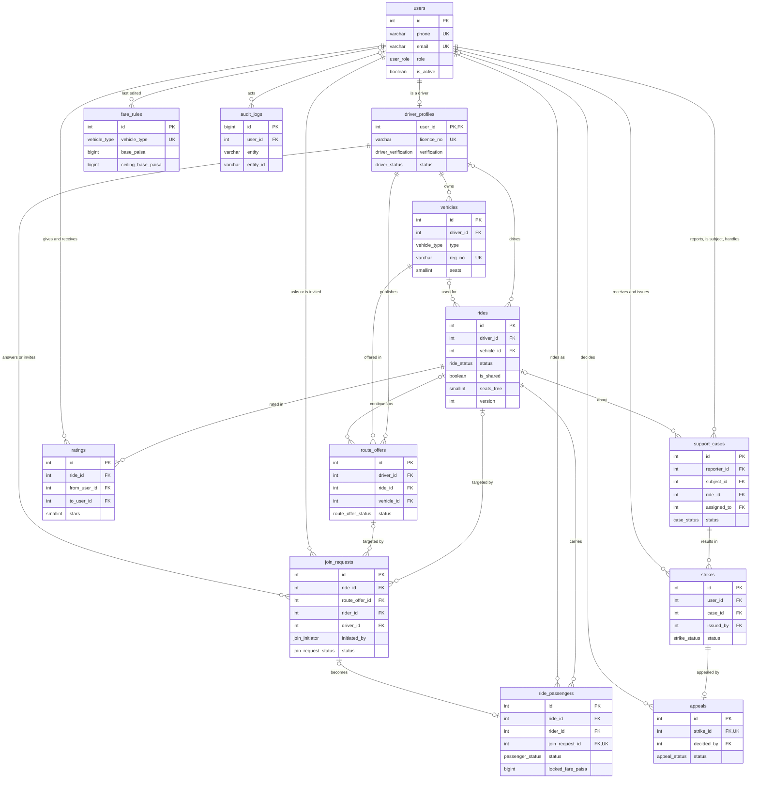

# Bhorsha Database v2.0.0: Architecture, Tables and Connections

PostgreSQL 16 database for the Bhorsha course release (Architecture v3.1, section 26). The schema lives in
`db/init/01_schema.sql` of the `bhorsha-db` kit. The Docker image `siam001/bhorsha-db:2.0.0` runs it on first start,
and the TypeORM baseline migration `SchemaBaseline1794441600000` runs the same file, so `migration:run` on an empty
database builds an identical schema. TypeORM runs with `synchronize: false` and only maps to it.

| What | Count |
| --- | --- |
| Tables | 13 |
| Foreign keys (table connections) | 29 (3 of them composite) |
| CHECK constraints | 63 |
| Indexes | 54 (18 partial) |
| Enum types | 14 |
| Domains | 2 |
| Triggers / trigger functions | 18 / 6 |
| Database guarantees under test | 47 (`db/scripts/constraint-tests.sql`) |

**Contents**

1. [Architecture](#1-architecture)
2. [Conventions](#2-conventions)
3. [Tables at a glance](#3-tables-at-a-glance)
4. [Relationship diagram](#4-relationship-diagram)
5. [Table connections (all 29 foreign keys)](#5-table-connections-all-29-foreign-keys)
6. [Table structures](#6-table-structures)
7. [Enums and state machines](#7-enums-and-state-machines)
8. [Triggers](#8-triggers)
9. [Transactions the API must run](#9-transactions-the-api-must-run)
10. [Error map for the global exception filter](#10-error-map-for-the-global-exception-filter)
11. [Example queries](#11-example-queries)
12. [Changes from the section 26 entity list](#12-changes-from-the-section-26-entity-list)
13. [Verify it yourself](#13-verify-it-yourself)

---

## 1. Architecture

**Pattern: one PostgreSQL database for a modular monolith, with tables owned by modules.** The schema is
relational and in third normal form. The database enforces the business rules that must never break:
declarative constraints first, and small triggers only where a rule spans rows or needs the old value. Contested
rows (a ride being accepted, the last seat) are protected by `SELECT … FOR UPDATE` plus a `version` column.

| Module | Owns (writes) | Notes |
| --- | --- | --- |
| identity | `users` | Accounts for all four roles |
| fleet | `driver_profiles`, `vehicles` | `driver_profiles` extends `users` 1:1 with a shared primary key |
| pricing | `fare_rules` | One rule per vehicle type; the legal ceiling is frozen |
| trips | `rides`, `ride_passengers`, `ratings` | Ride state machine, passengers, stops and fares |
| sharing | `route_offers`, `join_requests` | Going-this-way offers, invites, consent |
| trust | `support_cases`, `strikes`, `appeals` | Enforcement with due process |
| audit | `audit_logs` | Append-only change log |

A module writes only its own tables (section 8). The one exception is the seat transaction: `sharing` updates
`join_requests` while `trips` writes `rides` and `ride_passengers` through its exported service, in the same
transaction manager.

Why this design, and not the alternatives:

| Alternative | Why not |
| --- | --- |
| A database per service (microservices) | The seat transaction and, later, money must be one ACID transaction (ADR-002). Four people can't run that many services. |
| A document store (MongoDB) | Seat counts, one live seat per rider, and vehicle ownership are cross-row invariants that need relational constraints and transactions. |
| One wide `rides` table with rider columns (the v1 design) | It cannot store shared rides. `ride_passengers` is an association entity because each passenger has their own seats, stops, PIN, fare and state. |
| Storing averages and expiry statuses | Ratings, strike activity and offer/request expiry are computed on read: no background jobs and nothing to drift. |
| JSON for flexible fields | JSONB only for immutable whole values: `pricing_snapshot` and the audit log's old and new values. |

Two ideas shape the sharing tables:
- **Proposal vs contract.** A `join_requests` row is a proposal (consent from both sides, a quoted fare). A
  `ride_passengers` row is the contract (a held seat and a locked fare). The proposal becomes a contract only
  through the seat transaction.
- **Last line of defence.** Every concurrency rule is a database guarantee, so a bug in application code
  produces a 409, never an oversold seat or a double assignment.

Redis (live location, offers) and PostGIS (zones, breadcrumbs) join later, as section 17 describes. The ledger,
handover legs, stops, outbox and idempotency keys arrive as additive migrations when those features are built.

---

## 2. Conventions

| Topic | Rule |
| --- | --- |
| Primary keys | `integer GENERATED ALWAYS AS IDENTITY` (`audit_logs.id` is `bigint`). Never insert an explicit id: it fails with 428C9. |
| Profile table | `driver_profiles.user_id` is both primary key and foreign key to `users.id` (shared key). |
| Naming | Plural `snake_case` tables and columns; `camelCase` in TypeScript through the in-house `SnakeNamingStrategy`. |
| Money | `bigint` **paisa** (`*_paisa`), 1 Tk = 100 paisa. A `number` in TypeScript (`parseInt8`). No floats of Taka. |
| Distance, percent | Integer metres (`*_m`); basis points (`*_bps`, 2500 = 25 %). |
| Time | `timestamptz`, stored in UTC; displayed in Asia/Dhaka by the client. |
| Coordinates | Domains `geo_lat` and `geo_lng` = `numeric(9,6)` with range checks (`ck_geo_lat_range`, `ck_geo_lng_range`). |
| Constraint names | `pk_`, `fk_`, `uq_`, `ck_`, `ix_`, `trg_` + table + meaning. Stable, so the exception filter can map them (section 10). |
| Deletes | Every foreign key is `ON DELETE RESTRICT`. Users are deactivated (`is_active = false`), never deleted. |
| Soft delete | `vehicles.deleted_at`. Business "deletes" are states: cases `WITHDRAWN`, strikes `REVOKED`, offers `WITHDRAWN`. |
| `updated_at` | Kept by the `set_updated_at()` trigger on every mutable table (raw SQL included). |
| Comments | Every table and key column has a `COMMENT`, visible in pgAdmin and `\d+`. |

---

## 3. Tables at a glance

| # | Table | Module | Entity class | Stores |
| --- | --- | --- | --- | --- |
| 1 | `users` | identity | `User` | Every account: rider, driver, admin, support officer |
| 2 | `driver_profiles` | fleet | `DriverProfile` | Licence, verification, online status, last position |
| 3 | `vehicles` | fleet | `Vehicle` | A driver's vehicles, with passenger seats |
| 4 | `fare_rules` | pricing | `FareRule` | Tariff and legal ceiling per vehicle type |
| 5 | `rides` | trips | `Ride` | One vehicle trip: status, driver, vehicle, seats, version |
| 6 | `ride_passengers` | trips | `RidePassenger` | A rider on a ride: seats, stops, PIN, locked fare, state |
| 7 | `ratings` | trips | `Rating` | Stars from one user to another for a ride |
| 8 | `route_offers` | sharing | `RouteOffer` | A driver's "going this way" route with free seats |
| 9 | `join_requests` | sharing | `JoinRequest` | A rider's request to join, or a driver's invite |
| 10 | `support_cases` | trust | `SupportCase` | Complaints (overcharge, safety, co-rider) and decisions |
| 11 | `strikes` | trust | `Strike` | A penalty for a rider or driver, from an upheld case |
| 12 | `appeals` | trust | `Appeal` | An appeal against a strike, decided by another officer |
| 13 | `audit_logs` | audit | `AuditLog` | Who changed what, with old and new values |

`typeorm_migrations` is TypeORM's bookkeeping table, not part of the model.

---

## 4. Relationship diagram

Line ends: `||` exactly one, `|o` zero or one, `o{` zero or many.



Many-to-many: **riders and rides through `ride_passengers`**.

---

## 5. Table connections (all 29 foreign keys)

**Required** = the FK column is `NOT NULL`. **Cardinality** reads parent : child.

| # | Constraint | Child column(s) | Parent | Cardinality | Required | Meaning |
| --- | --- | --- | --- | --- | --- | --- |
| 1 | `fk_driver_profiles_user` | `driver_profiles.user_id` | `users.id` | 1 : 0..1 | Yes | The driver's account (shared primary key) |
| 2 | `fk_driver_profiles_reviewed_by` | `driver_profiles.reviewed_by` | `users.id` | 1 : N | No | Admin who verified or rejected |
| 3 | `fk_vehicles_driver` | `vehicles.driver_id` | `driver_profiles.user_id` | 1 : N | Yes | Vehicle owner |
| 4 | `fk_fare_rules_updated_by` | `fare_rules.updated_by` | `users.id` | 1 : N | No | Admin who last edited the tariff |
| 5 | `fk_rides_driver` | `rides.driver_id` | `driver_profiles.user_id` | 1 : N | No | Current driver (NULL until accepted) |
| 6 | `fk_rides_vehicle` | `rides.(vehicle_id, driver_id, vehicle_type)` | `vehicles.(id, driver_id, type)` | 1 : N | No | **Composite:** the vehicle exists, is this driver's, and has the requested type |
| 7 | `fk_route_offers_driver` | `route_offers.driver_id` | `driver_profiles.user_id` | 1 : N | Yes | Driver who published the offer |
| 8 | `fk_route_offers_ride` | `route_offers.ride_id` | `rides.id` | 1 : N | No | NULL = heading home, no ride yet |
| 9 | `fk_route_offers_vehicle` | `route_offers.(vehicle_id, driver_id, vehicle_type)` | `vehicles.(id, driver_id, type)` | 1 : N | Yes | **Composite:** the driver's own vehicle of that type |
| 10 | `fk_join_requests_ride` | `join_requests.ride_id` | `rides.id` | 1 : N | No | Target ride (or the offer, never both) |
| 11 | `fk_join_requests_route_offer` | `join_requests.route_offer_id` | `route_offers.id` | 1 : N | No | Target offer (or the ride, never both) |
| 12 | `fk_join_requests_rider` | `join_requests.rider_id` | `users.id` | 1 : N | Yes | Rider who asks or is invited |
| 13 | `fk_join_requests_driver` | `join_requests.driver_id` | `driver_profiles.user_id` | 1 : N | Yes | Driver on the other side |
| 14 | `fk_ride_passengers_ride` | `ride_passengers.ride_id` | `rides.id` | 1 : N | Yes | The ride |
| 15 | `fk_ride_passengers_rider` | `ride_passengers.rider_id` | `users.id` | 1 : N | Yes | The rider |
| 16 | `fk_ride_passengers_join_request` | `ride_passengers.join_request_id` | `join_requests.id` | 1 : 0..1 | No | The request that created this seat (unique) |
| 17 | `fk_ratings_ride` | `ratings.ride_id` | `rides.id` | 1 : N | Yes | Ride being rated |
| 18 | `fk_ratings_from_user` | `ratings.from_user_id` | `users.id` | 1 : N | Yes | Who rated |
| 19 | `fk_ratings_to_user` | `ratings.to_user_id` | `users.id` | 1 : N | Yes | Who was rated |
| 20 | `fk_support_cases_reporter` | `support_cases.reporter_id` | `users.id` | 1 : N | Yes | Who reported |
| 21 | `fk_support_cases_subject` | `support_cases.subject_id` | `users.id` | 1 : N | No | Who is reported |
| 22 | `fk_support_cases_ride` | `support_cases.ride_id` | `rides.id` | 1 : N | No | Ride the case is about |
| 23 | `fk_support_cases_assigned_to` | `support_cases.assigned_to` | `users.id` | 1 : N | No | Officer handling the case |
| 24 | `fk_strikes_user` | `strikes.user_id` | `users.id` | 1 : N | Yes | Struck rider or driver |
| 25 | `fk_strikes_case_subject` | `strikes.(case_id, user_id)` | `support_cases.(id, subject_id)` | 1 : N | Yes | **Composite:** a strike comes from a case and names that case's subject |
| 26 | `fk_strikes_issued_by` | `strikes.issued_by` | `users.id` | 1 : N | Yes | Officer who issued it |
| 27 | `fk_appeals_strike` | `appeals.strike_id` | `strikes.id` | 1 : 0..1 | Yes | The strike appealed (unique: one appeal per strike) |
| 28 | `fk_appeals_decided_by` | `appeals.decided_by` | `users.id` | 1 : N | No | Officer who decided (never the issuer) |
| 29 | `fk_audit_logs_user` | `audit_logs.user_id` | `users.id` | 1 : N | No | Who acted; NULL = system |

Connections without a foreign key:

| Link | How it is matched | Why |
| --- | --- | --- |
| `rides` ↔ `fare_rules` | `vehicle_type` | The fare is copied into each passenger's `locked_fare_paisa` and `pricing_snapshot` at booking |
| `audit_logs` → any table | `entity` (table name) + `entity_id` | One log for every table |
| `join_requests` → ride through an offer | `route_offers.ride_id` | Exactly one target is stored (`ck_join_requests_one_target`) |

---

## 6. Table structures

Columns show type, whether NULL is allowed, the default, and notes. "Rules" are CHECK and UNIQUE constraints.
Every mutable table also has `created_at timestamptz NOT NULL DEFAULT now()` and `updated_at` (trigger).

### identity

#### `users`
| Column | Type | Null | Default | Notes |
| --- | --- | --- | --- | --- |
| `id` | `integer` identity | No | auto | **PK** |
| `full_name` | `varchar(100)` | No | | Not blank |
| `phone` | `varchar(16)` | No | | **Unique.** `+8801[3-9]XXXXXXXX` (login id) |
| `email` | `varchar(254)` | Yes | | **Unique.** Lower-case |
| `password_hash` | `varchar(255)` | No | | bcrypt. Never selected by default, never returned or logged |
| `role` | `user_role` | No | | `RIDER`, `DRIVER`, `ADMIN`, `SUPPORT` |
| `is_active` | `boolean` | No | `true` | `false` = deactivated (DELETE /users/:id) |
| `suspended_until` | `timestamptz` | Yes | | Suspended while `now() < suspended_until` (section 16) |

Rules: `uq_users_phone`, `uq_users_email`, `ck_users_full_name`, `ck_users_phone_format`, `ck_users_email_format`.
Index: `ix_users_role (role, id DESC)`.

### fleet

#### `driver_profiles`
| Column | Type | Null | Default | Notes |
| --- | --- | --- | --- | --- |
| `user_id` | `integer` | No | | **PK, FK** → `users.id` |
| `licence_no` | `varchar(30)` | No | | **Unique** |
| `verification` | `driver_verification` | No | `'PENDING'` | `PENDING`, `VERIFIED`, `REJECTED` |
| `reviewed_by` | `integer` | Yes | | **FK** → `users.id`. Required once not `PENDING` |
| `reviewed_at` | `timestamptz` | Yes | | Required once not `PENDING` |
| `rejection_reason` | `text` | Yes | | Required when `REJECTED` |
| `status` | `driver_status` | No | `'OFFLINE'` | `ONLINE` only while `VERIFIED` |
| `last_lat`, `last_lng` | `geo_lat`, `geo_lng` | Yes | | Last posted position |
| `last_location_at` | `timestamptz` | Yes | | Set together with the position |

Rules: `uq_driver_profiles_licence_no`, `ck_driver_profiles_online_verified`, `ck_driver_profiles_review`,
`ck_driver_profiles_rejection_reason`, `ck_driver_profiles_location` (all three location columns set or all NULL).
Index: `ix_driver_profiles_pending (created_at) WHERE verification = 'PENDING'` (admin queue).

#### `vehicles`
| Column | Type | Null | Default | Notes |
| --- | --- | --- | --- | --- |
| `id` | `integer` identity | No | auto | **PK** |
| `driver_id` | `integer` | No | | **FK** → `driver_profiles.user_id`. Never changes |
| `type` | `vehicle_type` | No | | `BIKE`, `CAR`, `CNG`. Never editable |
| `reg_no` | `varchar(30)` | No | | Unique among non-deleted vehicles, case-insensitive |
| `seats` | `smallint` | No | | Passenger seats: bike 1, CNG 2, car 3 |
| `model`, `color` | `varchar` | Yes | | |
| `deleted_at` | `timestamptz` | Yes | | Soft delete |

Rules: `uq_vehicles_id_driver_type (id, driver_id, type)` (target of the composite FKs), `ck_vehicles_seats`
(1..3, a bike has exactly 1), `ck_vehicles_reg_no`.
Indexes: `uq_vehicles_reg_no_active (upper(reg_no)) WHERE deleted_at IS NULL`,
`ix_vehicles_driver_active (driver_id) WHERE deleted_at IS NULL`.

### pricing

#### `fare_rules`
| Column | Type | Null | Default | Notes |
| --- | --- | --- | --- | --- |
| `id` | `integer` identity | No | auto | **PK** |
| `vehicle_type` | `vehicle_type` | No | | **Unique**: one rule per type. Frozen |
| `base_paisa` | `bigint` | No | | Admin-editable; `<= ceiling_base_paisa` |
| `per_km_paisa` | `bigint` | No | | Admin-editable; `<= ceiling_per_km_paisa` |
| `base_distance_m` | `integer` | No | `2000` | The legal "first 2 km". **Frozen** |
| `ceiling_base_paisa` | `bigint` | No | | Legal ceiling. **Frozen** |
| `ceiling_per_km_paisa` | `bigint` | No | | Legal ceiling. **Frozen** |
| `share_discount_bps` | `integer` | No | `2500` | 1..9999, so a shared fare is always cheaper |
| `updated_by` | `integer` | Yes | | **FK** → `users.id` |

Rules: `uq_fare_rules_vehicle_type`, `ck_fare_rules_amounts`, `ck_fare_rules_base_distance`,
`ck_fare_rules_share_discount`, `ck_fare_rules_within_ceiling`. Trigger: `trg_fare_rules_regulation_frozen`.

The fare formula, for a passenger's own distance `d`. Both formulas share `base_distance_m`, so the part-by-part
CHECK proves the tariff never exceeds the ceiling at any distance:
```
solo    = base_paisa         + round(per_km_paisa         * max(d - base_distance_m, 0) / 1000)
ceiling = ceiling_base_paisa + round(ceiling_per_km_paisa * max(d - base_distance_m, 0) / 1000)
shared  = round(solo * (10000 - share_discount_bps) / 10000)
locked  = min(shared or solo, ceiling)
```
Example: a 10 km car trip is 26000 solo, 19500 shared, ceiling 35700 paisa (Tk 260, Tk 195, Tk 357).

### trips

#### `rides`
| Column | Type | Null | Default | Notes |
| --- | --- | --- | --- | --- |
| `id` | `integer` identity | No | auto | **PK** |
| `vehicle_type` | `vehicle_type` | No | | Requested type |
| `is_shared` | `boolean` | No | `false` | Bikes are never shared |
| `seats_total` | `smallint` | No | | 1..3: type capacity, or `seats_offered` when created from an offer |
| `seats_free` | `smallint` | No | | `0..seats_total`. Solo: always 0 |
| `status` | `ride_status` | No | `'REQUESTED'` | See section 7 |
| `driver_id` | `integer` | Yes | | **FK** → `driver_profiles`. NULL while `REQUESTED`/`OFFERING`; required from `ACCEPTED` on |
| `vehicle_id` | `integer` | Yes | | Composite **FK** with `driver_id`, `vehicle_type` |
| `version` | `integer` | No | `1` | Bumped by trigger on every UPDATE |
| `cancel_reason` | `ride_cancel_reason` | Yes | | Set exactly when `CANCELLED` |
| `accepted_at`, `started_at`, `completed_at`, `cancelled_at` | `timestamptz` | Yes | | Required by the matching status |

Rules: `ck_rides_seats_total`, `ck_rides_seats_free`, `ck_rides_solo_no_free_seats`, `ck_rides_bike_solo`,
`ck_rides_version`, `ck_rides_driver_vehicle_pair`, `ck_rides_driver_by_status`, `ck_rides_accepted_at`,
`ck_rides_started_at`, `ck_rides_completed`, `ck_rides_cancelled`, `ck_rides_cancel_reason`.

Indexes:
- `uq_rides_one_active_per_driver (driver_id) WHERE status IN (ACCEPTED, ARRIVED, IN_PROGRESS, AWAITING_HANDOVER)`:
  a driver never holds two active rides.
- `ix_rides_open (vehicle_type, created_at) WHERE status = 'REQUESTED'`: `GET /rides/open`.
- `ix_rides_driver (driver_id, id DESC)`: `GET /rides/my` for drivers.
- `ix_rides_status_created`, `ix_rides_created`: `GET /rides` filters.
- `ix_rides_vehicle`: the vehicle delete check.

Triggers: `trg_rides_status_transition`, `trg_rides_update_guards`, `trg_rides_updated_at`.

#### `ride_passengers` (users M:N rides)
| Column | Type | Null | Default | Notes |
| --- | --- | --- | --- | --- |
| `id` | `integer` identity | No | auto | **PK** |
| `ride_id` | `integer` | No | | **FK** → `rides.id` |
| `rider_id` | `integer` | No | | **FK** → `users.id` |
| `join_request_id` | `integer` | Yes | | **FK** → `join_requests.id`, unique. NULL for the rider who booked |
| `seats` | `smallint` | No | `1` | Shared: 1 or 2. Solo: the party size |
| `status` | `passenger_status` | No | `'CONFIRMED'` | See section 7 |
| `pickup_lat`, `pickup_lng`, `drop_lat`, `drop_lng` | `geo_lat`/`geo_lng` | No | | This passenger's own stops |
| `distance_m` | `integer` | No | | This passenger's own distance |
| `locked_fare_paisa` | `bigint` | No | | Locked at booking or join; never raised. `<= ceiling_paisa` |
| `ceiling_paisa` | `bigint` | No | | Legal ceiling applied to this fare |
| `pricing_snapshot` | `jsonb` | No | | Rule, inputs, discount and ceiling used (dispute evidence) |
| `pickup_pin` | `varchar(4)` | No | | 4 digits; shown only to this rider; never selected by default |
| `arrived_at`, `picked_up_at`, `dropped_at`, `cancelled_at` | `timestamptz` | Yes | | Required by the matching status |

Rules: `uq_ride_passengers_join_request`, `ck_ride_passengers_seats`, `ck_ride_passengers_distance`,
`ck_ride_passengers_fare`, `ck_ride_passengers_fare_within_ceiling`, `ck_ride_passengers_pricing_snapshot`,
`ck_ride_passengers_pickup_pin`, `ck_ride_passengers_picked_up` (arrive before pickup),
`ck_ride_passengers_no_show` (only after arriving), `ck_ride_passengers_dropped`, `ck_ride_passengers_cancelled`.

Indexes:
- `uq_ride_passengers_one_live_seat_per_rider (rider_id) WHERE status IN (CONFIRMED, PICKED_UP)`: a rider never
  holds two seats.
- `ix_ride_passengers_ride`, and `ix_ride_passengers_rider (rider_id, id DESC)` for `GET /rides/my` for riders.

#### `ratings`
| Column | Type | Null | Notes |
| --- | --- | --- | --- |
| `id` | `integer` identity | No | **PK** |
| `ride_id`, `from_user_id`, `to_user_id` | `integer` | No | **FKs** |
| `stars` | `smallint` | No | 1..5 |
| `comment` | `varchar(500)` | Yes | |

Rules: `uq_ratings_ride_from_to` (one per direction per ride), `ck_ratings_stars`, `ck_ratings_not_self`.
Index: `ix_ratings_to_user (to_user_id) INCLUDE (stars)`, so an average is an index-only scan.

### sharing

#### `route_offers`
| Column | Type | Null | Default | Notes |
| --- | --- | --- | --- | --- |
| `id` | `integer` identity | No | auto | **PK** |
| `driver_id` | `integer` | No | | **FK** → `driver_profiles` |
| `ride_id` | `integer` | Yes | | **FK** → `rides`. NULL = heading home with no ride yet |
| `vehicle_id`, `vehicle_type` | | No | | Composite **FK** to the driver's vehicle. Never `BIKE` |
| `from_lat`, `from_lng`, `to_lat`, `to_lng` | `geo_lat`/`geo_lng` | No | | Remaining route |
| `seats_offered` | `smallint` | No | | 1..3. Once a ride exists, `rides.seats_free` is the only seat count |
| `status` | `route_offer_status` | No | `'OPEN'` | `OPEN`, `CLOSED`, `WITHDRAWN` |
| `expires_at` | `timestamptz` | No | | Live while `OPEN` and `expires_at > now()` |

Rules: `ck_route_offers_seats`, `ck_route_offers_not_bike`, `ck_route_offers_expiry`.
Indexes: `ix_route_offers_open (vehicle_type, expires_at) WHERE status = 'OPEN'`, `ix_route_offers_driver`,
`ix_route_offers_ride`.

#### `join_requests`
| Column | Type | Null | Default | Notes |
| --- | --- | --- | --- | --- |
| `id` | `integer` identity | No | auto | **PK** |
| `ride_id` | `integer` | Yes | | **FK** → `rides`. Exactly one of `ride_id` / `route_offer_id` |
| `route_offer_id` | `integer` | Yes | | **FK** → `route_offers` |
| `rider_id` | `integer` | No | | **FK** → `users` |
| `driver_id` | `integer` | No | | **FK** → `driver_profiles`: the other side, copied from the ride or offer |
| `initiated_by` | `join_initiator` | No | | `RIDER` (asks) or `DRIVER` (invites) |
| `seats` | `smallint` | No | `1` | 1 or 2 |
| pickup/drop, `distance_m` | | No | | The rider's trip |
| `quoted_fare_paisa`, `ceiling_paisa`, `pricing_snapshot` | | No | | The shared fare offered; becomes the locked fare |
| `status` | `join_request_status` | No | `'PENDING'` | See section 7 |
| `expires_at` | `timestamptz` | No | | Rider request 12 s, driver invite 60 s (configurable) |
| `decided_at` | `timestamptz` | Yes | | Required for `ACCEPTED`/`DECLINED` |

Rules: `ck_join_requests_one_target`, `ck_join_requests_seats`, `ck_join_requests_distance`,
`ck_join_requests_quoted_fare`, `ck_join_requests_fare_within_ceiling`, `ck_join_requests_pricing_snapshot`,
`ck_join_requests_rider_not_driver`, `ck_join_requests_expiry`, `ck_join_requests_decided`.

Indexes:
- `ix_join_requests_rider (rider_id, id DESC)` and `ix_join_requests_driver (driver_id, id DESC)`:
  `GET /join-requests/my`.
- `ix_join_requests_ride`, `ix_join_requests_route_offer`.
- `ix_join_requests_pending_expiry (expires_at) WHERE status = 'PENDING'`.

### trust

#### `support_cases` ("cases" in the API)
| Column | Type | Null | Default | Notes |
| --- | --- | --- | --- | --- |
| `id` | `integer` identity | No | auto | **PK** |
| `type` | `case_type` | No | | `OVERCHARGE`, `SAFETY`, `CONDUCT`, `OTHER` |
| `status` | `case_status` | No | `'OPEN'` | `OPEN`, `UNDER_REVIEW`, `UPHELD`, `DISMISSED`, `WITHDRAWN` |
| `reporter_id` | `integer` | No | | **FK** → `users` |
| `subject_id` | `integer` | Yes | | **FK** → `users`. The person reported (not the reporter) |
| `ride_id` | `integer` | Yes | | **FK** → `rides` |
| `assigned_to` | `integer` | Yes | | **FK** → `users`: the officer |
| `description` | `text` | No | | 1..4000 characters |
| `amount_claimed_paisa` | `bigint` | Yes | | `OVERCHARGE` only: what the driver demanded |
| `resolution`, `resolved_at` | | Yes | | Required with an officer for `UPHELD`/`DISMISSED` |

Rules: `uq_support_cases_id_subject` (target of the strike FK), `ck_support_cases_description`,
`ck_support_cases_not_self`, `ck_support_cases_amount_claimed`, `ck_support_cases_decision`,
`ck_support_cases_resolution`.
Indexes: `ix_support_cases_status (status, id DESC)` (queue), `ix_support_cases_reporter`,
`ix_support_cases_subject`, `ix_support_cases_ride`.

#### `strikes`
| Column | Type | Null | Default | Notes |
| --- | --- | --- | --- | --- |
| `id` | `integer` identity | No | auto | **PK** |
| `user_id` | `integer` | No | | **FK** → `users`. Rider or driver; must be the case's subject |
| `case_id` | `integer` | No | | Composite **FK** `(case_id, user_id)` → `support_cases (id, subject_id)` |
| `issued_by` | `integer` | No | | **FK** → `users`. Never the struck user |
| `reason` | `text` | No | | Editable (PATCH /strikes/:id) |
| `status` | `strike_status` | No | `'ACTIVE'` | `ACTIVE`, `OVERTURNED` (appeal accepted), `REVOKED` (soft delete) |
| `issued_at`, `expires_at` | `timestamptz` | No | | 90 days; `expires_at > issued_at` |
| `revoked_at` | `timestamptz` | Yes | | Set exactly when `REVOKED` |

Rules: `ck_strikes_reason`, `ck_strikes_not_self`, `ck_strikes_window`, `ck_strikes_revoked`.
Indexes: `uq_strikes_case_user_live (case_id, user_id) WHERE status <> 'REVOKED'` (a double-clicked POST returns
409), and `ix_strikes_user (user_id, status, expires_at)`.

#### `appeals`
| Column | Type | Null | Default | Notes |
| --- | --- | --- | --- | --- |
| `id` | `integer` identity | No | auto | **PK** |
| `strike_id` | `integer` | No | | **FK** → `strikes`, unique |
| `statement` | `text` | No | | The appellant's statement |
| `status` | `appeal_status` | No | `'PENDING'` | `PENDING`, `ACCEPTED`, `REJECTED` |
| `decided_by` | `integer` | Yes | | **FK** → `users`. Never the issuer or the struck user |
| `decision_reason`, `decided_at` | | Yes | | Required once decided |

Rules: `uq_appeals_strike`, `ck_appeals_statement`, `ck_appeals_decision`, `ck_appeals_pending`.
Trigger: `trg_appeals_separation_of_duties`.
Index: `ix_appeals_pending (created_at) WHERE status = 'PENDING'` (72-hour SLA).

### audit

#### `audit_logs` (append-only)
| Column | Type | Null | Notes |
| --- | --- | --- | --- |
| `id` | `bigint` identity | No | **PK**; cursor pagination |
| `user_id` | `integer` | Yes | **FK** → `users`. NULL = system |
| `action` | `varchar(100)` | No | e.g. `RIDE_ACCEPTED` |
| `entity`, `entity_id` | `varchar` | No / Yes | Table and row id of the change |
| `old_value`, `new_value` | `jsonb` | Yes | Never contain `password`, `passwordHash` or `pickupPin` (CHECK) |
| `ip_address` | `inet` | Yes | |
| `request_id` | `varchar(64)` | Yes | From the request-ID middleware (NFR-09) |
| `created_at` | `timestamptz` | No | |

Rules: `ck_audit_logs_no_secrets`. Trigger: `trg_audit_logs_append_only` (UPDATE and DELETE fail with 42501).
Indexes: `ix_audit_logs_entity (entity, entity_id, id DESC)`, `ix_audit_logs_user (user_id, id DESC)`,
`ix_audit_logs_created`.

---

## 7. Enums and state machines

| Enum | Values | Used in |
| --- | --- | --- |
| `user_role` | `RIDER`, `DRIVER`, `ADMIN`, `SUPPORT` | `users.role` |
| `driver_verification` | `PENDING`, `VERIFIED`, `REJECTED` | `driver_profiles.verification` |
| `driver_status` | `OFFLINE`, `ONLINE` | `driver_profiles.status` |
| `vehicle_type` | `BIKE`, `CAR`, `CNG` | `vehicles.type`, `rides`, `route_offers`, `fare_rules` |
| `ride_status` | `REQUESTED`, `OFFERING`, `ACCEPTED`, `ARRIVED`, `IN_PROGRESS`, `AWAITING_HANDOVER`, `COMPLETED`, `CANCELLED` | `rides.status` |
| `ride_cancel_reason` | `RIDER_CANCELLED`, `DRIVER_CANCELLED`, `NO_DRIVER_FOUND`, `HANDOVER_FAILED`, `JOINED_ANOTHER_RIDE` | `rides.cancel_reason` |
| `passenger_status` | `CONFIRMED`, `PICKED_UP`, `DROPPED`, `CANCELLED`, `NO_SHOW` | `ride_passengers.status` |
| `route_offer_status` | `OPEN`, `CLOSED`, `WITHDRAWN` | `route_offers.status` |
| `join_initiator` | `RIDER`, `DRIVER` | `join_requests.initiated_by` |
| `join_request_status` | `PENDING`, `ACCEPTED`, `DECLINED`, `EXPIRED` | `join_requests.status` |
| `case_type` | `OVERCHARGE`, `SAFETY`, `CONDUCT`, `OTHER` | `support_cases.type` |
| `case_status` | `OPEN`, `UNDER_REVIEW`, `UPHELD`, `DISMISSED`, `WITHDRAWN` | `support_cases.status` |
| `strike_status` | `ACTIVE`, `OVERTURNED`, `REVOKED` | `strikes.status` |
| `appeal_status` | `PENDING`, `ACCEPTED`, `REJECTED` | `appeals.status` |

`OFFERING` and `AWAITING_HANDOVER` belong to the full product (dispatch waves, breakdown handover); course code
does not use them yet.

**Allowed transitions** (anything else raises 23514 → 409). These three are enforced by triggers; the
`build-verify` gate checks that every listed edge names real enum labels.

```
rides            REQUESTED   -> OFFERING | ACCEPTED | CANCELLED
                 OFFERING    -> ACCEPTED | CANCELLED
                 ACCEPTED    -> ARRIVED | CANCELLED
                 ARRIVED     -> IN_PROGRESS | CANCELLED
                 IN_PROGRESS -> COMPLETED | AWAITING_HANDOVER | CANCELLED
                 AWAITING_HANDOVER -> IN_PROGRESS | CANCELLED        (no driver within 10 min: HANDOVER_FAILED)

ride_passengers  CONFIRMED -> PICKED_UP | CANCELLED | NO_SHOW
                 PICKED_UP -> DROPPED

join_requests    PENDING -> ACCEPTED | DECLINED | EXPIRED
```

Other tables move by conditional updates in the API (`WHERE status = :expected`):
- Cases: `OPEN -> UNDER_REVIEW | UPHELD | DISMISSED | WITHDRAWN`, and `UNDER_REVIEW -> UPHELD | DISMISSED | WITHDRAWN`.
- Strikes: `ACTIVE -> OVERTURNED | REVOKED`.
- Appeals: `PENDING -> ACCEPTED | REJECTED`.
- Route offers: `OPEN -> CLOSED | WITHDRAWN`.

On a shared ride, the ride-level `ARRIVED` marks the first pickup only; each passenger's arrival is
`ride_passengers.arrived_at`. The ride stays `IN_PROGRESS` until the last drop-off.

---

## 8. Triggers

| Trigger | Table | Fires | What it guarantees |
| --- | --- | --- | --- |
| `trg_<table>_updated_at` (11) | mutable tables | BEFORE UPDATE | `updated_at` is always current |
| `trg_rides_status_transition` | `rides` | BEFORE UPDATE OF status, when it changes | Only diagram edges |
| `trg_ride_passengers_status_transition` | `ride_passengers` | same | Only passenger edges |
| `trg_join_requests_status_transition` | `join_requests` | same | An answered request can't be answered again |
| `trg_rides_update_guards` | `rides` | BEFORE UPDATE | 1) bumps `version`. 2) An assigned driver is never replaced except from `AWAITING_HANDOVER` (`ck_rides_driver_locked`). 3) A ride can't finish with a passenger still waiting or aboard (`ck_rides_close_with_live_passengers`) |
| `trg_fare_rules_regulation_frozen` | `fare_rules` | BEFORE UPDATE of ceiling columns | The legal ceiling changes only by migration |
| `trg_appeals_separation_of_duties` | `appeals` | BEFORE INSERT/UPDATE of decided_by | The issuer (or the struck user) can't decide the appeal |
| `trg_audit_logs_append_only` | `audit_logs` | BEFORE UPDATE/DELETE | Append-only (42501) |

Every trigger error carries a stable constraint name (`RAISE ... USING CONSTRAINT`), which TypeORM exposes as
`QueryFailedError.driverError.constraint`.

---

## 9. Transactions the API must run

Use READ COMMITTED (the default) with one QueryRunner per operation, and take locks in this order everywhere:

> **route_offers → rides (by id) → ride_passengers → join_requests → vehicles**

A fixed order prevents deadlocks. If one still happens (40P01), or a lock can't be taken (55P03), return 409 and
let the client retry.

### Seat transaction: accept a join request or an invite (Rider and Driver modules)
1. If the request targets a route offer, lock it: `SELECT ... FROM route_offers WHERE id = $1 FOR UPDATE`.
   If `ride_id` is NULL (heading home), INSERT the ride as `ACCEPTED`, `is_shared`,
   `seats_total = seats_free = seats_offered`, and set `route_offers.ride_id`.
2. Lock the target ride, plus the rider's own `REQUESTED` ride if they are waiting on one:
   `SELECT ... FROM rides WHERE id = ANY($ids) ORDER BY id FOR UPDATE`.
3. Check that the target is shared, `ACCEPTED`/`ARRIVED`/`IN_PROGRESS`, and has `seats_free >= seats`. If not,
   return 409 "Seat no longer available".
4. If the rider was waiting, cancel **their seat first, then their ride** (`JOINED_ANOTHER_RIDE`,
   `WHERE status = 'REQUESTED'`). This must come before step 5: "one live seat per rider" is a partial unique
   index, and those can't be deferred.
5. INSERT the `ride_passengers` row from the request: stops, distance, `quoted_fare_paisa` as
   `locked_fare_paisa`, ceiling, snapshot, a new PIN, and `join_request_id`.
6. `UPDATE rides SET seats_free = seats_free - $seats WHERE id = $ride`. `ck_rides_seats_free` backstops it.
7. `UPDATE join_requests SET status = 'ACCEPTED', decided_at = now() WHERE id = $1 AND status = 'PENDING' AND expires_at > now()`.
   0 rows means it was already answered or expired: 409.
8. COMMIT. Send emails and notifications only after the commit.

When two requests race for the last seat, exactly one commits. The other gets 409 at step 3, or the CHECK
refuses it at step 6.

### Accept a ride request (Driver module)
1. `SELECT ... FROM rides WHERE id = $1 FOR UPDATE`, then check `status = 'REQUESTED'` and `version`.
2. `SELECT ... FROM vehicles WHERE id = $v AND driver_id = $me AND deleted_at IS NULL FOR SHARE`.
3. Run the conditional UPDATE (example below). 0 rows, or 23505 on `uq_rides_one_active_per_driver`, means 409.

```ts
const result = await qr.manager.createQueryBuilder().update(Ride)
  .set({ status: RideStatus.ACCEPTED, driverId, vehicleId, acceptedAt: () => 'now()' })
  .where('id = :id AND status = :expected AND version = :version', { id, expected: RideStatus.REQUESTED, version })
  .execute();
if (result.affected === 0) throw new ConflictException('Ride is no longer available');
```
`save()` never adds the version check: use QueryBuilder for every transition.

### Pickup, drop-off, cancel, finish
- **Arrive:** set the next passenger's `arrived_at`. The ride moves `ACCEPTED -> ARRIVED` only once.
- **Pickup:** `UPDATE ... SET status = 'PICKED_UP', picked_up_at = now() WHERE id = $p AND status = 'CONFIRMED' AND pickup_pin = $pin`.
  0 rows means a wrong PIN or the wrong state. The first pickup also moves the ride `ARRIVED -> IN_PROGRESS`.
- **Every seat change on a shared ride** updates `rides.seats_free` in the same transaction: a drop-off, a
  rider's cancel before pickup, and a `NO_SHOW` (5 minutes after `arrived_at`) all do
  `seats_free = seats_free + seats`.
- **Finish:** close every passenger first (drop off, cancel or no-show), then complete or cancel the ride.
  `ck_rides_close_with_live_passengers` refuses the reverse order.
- **Driver rejected while online:** set `status = 'OFFLINE'` in the same UPDATE as `verification = 'REJECTED'`.

### Register a driver (Admin module)
INSERT `users`, then `driver_profiles`, in one transaction. 23505 on `uq_users_phone` or
`uq_driver_profiles_licence_no` rolls back both: 409.

### Remove a vehicle (Driver module)
1. `SELECT ... FROM vehicles WHERE id = $1 AND driver_id = $me FOR UPDATE`.
2. Check for a live ride on it in a separate statement. If there is one, return 409.
3. `UPDATE vehicles SET deleted_at = now()`.

### Configuration, not data
Request lifetimes (12 s for rider requests, 60 s for invites) and the open-request window (10 minutes) come from
env, so Swagger demos can use longer values. When a rider books again, the booking flow cancels their stale
`REQUESTED` ride (`NO_DRIVER_FOUND`).

---

## 10. Error map for the global exception filter

The document maps PostgreSQL 23505, 23503 and 23514 to 409. Map the constraint name
(`err.driverError.constraint`) to a friendly message:

| Constraint | SQLSTATE | HTTP | Message |
| --- | --- | --- | --- |
| `uq_users_phone` | 23505 | 409 | Phone number already registered |
| `uq_users_email` | 23505 | 409 | Email already registered |
| `uq_driver_profiles_licence_no` | 23505 | 409 | Licence number already registered |
| `uq_vehicles_reg_no_active` | 23505 | 409 | Registration number already in use |
| `uq_rides_one_active_per_driver` | 23505 | 409 | You already have an active ride |
| `uq_ride_passengers_one_live_seat_per_rider` | 23505 | 409 | You already have an active ride |
| `uq_ratings_ride_from_to` | 23505 | 409 | You already rated this person for this ride |
| `uq_strikes_case_user_live` | 23505 | 409 | A strike for this case already exists |
| `uq_appeals_strike` | 23505 | 409 | This strike has already been appealed |
| `ck_rides_seats_free` | 23514 | 409 | Seat no longer available |
| `ck_rides_driver_locked` | 23514 | 409 | Ride already accepted by another driver |
| `ck_rides_close_with_live_passengers` | 23514 | 409 | Drop off or cancel every passenger first |
| `trg_rides_status_transition` | 23514 | 409 | The ride is not in a state that allows this |
| `trg_ride_passengers_status_transition` | 23514 | 409 | The passenger is not in a state that allows this |
| `trg_join_requests_status_transition` | 23514 | 409 | This request was already answered |
| `ck_ride_passengers_picked_up`, `ck_ride_passengers_no_show` | 23514 | 409 | Arrive at the pickup first |
| `ck_fare_rules_within_ceiling` | 23514 | 409 | Fare is above the legal ceiling |
| `ck_fare_rules_regulation_frozen` | 23514 | 409 | The legal ceiling can only change by migration |
| `ck_driver_profiles_online_verified` | 23514 | 409 | Only verified drivers can go online |
| `fk_rides_vehicle`, `fk_route_offers_vehicle` | 23503 | 409 | Use your own vehicle of the requested type |
| `fk_strikes_case_subject` | 23503 | 409 | A strike must name the case's subject |
| `ck_appeals_separation_of_duties` | 23514 | **403** | You issued this strike and cannot decide its appeal |
| any other 23505 / 23503 / 23514 | | 409 | Request conflicts with the current data |
| 40P01, 40001, 55P03 | | 409 | Busy, please retry |
| 42501, 428C9 | | 500 | Generic message: these mean a bug (append-only write, explicit id) |

DTO validation (400) should catch format errors (phone, email, coordinates, seats) before the database does.

---

## 11. Example queries

Open requests within 3 km of a driver (`GET /rides/open`, course pull model): a bounding box first, then the
exact haversine distance. `:max_age` is the open-request window from config.
```sql
SELECT r.id AS ride_id, r.vehicle_type, r.is_shared, r.seats_free, p.locked_fare_paisa, round(d.km::numeric, 2) AS km
  FROM rides r
  JOIN ride_passengers p ON p.ride_id = r.id AND p.status = 'CONFIRMED' AND p.join_request_id IS NULL
 CROSS JOIN LATERAL (
   SELECT 6371 * 2 * asin(sqrt(power(sin(radians(p.pickup_lat - :lat) / 2), 2)
        + cos(radians(:lat)) * cos(radians(p.pickup_lat)) * power(sin(radians(p.pickup_lng - :lng) / 2), 2))) AS km
 ) d
 WHERE r.status = 'REQUESTED'
   AND r.vehicle_type = ANY (:driver_vehicle_types::vehicle_type[])
   AND r.created_at > now() - :max_age::interval
   AND p.pickup_lat BETWEEN :lat - 0.027 AND :lat + 0.027      -- about 3 km
   AND p.pickup_lng BETWEEN :lng - 0.030 AND :lng + 0.030      -- about 3 km at Dhaka's latitude
   AND d.km <= 3
 ORDER BY d.km
 LIMIT 20;
```
With the seed, Karim (23.8135, 90.4245) sees ride 5 at 0.60 km.

A rider's own rides, newest first (cursor pagination on `ride_passengers.id`):
```sql
SELECT r.id, r.status, r.vehicle_type, r.is_shared, p.status AS my_status, p.locked_fare_paisa, p.id AS cursor
  FROM ride_passengers p
  JOIN rides r ON r.id = p.ride_id
 WHERE p.rider_id = :me AND (:cursor::int IS NULL OR p.id < :cursor)
 ORDER BY p.id DESC
 LIMIT 20;
```

Rating and strikes that count toward suspension (section 16: ACTIVE, unexpired, not under a pending appeal):
```sql
SELECT u.id, u.full_name,
       (SELECT round(avg(stars), 2) FROM ratings WHERE to_user_id = u.id) AS rating,
       (SELECT count(*) FROM strikes s
         WHERE s.user_id = u.id AND s.status = 'ACTIVE' AND s.expires_at > now()
           AND NOT EXISTS (SELECT 1 FROM appeals a WHERE a.strike_id = s.id AND a.status = 'PENDING')) AS counting_strikes
  FROM users u
 WHERE u.id = :user_id;
```

Seat bookkeeping check, for the 50-request load test (expect no rows):
```sql
SELECT r.id, r.seats_total, r.seats_free,
       COALESCE(sum(p.seats) FILTER (WHERE p.status IN ('CONFIRMED', 'PICKED_UP')), 0) AS live_seats
  FROM rides r
  LEFT JOIN ride_passengers p ON p.ride_id = r.id
 WHERE r.is_shared AND r.status NOT IN ('COMPLETED', 'CANCELLED')
 GROUP BY r.id
HAVING r.seats_free <> r.seats_total - COALESCE(sum(p.seats) FILTER (WHERE p.status IN ('CONFIRMED', 'PICKED_UP')), 0);
```

Every foreign key, straight from the database (29 rows):
```sql
SELECT conrelid::regclass AS child_table, conname AS constraint_name, pg_get_constraintdef(oid) AS definition
  FROM pg_constraint
 WHERE contype = 'f' AND connamespace = 'public'::regnamespace
 ORDER BY conrelid::regclass::text, conname;
```

---

## 12. Changes from the section 26 entity list

The schema keeps every field the architecture document lists. These additions and changes should go into the
report's ER diagram:

| Table | Added or changed | Why |
| --- | --- | --- |
| users | `suspended_until` | 7-day suspension after 3 active strikes (section 16) |
| driver_profiles | `rating` is **not stored**; added `reviewed_by`, `reviewed_at`, `rejection_reason` | Ratings are computed from `ratings` (no drift); every verification decision is attributable |
| vehicles | `model`, `color`; `reg_no` unique among non-deleted vehicles | Identify the car; a sold vehicle can be registered again |
| fare_rules | `base_distance_m`, `share_discount_bps`, `updated_by`; ceiling columns frozen | The legal "first 2 km", the shared fare (section 12), and a ceiling the admin can't raise |
| rides | `vehicle_type`, `cancel_reason`, `accepted_at`, `started_at`, `completed_at`, `cancelled_at` | Matching drivers by type; the lifecycle the state machine needs |
| ride_passengers | `join_request_id`, `distance_m`, `ceiling_paisa`, `pricing_snapshot`, `arrived_at`, `picked_up_at`, `dropped_at`, `cancelled_at` | Per-passenger fare evidence (section 13); NO_SHOW after arriving; the second pickup on a shared ride |
| route_offers | `vehicle_id`, `vehicle_type`, `status` | The vehicle on offer (never a bike); withdraw = status |
| join_requests | `driver_id`, pickup/drop, `distance_m`, `ceiling_paisa`, `pricing_snapshot`, `decided_at`; exactly one of `ride_id` / `route_offer_id` | The request carries everything the seat needs, and its counterparty |
| cases → `support_cases` | `type`, `assigned_to`, `description`, `amount_claimed_paisa`, `resolution`, `resolved_at` | "case" is a reserved word; a decision needs a written reason |
| strikes | `reason`, `status`, `issued_at`, `revoked_at`; `user_id` must be the case's subject | Revoke = status; due process |
| appeals | `statement`, `decision_reason`, `decided_at` | The appeal text and a written decision |
| audit_logs | `request_id` | Request ID end to end (NFR-09) |

---

## 13. Verify it yourself

```bash
docker compose exec db psql -U bhorsha -d bhorsha -f /scripts/verify.sql            # ... ALL CHECKS PASSED
docker compose exec db psql -U bhorsha -d bhorsha -f /scripts/constraint-tests.sql  # 47 passed, 0 failed
```

`constraint-tests.sql` runs each guarantee in its own rolled-back sub-transaction. It checks the SQLSTATE **and**
the constraint name, so every test proves the rule it names. It covers seats, races, state machines, the Legal
Fare Guard, trust and safety, fleet and identity rules, and the audit log, and runs the main flows end to end:
the seat transaction, the last-seat race, the invite to a waiting rider, the heading-home offer, the driver
flow, a shared-ride completion and a rider cancel. The image build runs both scripts and refuses to build if
anything fails.
