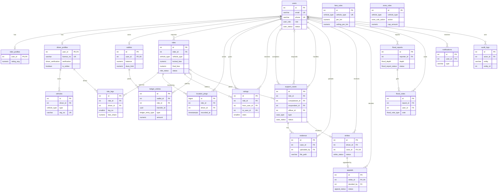

# Bhorsha Database: Schema, Tables and Connections

PostgreSQL 16 database for Bhorsha. The schema comes from `01_schema.sql`, which is baked into the
Docker image `siam001/bhorsha-db` (inside the container: `/docker-entrypoint-initdb.d/01_schema.sql`).
That SQL file is the source of truth. TypeORM runs with `synchronize: false` and only maps to it.

| What | Count |
| --- | --- |
| Tables | 20 |
| Foreign keys (table connections) | 29 |
| Enum types | 16 |
| Domains (shared column types) | 2 |
| Trigger functions | 3 |

**Contents**

1. [Conventions](#1-conventions)
2. [Tables at a glance](#2-tables-at-a-glance)
3. [Relationship diagram](#3-relationship-diagram)
4. [Table connections (all 29 foreign keys)](#4-table-connections-all-29-foreign-keys)
5. [Table structures](#5-table-structures)
6. [Enum types](#6-enum-types)
7. [Triggers and functions](#7-triggers-and-functions)
8. [Example join queries](#8-example-join-queries)

---

## 1. Conventions

| Topic | Rule |
| --- | --- |
| Primary keys | `integer GENERATED BY DEFAULT AS IDENTITY`. `location_pings.id` is `bigint` because it grows fastest. |
| Profile tables | `rider_profiles` and `driver_profiles` use `user_id` as both primary key and foreign key (shared key with `users`). |
| Naming | Plural `snake_case` tables and columns. TypeScript uses `camelCase` (`SnakeNamingStrategy`). |
| Money | `numeric(10,2)` in Taka. Read as a `string` in TypeScript, never as a float. |
| Time | `timestamptz`, stored in UTC. |
| Coordinates | Domains `geo_lat` and `geo_lng` = `numeric(9,6)` with range checks (−90..90, −180..180). |
| Delete rule | No `ON DELETE` is set, so every FK is `NO ACTION`: a parent row cannot be deleted while a child row points at it. Deactivate users with `status` instead of deleting them. |
| Append-only | `ledger_entries` and `audit_logs` reject `UPDATE` and `DELETE`. Fix mistakes with a new reversing row. |

---

## 2. Tables at a glance

| # | Table | Area | Entity class | Stores |
| --- | --- | --- | --- | --- |
| 1 | `users` | Accounts | `User` | Every account: rider, driver, admin, support officer |
| 2 | `rider_profiles` | Accounts | `RiderProfile` | Rider extras: emergency contact, rating |
| 3 | `driver_profiles` | Accounts | `DriverProfile` | Driver extras: licence, verification, online status, live position |
| 4 | `vehicles` | Accounts | `Vehicle` | Vehicles owned by a driver |
| 5 | `rides` | Rides & fares | `Ride` | One trip request from a rider, with the locked fare |
| 6 | `ride_legs` | Rides & fares | `RideLeg` | The driver part of a ride (leg 2 exists only after a breakdown handover) |
| 7 | `location_pings` | Rides & fares | `LocationPing` | GPS points sent by the driver during a ride |
| 8 | `ratings` | Rides & fares | `Rating` | Stars and comment from one user to another for a ride |
| 9 | `fare_rules` | Rides & fares | `FareRule` | Tariff and legal ceiling per vehicle type (config) |
| 10 | `zone_rules` | Rides & fares | `ZoneRule` | Time-boxed areas that block or cap rides (config) |
| 11 | `wallets` | Payments | `Wallet` | One wallet per user, plus one platform system wallet |
| 12 | `ledger_entries` | Payments | `LedgerEntry` | Double-entry money movements between wallets |
| 13 | `support_cases` | Safety | `SupportCase` | Complaints and disputes, and the officer's decision |
| 14 | `evidence` | Safety | `Evidence` | Files attached to a case |
| 15 | `strikes` | Safety | `Strike` | Penalty given to a driver when a case is upheld |
| 16 | `appeals` | Safety | `Appeal` | A driver's appeal against a strike |
| 17 | `flood_reports` | Flood | `FloodReport` | Waterlogging pins reported by users |
| 18 | `flood_votes` | Flood | `FloodVote` | "Still flooded" / "Cleared" votes on a report |
| 19 | `notifications` | System | `Notification` | In-app messages to a user |
| 20 | `audit_logs` | System | `AuditLog` | Who changed what, with before/after JSON |

---

## 3. Relationship diagram

Shows primary keys (PK), foreign keys (FK), unique keys (UK) and a few important columns.
Full column lists are in [section 5](#5-table-structures).

Line ends: `||` exactly one, `|o` zero or one, `o{` zero or many.



`users` is the hub: 17 of the 29 foreign keys point at it.

---

## 4. Table connections (all 29 foreign keys)

**Required** = the FK column is `NOT NULL`. **Cardinality** reads parent : child.

| # | Child column | → Parent column | Cardinality | Required | Meaning |
| --- | --- | --- | --- | --- | --- |
| 1 | `rider_profiles.user_id` | `users.id` | 1 : 0..1 | Yes | The rider's profile (shared primary key) |
| 2 | `driver_profiles.user_id` | `users.id` | 1 : 0..1 | Yes | The driver's profile (shared primary key) |
| 3 | `vehicles.driver_id` | `driver_profiles.user_id` | 1 : N | Yes | Driver who owns the vehicle |
| 4 | `rides.rider_id` | `users.id` | 1 : N | Yes | Rider who requested the ride |
| 5 | `ride_legs.ride_id` | `rides.id` | 1 : 0..2 | Yes | Ride this leg belongs to (`leg_no` 1 or 2) |
| 6 | `ride_legs.driver_id` | `driver_profiles.user_id` | 1 : N | Yes | Driver who drove the leg |
| 7 | `location_pings.ride_id` | `rides.id` | 1 : N | Yes | Ride being tracked |
| 8 | `location_pings.driver_id` | `users.id` | 1 : N | Yes | Driver who sent the ping |
| 9 | `ratings.ride_id` | `rides.id` | 1 : N | Yes | Ride being rated |
| 10 | `ratings.from_user_id` | `users.id` | 1 : N | Yes | Who gave the rating |
| 11 | `ratings.to_user_id` | `users.id` | 1 : N | Yes | Who received the rating |
| 12 | `wallets.user_id` | `users.id` | 1 : 0..1 | No | Wallet owner. `NULL` = the single platform system wallet |
| 13 | `ledger_entries.wallet_id` | `wallets.id` | 1 : N | Yes | Wallet the money moves in or out of |
| 14 | `ledger_entries.ride_id` | `rides.id` | 1 : N | No | Ride the payment is for. `NULL` for top-ups |
| 15 | `support_cases.ride_id` | `rides.id` | 1 : N | No | Ride the case is about. `NULL` for driver-level cases (`BREAKDOWN_ABUSE`) |
| 16 | `support_cases.complainant_id` | `users.id` | 1 : N | No | Who complained. `NULL` = raised by the system |
| 17 | `support_cases.respondent_id` | `users.id` | 1 : N | No | Who the complaint is against |
| 18 | `support_cases.officer_id` | `users.id` | 1 : N | No | Support officer handling the case |
| 19 | `evidence.case_id` | `support_cases.id` | 1 : N | Yes | Case the file belongs to |
| 20 | `evidence.uploaded_by` | `users.id` | 1 : N | Yes | Who uploaded the file |
| 21 | `strikes.driver_id` | `users.id` | 1 : N | Yes | Driver who got the strike |
| 22 | `strikes.case_id` | `support_cases.id` | 1 : 0..1 | Yes | Case that caused it (unique: max one strike per case) |
| 23 | `appeals.strike_id` | `strikes.id` | 1 : 0..1 | Yes | Strike being appealed (unique: max one appeal per strike) |
| 24 | `appeals.decided_by` | `users.id` | 1 : N | No | Officer who decided. `NULL` while pending |
| 25 | `flood_reports.reporter_id` | `users.id` | 1 : N | Yes | Who reported the flood |
| 26 | `flood_votes.report_id` | `flood_reports.id` | 1 : N | Yes | Report being voted on |
| 27 | `flood_votes.user_id` | `users.id` | 1 : N | Yes | Who voted (unique per report: one vote per user) |
| 28 | `notifications.user_id` | `users.id` | 1 : N | Yes | Who the notification is for |
| 29 | `audit_logs.actor_id` | `users.id` | 1 : N | No | Who did the action. `NULL` = scheduled job or system |

Things to know about these connections:

- `vehicles.driver_id` and `ride_legs.driver_id` point at `driver_profiles.user_id`, which is the same number as
  `users.id`. So you can join them straight to `users` to get the driver's name.
- `location_pings.driver_id` and `strikes.driver_id` point at `users`, not `driver_profiles`. The database does
  not check that the user is a driver there; the app must.
- `flood_votes` is the many-to-many link between `users` and `flood_reports`.
- `ratings` links two users through a ride. The unique key `(ride_id, from_user_id, to_user_id)` lets a rider rate
  both drivers of a handover ride, once each.

### Connections without a foreign key

| Link | How it is matched | Why there is no FK |
| --- | --- | --- |
| `rides` ↔ `fare_rules` | `rides.vehicle_type = fare_rules.vehicle_type` (one rule per type) | Config table; the fare is copied into `rides.locked_fare` at booking |
| `rides` ↔ `zone_rules` | `vehicle_type`, pickup inside `center_lat/lng` + `radius_m`, time between `starts_at` and `ends_at` | Geographic and time match, checked by the app and a scheduled job |
| `audit_logs` → any table | `audit_logs.entity` (table name) + `audit_logs.entity_id` (row id) | One log table for every entity |
| `ledger_entries` ↔ `ledger_entries` | Same `transfer_id` (always exactly 2 rows) | Pairs the debit and credit of one transfer; checked by trigger |

---

## 5. Table structures

Column tables show: type, whether `NULL` is allowed, default value, and notes (keys and checks).

### Accounts

#### 1. `users`

Every account. Named plural because `user` is a reserved word.

| Column | Type | Null | Default | Notes |
| --- | --- | --- | --- | --- |
| `id` | `integer` identity | No | auto | **PK** |
| `name` | `varchar(100)` | No | | |
| `email` | `varchar(255)` | Yes | | Unique. Must be lower-case |
| `phone` | `varchar(20)` | Yes | | Unique. Format `+8801[3-9]XXXXXXXX` |
| `password_hash` | `varchar(255)` | No | | |
| `role` | `user_role` | No | | `RIDER`, `DRIVER`, `ADMIN`, `SUPPORT` |
| `status` | `user_status` | No | `'ACTIVE'` | |
| `created_at` | `timestamptz` | No | `now()` | |

- **Constraints:** `uq_users_email`, `uq_users_phone`, `ck_users_contact` (email or phone is required),
  `ck_users_email_lc` (email is lower-case), `ck_users_phone_e164` (Bangladesh mobile format).
- **Referenced by:** 17 foreign keys (see section 4).

#### 2. `rider_profiles`

| Column | Type | Null | Default | Notes |
| --- | --- | --- | --- | --- |
| `user_id` | `integer` | No | | **PK**, **FK** → `users.id` |
| `emergency_name` | `varchar(100)` | Yes | | |
| `emergency_phone` | `varchar(20)` | Yes | | |
| `emergency_email` | `varchar(255)` | Yes | | |
| `rating_avg` | `numeric(3,2)` | Yes | | 1 to 5. `NULL` = not rated yet |

#### 3. `driver_profiles`

| Column | Type | Null | Default | Notes |
| --- | --- | --- | --- | --- |
| `user_id` | `integer` | No | | **PK**, **FK** → `users.id` |
| `licence_no` | `varchar(50)` | No | | Unique |
| `licence_file` | `varchar(255)` | Yes | | File path |
| `verification` | `driver_verification` | No | `'PENDING'` | |
| `is_online` | `boolean` | No | `false` | |
| `current_lat` | `geo_lat` | Yes | | |
| `current_lng` | `geo_lng` | Yes | | |
| `rating_avg` | `numeric(3,2)` | Yes | | 1 to 5 |
| `trusted_reporter` | `boolean` | No | `false` | Flood reports from this driver are trusted |

- **Constraints:** `uq_driver_profiles_licence_no`;
  `ck_driver_online` (can be online only if `VERIFIED` and position is known);
  `ck_driver_position_pair` (lat and lng are both set or both `NULL`).
- **Indexes:** `ix_driver_profiles_dispatch (current_lat, current_lng) WHERE is_online AND verification = 'VERIFIED'`
  for nearest-driver search.
- **Referenced by:** `vehicles.driver_id`, `ride_legs.driver_id`.

#### 4. `vehicles`

| Column | Type | Null | Default | Notes |
| --- | --- | --- | --- | --- |
| `id` | `integer` identity | No | auto | **PK** |
| `driver_id` | `integer` | No | | **FK** → `driver_profiles.user_id` |
| `type` | `vehicle_type` | No | | `BIKE`, `CAR`, `CNG` |
| `reg_no` | `varchar(30)` | No | | Unique registration number |
| `model` | `varchar(60)` | Yes | | |
| `color` | `varchar(30)` | Yes | | |
| `reg_file` | `varchar(255)` | Yes | | File path |
| `verified` | `boolean` | No | `false` | |

- **Constraints:** `uq_vehicles_reg_no`.
- **Indexes:** `ix_vehicles_driver (driver_id)`.

### Rides and fares

#### 5. `rides`

| Column | Type | Null | Default | Notes |
| --- | --- | --- | --- | --- |
| `id` | `integer` identity | No | auto | **PK** |
| `rider_id` | `integer` | No | | **FK** → `users.id` |
| `vehicle_type` | `vehicle_type` | No | | |
| `pickup_lat` | `geo_lat` | No | | |
| `pickup_lng` | `geo_lng` | No | | |
| `drop_lat` | `geo_lat` | No | | |
| `drop_lng` | `geo_lng` | No | | |
| `planned_km` | `numeric(7,2)` | No | | `> 0` |
| `locked_fare` | `numeric(10,2)` | No | | `> 0`. Set at booking by the Legal Fare Guard |
| `final_fare` | `numeric(10,2)` | Yes | | `>= 0` and `<= locked_fare` |
| `status` | `ride_status` | No | `'REQUESTED'` | |
| `payment_method` | `payment_method` | No | | `CASH`, `WALLET` |
| `pin` | `char(4)` | No | | 4 digits |
| `share_token` | `varchar(64)` | No | random 32-char hex | Unique. Used for the share-trip link |
| `requested_at` | `timestamptz` | No | `now()` | |
| `completed_at` | `timestamptz` | Yes | | |

- **Constraints:** `uq_rides_share_token`;
  `ck_rides_final_le_locked` (rider never pays more than the locked fare);
  `ck_rides_settled` (`COMPLETED` / `ENDED_EARLY` need `final_fare` and `completed_at`).
- **Indexes:**
  - `uq_rides_one_active_per_rider` — unique `(rider_id)` while status is `REQUESTED`, `ACCEPTED`, `ARRIVED`,
    `IN_PROGRESS` or `BREAKDOWN`. A rider can have only one live ride.
  - `ix_rides_rider_requested (rider_id, requested_at DESC)` — ride history.
  - `ix_rides_live_status (status)` — live rides only.
- **Referenced by:** `ride_legs`, `location_pings`, `ratings`, `ledger_entries`, `support_cases`.

#### 6. `ride_legs`

| Column | Type | Null | Default | Notes |
| --- | --- | --- | --- | --- |
| `id` | `integer` identity | No | auto | **PK** |
| `ride_id` | `integer` | No | | **FK** → `rides.id` |
| `driver_id` | `integer` | No | | **FK** → `driver_profiles.user_id` |
| `leg_no` | `smallint` | No | | `1` or `2` |
| `distance_km` | `numeric(7,2)` | Yes | | `>= 0` |
| `fare_share` | `numeric(10,2)` | Yes | | `>= 0`. Gross share; commission is in the ledger |
| `end_reason` | `leg_end_reason` | Yes | | `COMPLETED`, `BREAKDOWN`. `NULL` with `ended_at` set = leg cancelled before the trip started |
| `started_at` | `timestamptz` | Yes | | |
| `ended_at` | `timestamptz` | Yes | | |

- **Constraints:** `uq_ride_legs_ride_leg (ride_id, leg_no)` (only one leg 2 per ride);
  `ck_ride_legs_reason_needs_end`; `ck_ride_legs_order` (`ended_at >= started_at`).
- **Indexes:**
  - `uq_ride_legs_one_open_per_driver` — unique `(driver_id) WHERE ended_at IS NULL`. A driver can have only one
    open leg.
  - `ix_ride_legs_driver_started (driver_id, started_at DESC)`.

#### 7. `location_pings`

| Column | Type | Null | Default | Notes |
| --- | --- | --- | --- | --- |
| `id` | `bigint` identity | No | auto | **PK** |
| `ride_id` | `integer` | No | | **FK** → `rides.id` |
| `driver_id` | `integer` | No | | **FK** → `users.id` |
| `lat` | `geo_lat` | No | | |
| `lng` | `geo_lng` | No | | |
| `recorded_at` | `timestamptz` | No | `now()` | |

- **Indexes:** `ix_location_pings_ride_time (ride_id, recorded_at)`;
  `ix_location_pings_recorded_brin` BRIN on `recorded_at` (cheap 90-day cleanup).

#### 8. `ratings`

| Column | Type | Null | Default | Notes |
| --- | --- | --- | --- | --- |
| `id` | `integer` identity | No | auto | **PK** |
| `ride_id` | `integer` | No | | **FK** → `rides.id` |
| `from_user_id` | `integer` | No | | **FK** → `users.id` |
| `to_user_id` | `integer` | No | | **FK** → `users.id` |
| `stars` | `smallint` | No | | 1 to 5 |
| `comment` | `text` | Yes | | |

- **Constraints:** `uq_ratings_ride_pair (ride_id, from_user_id, to_user_id)`;
  `ck_ratings_not_self` (cannot rate yourself).
- **Indexes:** `ix_ratings_to_user (to_user_id)`.

#### 9. `fare_rules`

Config table. Matched to rides by `vehicle_type` (no FK).

| Column | Type | Null | Default | Notes |
| --- | --- | --- | --- | --- |
| `id` | `integer` identity | No | auto | **PK** |
| `vehicle_type` | `vehicle_type` | No | | Unique: one rule per type |
| `base_fare` | `numeric(10,2)` | No | | `>= 0` |
| `base_km` | `numeric(5,2)` | No | | `>= 0`. Distance covered by the base fare |
| `per_km` | `numeric(10,2)` | No | | `>= 0` |
| `ceiling_base` | `numeric(10,2)` | No | | `>= 0`. Legal maximum base fare |
| `ceiling_per_km` | `numeric(10,2)` | No | | `>= 0`. Legal maximum per km |
| `commission_pct` | `numeric(5,2)` | No | `10` | 0 to 100 |
| `active` | `boolean` | No | `true` | |

- **Constraints:** `uq_fare_rules_vehicle_type`;
  `ck_fare_rules_within_ceiling` (`base_fare <= ceiling_base` and `per_km <= ceiling_per_km`).
- Fare for a trip = `base_fare + per_km × max(km − base_km, 0)`.

#### 10. `zone_rules`

Config table. A scheduled job checks `starts_at` / `ends_at`.

| Column | Type | Null | Default | Notes |
| --- | --- | --- | --- | --- |
| `id` | `integer` identity | No | auto | **PK** |
| `name` | `varchar(100)` | No | | |
| `vehicle_type` | `vehicle_type` | No | | |
| `center_lat` | `geo_lat` | No | | |
| `center_lng` | `geo_lng` | No | | |
| `radius_m` | `integer` | No | | `> 0` |
| `starts_at` | `timestamptz` | No | | |
| `ends_at` | `timestamptz` | No | | `> starts_at` |
| `action` | `zone_rule_action` | No | | `BLOCK`, `CAP` |
| `cap_amount` | `numeric(10,2)` | Yes | | `> 0`. Required when `action = 'CAP'`, must be `NULL` otherwise |

- **Constraints:** `ck_zone_rules_window`, `ck_zone_rules_cap`.
- **Indexes:** `ix_zone_rules_lookup (vehicle_type, starts_at, ends_at)`.

### Payments

#### 11. `wallets`

| Column | Type | Null | Default | Notes |
| --- | --- | --- | --- | --- |
| `id` | `integer` identity | No | auto | **PK** |
| `user_id` | `integer` | Yes | | **FK** → `users.id`. Unique. `NULL` only for the system wallet |
| `balance` | `numeric(10,2)` | No | `0` | Updated **only** by trigger from `ledger_entries`. Never write it from the app |
| `dues_limit` | `numeric(10,2)` | No | `0` | `>= 0`. How far a driver's balance may go negative |

- **Constraints:** `uq_wallets_user`;
  `ck_wallets_dues` (`balance >= -dues_limit` for user wallets; riders have `dues_limit` 0).
- **Indexes:** `uq_wallets_single_system` — only one wallet can have `user_id IS NULL`.
- **Referenced by:** `ledger_entries.wallet_id`.

#### 12. `ledger_entries`

Append-only. Every transfer is **exactly 2 rows** with the same `transfer_id`, on 2 different wallets, summing to 0.

| Column | Type | Null | Default | Notes |
| --- | --- | --- | --- | --- |
| `id` | `integer` identity | No | auto | **PK** |
| `wallet_id` | `integer` | No | | **FK** → `wallets.id` |
| `ride_id` | `integer` | Yes | | **FK** → `rides.id`. `NULL` for top-ups |
| `transfer_id` | `uuid` | No | | Groups the two rows of one transfer |
| `type` | `ledger_entry_type` | No | | `FARE`, `COMMISSION`, `CHANGE`, `REFUND`, `DUES`, `TOPUP` |
| `amount` | `numeric(10,2)` | No | | Not 0. Debit `< 0`, credit `> 0` |
| `idempotency_key` | `varchar(100)` | No | | e.g. `ride:12:change` |
| `created_at` | `timestamptz` | No | `now()` | |

- **Constraints:** `uq_ledger_entries_wallet_idem (wallet_id, idempotency_key)` — a retried request can't post twice.
- **Indexes:** `ix_ledger_entries_wallet_created (wallet_id, created_at DESC)`;
  `ix_ledger_entries_transfer (transfer_id)`; `ix_ledger_entries_ride (ride_id) WHERE ride_id IS NOT NULL`.
- **Triggers:** `trg_ledger_apply_to_wallet`, `trg_ledger_assert_balanced`, `trg_ledger_entries_append_only`
  (see section 7).

### Safety

#### 13. `support_cases`

Named plural because `case` is a reserved word.

| Column | Type | Null | Default | Notes |
| --- | --- | --- | --- | --- |
| `id` | `integer` identity | No | auto | **PK** |
| `type` | `case_type` | No | | `OVERCHARGE`, `SAFETY`, `CONDUCT`, `CHANGE_DISPUTE`, `BREAKDOWN_ABUSE` |
| `ride_id` | `integer` | Yes | | **FK** → `rides.id` |
| `complainant_id` | `integer` | Yes | | **FK** → `users.id`. `NULL` = system |
| `respondent_id` | `integer` | Yes | | **FK** → `users.id` |
| `officer_id` | `integer` | Yes | | **FK** → `users.id` |
| `status` | `case_status` | No | `'OPEN'` | |
| `amount_claimed` | `numeric(10,2)` | Yes | | `>= 0`. For `OVERCHARGE`: what the driver asked for |
| `lat` | `geo_lat` | Yes | | |
| `lng` | `geo_lng` | Yes | | |
| `decision_reason` | `text` | Yes | | |
| `evidence_pack_path` | `varchar(255)` | Yes | | |
| `created_at` | `timestamptz` | No | `now()` | |
| `decided_at` | `timestamptz` | Yes | | |

- **Constraints:** `ck_support_cases_decision` — when status is `UPHELD` or `DISMISSED`, `decision_reason`,
  `decided_at` and `officer_id` are required.
- **Indexes:** `ix_support_cases_queue (status, created_at) WHERE status IN ('OPEN', 'UNDER_REVIEW')`;
  `ix_support_cases_ride (ride_id)`; `ix_support_cases_respondent (respondent_id)`.
- **Referenced by:** `evidence.case_id`, `strikes.case_id`.

#### 14. `evidence`

| Column | Type | Null | Default | Notes |
| --- | --- | --- | --- | --- |
| `id` | `integer` identity | No | auto | **PK** |
| `case_id` | `integer` | No | | **FK** → `support_cases.id` |
| `uploaded_by` | `integer` | No | | **FK** → `users.id` |
| `file_path` | `varchar(255)` | No | | |
| `note` | `text` | Yes | | |
| `created_at` | `timestamptz` | No | `now()` | |

- **Indexes:** `ix_evidence_case (case_id)`.

#### 15. `strikes`

| Column | Type | Null | Default | Notes |
| --- | --- | --- | --- | --- |
| `id` | `integer` identity | No | auto | **PK** |
| `driver_id` | `integer` | No | | **FK** → `users.id` |
| `case_id` | `integer` | No | | **FK** → `support_cases.id`. Unique |
| `status` | `strike_status` | No | `'ACTIVE'` | `ACTIVE`, `OVERTURNED`, `EXPIRED` |
| `issued_at` | `timestamptz` | No | `now()` | |
| `expires_at` | `timestamptz` | No | | `> issued_at` |

- **Constraints:** `uq_strikes_case`, `ck_strikes_window`.
- **Indexes:** `ix_strikes_driver_active (driver_id) WHERE status = 'ACTIVE'` — used for the
  "3 active strikes = 7-day suspension" count.
- **Referenced by:** `appeals.strike_id`.

#### 16. `appeals`

| Column | Type | Null | Default | Notes |
| --- | --- | --- | --- | --- |
| `id` | `integer` identity | No | auto | **PK** |
| `strike_id` | `integer` | No | | **FK** → `strikes.id`. Unique |
| `statement` | `text` | No | | Driver's appeal text |
| `status` | `appeal_status` | No | `'PENDING'` | `PENDING`, `ACCEPTED`, `REJECTED` |
| `decided_by` | `integer` | Yes | | **FK** → `users.id` |
| `reason` | `text` | Yes | | |
| `created_at` | `timestamptz` | No | `now()` | |
| `decided_at` | `timestamptz` | Yes | | |

- **Constraints:** `uq_appeals_strike`; `ck_appeals_decision` — once not `PENDING`, `decided_by`, `reason` and
  `decided_at` are required.
- **Indexes:** `ix_appeals_pending (created_at) WHERE status = 'PENDING'` — for the 72-hour escalation job.

### Flood

#### 17. `flood_reports`

| Column | Type | Null | Default | Notes |
| --- | --- | --- | --- | --- |
| `id` | `integer` identity | No | auto | **PK** |
| `reporter_id` | `integer` | No | | **FK** → `users.id` |
| `lat` | `geo_lat` | No | | |
| `lng` | `geo_lng` | No | | |
| `depth` | `flood_depth` | No | | `ANKLE` < `KNEE` < `WAIST` (ordered, so `depth >= 'KNEE'` works) |
| `photo_path` | `varchar(255)` | Yes | | |
| `status` | `flood_report_status` | No | `'UNCONFIRMED'` | |
| `expires_at` | `timestamptz` | No | `now() + 3 hours` | |
| `created_at` | `timestamptz` | No | `now()` | |

- **Indexes:** `ix_flood_reports_live_geo (lat, lng)` and `ix_flood_reports_expiry (expires_at)`, both only for
  `UNCONFIRMED` / `CONFIRMED` reports.
- **Referenced by:** `flood_votes.report_id`.

#### 18. `flood_votes`

| Column | Type | Null | Default | Notes |
| --- | --- | --- | --- | --- |
| `id` | `integer` identity | No | auto | **PK** |
| `report_id` | `integer` | No | | **FK** → `flood_reports.id` |
| `user_id` | `integer` | No | | **FK** → `users.id` |
| `vote` | `flood_vote_type` | No | | `STILL_FLOODED`, `CLEARED` |
| `created_at` | `timestamptz` | No | `now()` | |

- **Constraints:** `uq_flood_votes_report_user (report_id, user_id)` — one vote per user per report.
- **Indexes:** `ix_flood_votes_user (user_id)`.

### System

#### 19. `notifications`

| Column | Type | Null | Default | Notes |
| --- | --- | --- | --- | --- |
| `id` | `integer` identity | No | auto | **PK** |
| `user_id` | `integer` | No | | **FK** → `users.id` |
| `type` | `varchar(50)` | No | | |
| `message` | `text` | No | | |
| `read_at` | `timestamptz` | Yes | | `NULL` until the user opens it |
| `created_at` | `timestamptz` | No | `now()` | |

- **Indexes:** `ix_notifications_user_created (user_id, created_at DESC)`;
  `ix_notifications_unread (user_id) WHERE read_at IS NULL`.

#### 20. `audit_logs`

Append-only.

| Column | Type | Null | Default | Notes |
| --- | --- | --- | --- | --- |
| `id` | `integer` identity | No | auto | **PK** |
| `actor_id` | `integer` | Yes | | **FK** → `users.id`. `NULL` = scheduled job / system |
| `action` | `varchar(100)` | No | | |
| `entity` | `varchar(50)` | No | | Table name of the changed row |
| `entity_id` | `integer` | Yes | | Id of the changed row |
| `before_json` | `jsonb` | Yes | | |
| `after_json` | `jsonb` | Yes | | |
| `created_at` | `timestamptz` | No | `now()` | |

- **Indexes:** `ix_audit_logs_entity (entity, entity_id)`; `ix_audit_logs_actor_created (actor_id, created_at DESC)`;
  `ix_audit_logs_created (created_at DESC)`.
- **Triggers:** `trg_audit_logs_append_only`.

---

## 6. Enum types

| Enum | Values | Used in |
| --- | --- | --- |
| `user_role` | `RIDER`, `DRIVER`, `ADMIN`, `SUPPORT` | `users.role` |
| `user_status` | `ACTIVE`, `SUSPENDED`, `BANNED` | `users.status` |
| `driver_verification` | `PENDING`, `VERIFIED`, `REJECTED` | `driver_profiles.verification` |
| `vehicle_type` | `BIKE`, `CAR`, `CNG` | `vehicles.type`, `rides.vehicle_type`, `fare_rules.vehicle_type`, `zone_rules.vehicle_type` |
| `ride_status` | `REQUESTED`, `ACCEPTED`, `ARRIVED`, `IN_PROGRESS`, `BREAKDOWN`, `COMPLETED`, `ENDED_EARLY`, `NO_DRIVER`, `CANCELLED` | `rides.status` |
| `payment_method` | `CASH`, `WALLET` | `rides.payment_method` |
| `leg_end_reason` | `COMPLETED`, `BREAKDOWN` | `ride_legs.end_reason` |
| `ledger_entry_type` | `FARE`, `COMMISSION`, `CHANGE`, `REFUND`, `DUES`, `TOPUP` | `ledger_entries.type` |
| `zone_rule_action` | `BLOCK`, `CAP` | `zone_rules.action` |
| `flood_depth` | `ANKLE`, `KNEE`, `WAIST` (ordered) | `flood_reports.depth` |
| `flood_report_status` | `UNCONFIRMED`, `CONFIRMED`, `EXPIRED`, `REMOVED` | `flood_reports.status` |
| `flood_vote_type` | `STILL_FLOODED`, `CLEARED` | `flood_votes.vote` |
| `case_type` | `OVERCHARGE`, `SAFETY`, `CONDUCT`, `CHANGE_DISPUTE`, `BREAKDOWN_ABUSE` | `support_cases.type` |
| `case_status` | `OPEN`, `UNDER_REVIEW`, `UPHELD`, `DISMISSED` | `support_cases.status` |
| `strike_status` | `ACTIVE`, `OVERTURNED`, `EXPIRED` | `strikes.status` |
| `appeal_status` | `PENDING`, `ACCEPTED`, `REJECTED` | `appeals.status` |

Live ride statuses (used by the partial indexes on `rides`): `REQUESTED`, `ACCEPTED`, `ARRIVED`, `IN_PROGRESS`,
`BREAKDOWN`.

**Domains:** `geo_lat` = `numeric(9,6)` between −90 and 90; `geo_lng` = `numeric(9,6)` between −180 and 180.

---

## 7. Triggers and functions

| Trigger | Table | Fires | Function | What it does |
| --- | --- | --- | --- | --- |
| `trg_ledger_apply_to_wallet` | `ledger_entries` | `AFTER INSERT`, each row | `ledger_apply_to_wallet()` | Adds the entry's `amount` to `wallets.balance` |
| `trg_ledger_assert_balanced` | `ledger_entries` | `AFTER INSERT`, deferred to `COMMIT` | `ledger_assert_balanced()` | Rejects the transaction unless each `transfer_id` has exactly 2 rows, on 2 wallets, summing to 0 |
| `trg_ledger_entries_append_only` | `ledger_entries` | `BEFORE UPDATE OR DELETE` | `forbid_update_delete()` | Blocks changes and deletes |
| `trg_audit_logs_append_only` | `audit_logs` | `BEFORE UPDATE OR DELETE` | `forbid_update_delete()` | Blocks changes and deletes |

Because of these, a money movement must be written as **two `ledger_entries` rows in one transaction**. The
app never updates `wallets.balance` directly.

---

## 8. Example join queries

Ride with its rider and each leg's driver (a handover ride returns 2 rows):

```sql
SELECT r.id AS ride_id, rider.name AS rider, r.status, r.locked_fare, r.final_fare,
       l.leg_no, drv.name AS driver, l.distance_km, l.fare_share
  FROM rides r
  JOIN users rider      ON rider.id = r.rider_id
  LEFT JOIN ride_legs l ON l.ride_id = r.id
  LEFT JOIN users drv   ON drv.id = l.driver_id
 WHERE r.id = 1
 ORDER BY l.leg_no;
```

Wallets with their owner and ledger history:

```sql
SELECT w.id AS wallet_id, COALESCE(u.name, 'SYSTEM') AS owner, w.balance,
       e.type, e.amount, e.ride_id, e.created_at
  FROM wallets w
  LEFT JOIN users u          ON u.id = w.user_id
  LEFT JOIN ledger_entries e ON e.wallet_id = w.id
 ORDER BY w.id, e.created_at;
```

Case → strike → appeal chain:

```sql
SELECT c.id AS case_id, c.type, c.status AS case_status,
       resp.name AS respondent, ofc.name AS officer,
       s.id AS strike_id, s.status AS strike_status,
       a.status AS appeal_status
  FROM support_cases c
  LEFT JOIN users resp ON resp.id = c.respondent_id
  LEFT JOIN users ofc  ON ofc.id  = c.officer_id
  LEFT JOIN strikes s  ON s.case_id = c.id
  LEFT JOIN appeals a  ON a.strike_id = s.id
 ORDER BY c.id;
```

List every foreign key straight from the database (should return 29 rows):

```sql
SELECT conrelid::regclass AS child_table,
       conname            AS constraint_name,
       pg_get_constraintdef(oid) AS definition
  FROM pg_constraint
 WHERE contype = 'f' AND connamespace = 'public'::regnamespace
 ORDER BY conrelid::regclass::text, conname;
```
